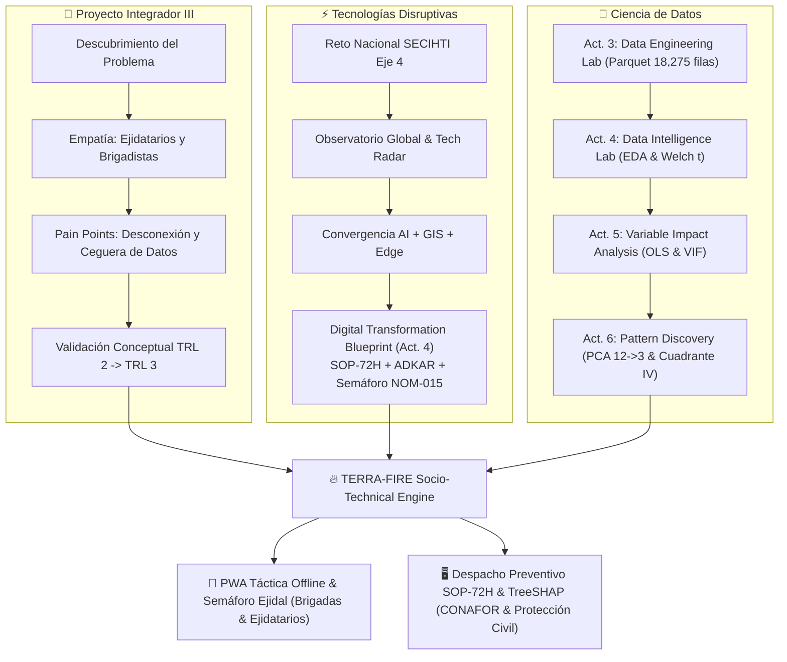
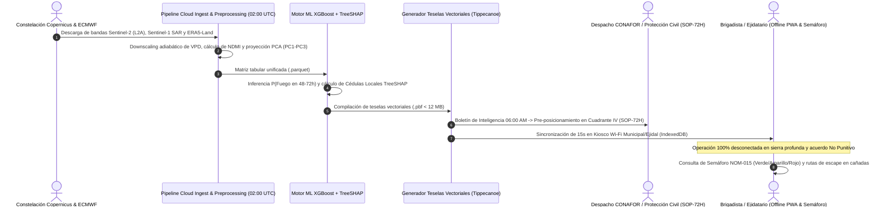

# 🛰️ TERRA-FIRE: Panel Central de Control & Mapa de Contenido (MOC)

> [!tip] Navegación Rápida
> Este panel es el centro neurálgico de la bóveda. Conecta los pilares académicos del cuatrimestre Sep-Dic 2026 con la especificación técnica, la inteligencia empírica de datos (`matrix_v1.parquet`, $N = 18,275$) y el **Digital Transformation Blueprint** de la plataforma **TERRA-FIRE**.
> - **Ciencia de Datos (Actividades 3, 4, 5 y 6 Completadas):** Dictamen **`READY FOR SEGMENTATION`** (reducción dimensional PCA $12 \to 3$ reteniendo $87.87\%$ de varianza; descubrimiento del **Cuadrante IV Piro-Antropogénico** con $68.61\%$ de los incendios).
> - **Tecnologías Disruptivas (Actividad 4 Completada):** Dictamen **`READY FOR TRANSFORMATION`** (**Puntaje: 9.43 / 10.0**).
> - También puedes abrir [[TERRA-FIRE Visual Overview.canvas|el Lienzo Visual Canvas]] para una experiencia en 2D.

---

## 📌 Métricas y Parámetros Operativos Clave

| Métrica / Parámetro                     | Valor Objetivo / Validado | Justificación Técnica y Empírica                                                                   |
| :-------------------------------------- | :-------------------- | :-------------------------------------------------------------------------------------- |
| **Nivel de Madurez Tecnológica**        | **TRL 3 Validado** | Pipeline ETL, Feature Store Parquet, 12 regresiones OLS y PCA ($12 \to 3$) validados experimentalmente. |
| **Estatus de Transformación Digital**   | **READY FOR TRANSFORMATION (9.43/10)** | Blueprint socio-técnico completo: protocolo `SOP-72H`, Carta Ejidal No Punitiva, ADKAR y Roadmap de 5 etapas. |
| **Ventana de Anticipación (Lead Time)** | **48 a 72 Horas**     | Tiempo necesario para movilización preventiva de brigadas (`SOP-72H`) y diferimiento de quemas agrícolas. |
| **Resolución Espacial**                 | **10 a 20 Metros**    | Vóxeles basados en Copernicus Sentinel-2 MSI para capturar micro-cañadas y laderas.     |
| **Conectividad en Campo**               | **0% (100% Offline)** | PWA con almacenamiento local `IndexedDB` / SQLite WASM y teselas vectoriales Tippecanoe (`< 12 MB`).     |
| **Causa Raíz Empíricamente Probada**    | **63.58% Pastizal / 420m Agro** | Los incendios ocurren a mediana de $420\text{ m}$ de parcelas agrícolas ($\Delta = -60.53\%, p < 10^{-30}$) y el $68.61\%$ se concentra en el **Cuadrante IV de PCA**. |

---

## 🏛️ Convergencia de los 3 Pilares del Proyecto

---

## 🗺️ Mapa de Contenidos y Documentos de la Bóveda

### 1. 📘 Proyecto Integrador III (Problem Discovery Lab)
*Investigación de campo, empatía centrada en el usuario, análisis de fricción operativa y validación de concepto TRL 1-2.*
- [[01 - Problem Definition & Context|01. Definición del Problema y Contexto]]: Desglose del paradigma reactivo de CONAFOR, evidencia histórica y matriz de contexto socio-ecológico.
- [[02 - Stakeholders & Empathy Maps|02. Actores y Mapas de Empatía]]: Fichas de usuarios (Ejidatarios, Brigadas Comunitarias, Despacho CONAFOR) y Mapa de Empatía detallado.
- [[03 - User Journey & Pain Points|03. User Journey Map y Matriz de Dolores]]: Recorrido cronológico del usuario en quemas agrícolas y análisis de puntos críticos de falla.
- [[04 - Ideation, HMW & Concept Evaluation|04. Ideación, Preguntas HMW y Selección de Concepto]]: Preguntas How Might We, matriz Impacto vs Factibilidad y ponderación multicriterio.
- [[05 - Solution Concept & TRL Assessment|05. Concepto de Solución TERRA-FIRE y Evaluación TRL 1-2]]: Definición formal de TERRA-FIRE, principios teóricos y plan de maduración TRL.

### 2. ⚡ Tecnologías Disruptivas (Future Exploration & Digital Transformation)
*Prospectiva tecnológica a 10 años, observatorio de innovación, convergencia, ética y el Blueprint de Transformación Digital.*
- [[01 - National Challenge & Strategic Context|01. Reto Nacional y Contexto Estratégico]]: Alineación al Eje Estratégico 4 de SECIHTI, limitaciones del SPPIF/FWI y Diagrama de Ishikawa de causa raíz.
- [[02 - Industrial Evolution & Tech Radar|02. Evolución Industrial y Tech Radar]]: De la Industria 1.0 a 5.0 en el sector forestal y radar tecnológico (Adopt, Trial, Assess, Hold).
- [[03 - Disruptive Convergence|03. Convergencia Disruptiva]]: Sinergia entre IA, Teledetección Orbital, Redes Edge y Computación en la Nube.
- [[04 - Future Scenarios 2026-2036|04. Escenarios Futuros 2026–2036]]: Análisis prospectivo: Sierra Quemada (pesimista), Paneles Desconectados (incremental) y Resiliencia Cognitiva (transformacional).
- [[05 - Impact Analysis & Ethics|05. Análisis de Impacto y Consideraciones Éticas]]: Evaluación multidimensional (social, económica, ambiental, regulatoria) y soberanía de datos ejidales.
- [[06 - Global Innovation Observatory|06. Activity 2: Global Innovation Observatory]]: Vigilancia tecnológica global, triangulación científica/mercado y selección del stack convergente.
- [[07 - Digital Transformation Blueprint|07. Activity 4: Digital Transformation Blueprint]]: Evaluación del estado actual, oportunidades, diseño de estado futuro (`SOP-72H`, Semáforo NOM-015, Carta No Punitiva), brechas de capacidad, estrategia de adopción de stakeholders, gestión del cambio (Prosci ADKAR + Kotter), hoja de ruta de 5 etapas y dictamen **`READY FOR TRANSFORMATION (9.43/10)`**.
  - *Versión completa para entrega:* [[Activity 4. Digital Transformation Blueprint]]

### 3. 🔬 Ciencia de Datos (Data Opportunity Mapping)
*Arquitectura de datos masivos, catálogo satelital, ingeniería de variables y diseño de dataset para Machine Learning.*
- [[01 - Data Formulation & Decision Requirements|01. Formulación de Datos y Requisitos de Decisión]]: Reencuadre del problema a Ciencia de Datos, decisiones operativas (DEC-01 a DEC-04) y matriz de necesidades.
- [[02 - Data Source Catalog & Ingestion|02. Catálogo de Fuentes de Datos y Protocolos]]: Evaluación de Sentinel-2, Sentinel-1 SAR, ERA5-Land, NASA FIRMS, GLO-30 DEM y registros de CONAFOR.
- [[03 - Big Data 5Vs & Ecosystem Architecture|03. Análisis de las 5Vs de Big Data y Ecosistema]]: Volumen, Velocidad, Variedad, Veracidad, Valor y diagrama arquitectónico de flujo de datos.
- [[04 - Feature Taxonomy & Prioritization|04. Taxonomía de Variables y Priorización]]: Inventario de predictores (biofísicos, termodinámicos, topográficos, antrópicos) y matriz de relevancia (P1, P2, P3).
- [[05 - Gap & Risk Analysis|05. Análisis de Brechas y Matriz de Riesgos]]: Mapa integral de oportunidades, brechas técnicas (calibración, latencia óptica) y riesgos analíticos (R-01 a R-06).
- [[06 - Dataset Specification & Recommendations|06. Especificación del Dataset y Recomendaciones]]: Esquema formal `terra_fire_spatiotemporal_matrix_v1.parquet` y hoja de ruta estratégica.

### 4. 📥 Ciencia de Datos (Data Acquisition Strategy)
*Localización, evaluación, gobernanza y selección de datasets espaciales reales para el pipeline de Machine Learning.*
- [[01 - Data Requirements|01. Requisitos de Datos]]: Continuidad desde DOM y decisiones operativas soportadas.
- [[02 - Candidate Dataset Inventory|02. Inventario de Datasets Candidatos]]: Perfiles detallados de CONAFOR, NASA FIRMS, ERA5-Land, Copernicus GLO-30 y Sentinel-2.
- [[03 - Coverage & Quality Assessment|03. Análisis de Cobertura y Calidad]]: Evaluación de variables, brechas críticas (mitigación de LFMC y escala micro-meteorológica) y métricas de calidad.
- [[04 - Governance & Traceability|04. Gobernanza y Trazabilidad]]: Riesgos éticos (estigmatización, sesgo algorítmico) y protocolo de preservación.
- [[05 - Selection & Integration Feasibility|05. Selección y Factibilidad de Integración]]: Resoluciones, H3 hexágonos, downscaling adiabático y mitigación de discrepancias espaciotemporales.
- [[06 - Acquisition Plan & Readiness Decision|06. Plan de Adquisición y Decisión de Preparación]]: Decisión final cuantitativa y listado de referencias bibliográficas.

### 5. 🔬 Scientific Intelligence Report (Literature Review)
*Evaluación sistemática de la literatura, brechas tecnológicas y fundamentación científica del proyecto.*
- [[01 - Research Problem & Questions|01. Problema de Investigación y Preguntas]]: Resumen del problema y planteamiento de las preguntas primarias y secundarias.
- [[02 - Scientific Search Strategy & Selection|02. Estrategia de Búsqueda y Selección]]: Criterios de elegibilidad, flujo PRISMA y selección de 15 artículos de alto impacto.
- [[03 - Scientific Evidence & Methodological Comparison|03. Evidencia Científica y Comparación Metodológica]]: Extracción de datos y síntesis de los paradigmas metodológicos (XGBoost vs. Deep Learning).
- [[04 - Thematic Literature Map & Evolution|04. Mapa Temático y Evolución]]: Pilares de investigación y las cinco eras de la evolución científica de los incendios.
- [[05 - Science-Technology Connection & Gap Analysis|05. Conexión Ciencia-Tecnología y Brechas]]: Mapeo de principios a software (Sentinel-2, XGBoost, Tippecanoe) y priorización de 4 brechas.
- [[06 - Scientific Foundation & Hypothesis|06. Fundamentación Científica e Hipótesis]]: Principios físicos (VPD, LFMC), hipótesis preliminar, evaluación TRL 1-2 y conclusiones.

### 6. 🎯 Validación de Concepto de Solución (TRL 2 ➔ TRL 3)
*Validación formal del concepto, matriz de incertidumbres A1-A4, hipótesis falsables H1-H4, 4 diseños experimentales y veredicto READY FOR PoC.*
- [[01 - Solution Concept & System Architecture|01. Concepto de Solución y Arquitectura Funcional]]: Ficha técnica del concepto, usuarios clave, salidas operativas y alineación NOM-015.
- [[02 - Conceptual Solution Model & Component Flow|02. Modelo Conceptual y Flujo de Componentes]]: Las dos capas operativas, los 5 subsistemas y formulación de NDMI, VPD Tetens y TreeSHAP.
- [[03 - Critical Assumptions & Research Questions|03. Supuestos Críticos y Preguntas de Investigación]]: Los 4 dominios de vulnerabilidad (A1 a A4) y preguntas de investigación asociadas (RQ1 a RQ4).
- [[04 - Hypotheses Formulation & Gating|04. Formulación de Hipótesis y Falsabilidad]]: Hipótesis H1 a H4 con variables independientes, dependientes, de control y umbrales numéricos.
- [[05 - Validation Criteria & Performance Metrics|05. Criterios de Validación y Métricas]]: Justificación de PR-AUC vs ROC-AUC, calibración Brier y líneas base operativas (SPPIF, KernelSHAP, GeoTIFF, persistencia).
- [[06 - Experimental Design & Validation Protocols|06. Diseño Experimental y Protocolos]]: Procedimientos de laboratorio para Experimentos 1, 2, 3 y 4 (Spatial Block CV, TreeSHAP latency, PWA offline, SAR C-band).
- [[07 - Multi-Dimensional Conceptual Assessment|07. Evaluación Conceptual Multidimensional]]: Calificación unánime STRONG en las 6 dimensiones de ingeniería y análisis de brechas.
- [[08 - PoC Readiness Decision & Experimental Scope|08. Decisión de Preparación para PoC y Alcance]]: Veredicto formal **READY FOR PoC**, delimitación dentro/fuera de alcance en TRL 3 y conclusiones.

### 7. ⚙️ Especificaciones Técnicas y Arquitectura
*Guías detalladas para implementación de software, algoritmos y almacenamiento offline.*
- [[End-to-End System Pipeline|Pipeline Técnico Extremo a Extremo]]: Diagramas de secuencia y flujo de ingesta, inferencia y entrega.
- [[Feature Store & Parquet Schema|Feature Store y Fórmulas Matemáticas]]: Formulación de NDMI, SAVI, NBR, VPD y diccionario de datos en Parquet.
- [[Offline-First Edge Architecture|Arquitectura Edge y Modo Offline]]: Implementación de PWA, Service Workers, teselas vectoriales `.pbf` y almacenamiento SQLite/WASM.

### 8. 🧪 Laboratorios Empíricos de Ciencia de Datos (Actividades 3, 4, 5 y 6)
*Ejecución analítica sobre la matriz espaciotemporal validada `terra_fire_spatiotemporal_matrix_v1.parquet` ($18,275 \times 22$).*
- [[Activity 3 - Data Engineering Lab - Report|Actividad 3: Data Engineering Lab - Reporte Oficial]]: Pipeline ETL reproducible de 4 capas, limpieza de 101,003 registros de CONAFOR, 657,791 detecciones NASA FIRMS y 17,544 horas de ERA5-Land. Exportación Parquet (0.30 MB, 0% nulos) y dictamen **`READY FOR ANALYSIS`**.
- [[Activity 4. Data Intelligence Lab|Actividad 4: Data Intelligence Lab - Reporte Oficial]]: Estadística descriptiva, pruebas $t$ de Welch y 12 tableros visuales (`fig01`–`fig12`). Demostración empírica del gatillo antrópico (`dist_agri_m` mediana $420\text{ m}$ vs $1,200\text{ m}$), dominancia de *Pastizal Inducido* ($63.58\%$) y umbral termodinámico ($VPD > 2.0\text{ kPa}$). Dictamen **`READY FOR ADVANCED ANALYSIS`**.
- [[Activity 5. Variable Impact Analysis|Actividad 5: Variable Impact Analysis - Reporte Oficial]]: Matrices de correlación Pearson/Spearman, 12 modelos de regresión OLS (`statsmodels`), diagnóstico de multicolinealidad VIF (poda de `nbr` con $\text{VIF} > 100$ y `wind_v10_mean`), demostración de confusión espacial de valle ($R^2 = 0.9000$) y jerarquía de impacto (`fig13`–`fig20`). Dictamen **`READY FOR PATTERN DISCOVERY`**.
- [[Activity 6. Pattern Discovery Challenge|Actividad 6: Pattern Discovery Challenge - Reporte Oficial]]: Reducción de dimensionalidad **PCA ($12 \to 3$ componentes ortogonales: `PC1`, `PC2`, `PC3`)** reteniendo el **87.87% de la varianza** ($75.0\%$ compresión, $\text{VIF} = 1.00$). Descubrimiento del **Cuadrante IV Piro-Antropogénico** ($68.61\%$ de todos los incendios, amplificación de riesgo $28.1\times$), lazo de histéresis estacional y aislamiento de outliers de monzón mediante $T^2$ de Hotelling (`fig21`–`fig27`). Dictamen **`READY FOR SEGMENTATION`**.

### 9. 📚 Referencias y Recursos
- [[Project References & Bibliography|Bibliografía y Referencias Oficiales]]: Catálogo de literatura científica, transformación digital, gestión del cambio y fuentes gubernamentales bajo formato APA 7ma edición.
- [[Technical Glossary|Glosario de Términos]]: Definición clara de siglas y conceptos técnicos (FWI, NDMI, VPD, TRL, COG, STAC, SHAP, PR-AUC, PCA, ADKAR, SOP-72H, etc.).

---

## 🔄 Flujo Operativo Socio-Técnico del Sistema TERRA-FIRE (To-Be)

