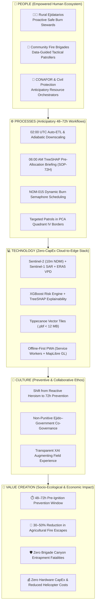

# 🚀 Activity 4: Digital Transformation Blueprint (TERRA-FIRE)

*Part of the [[00 - TERRA-FIRE Central Dashboard]] | Continuation of [[06 - Global Innovation Observatory]] & [[03 - Disruptive Convergence]]*

---

> [!abstract] Executive Summary & Transformation Verdict
> Moving from **Technology Selection $\rightarrow$ Digital Transformation Design**, this blueprint designs the socio-technical, procedural, and cultural evolution required across rural *ejidos*, community fire brigades, **CONAFOR**, and **State/Municipal Civil Protection** to adopt the validated **TERRA-FIRE** stack (`Copernicus Sentinel-2 10–20m + Sentinel-1 C-SAR + ECMWF ERA5-Land Downscaled VPD + XGBoost/TreeSHAP + Offline-First MapLibre PWA`).
> - **Paradigm Shift:** Transitions wildfire management from a **3–12h post-ignition reactive suppression lag** to a **48–72h pre-ignition anticipatory prevention window**.
> - **Empirical Targeting:** Focuses preventive governance on **PCA Quadrant IV (*Dry Agricultural Valley Interface*)**, which captures **68.61% of regional wildfires** ($601 / 876$) at a $28.1\times$ risk multiplication, and *Pastizal Inducido* borders ($63.58\%$ of ignitions, median agricultural distance $420\text{ m}$).
> - **Key Socio-Technical Innovations:** Non-Punitive Ejidal Data Charter, 3-Color **NOM-015 Burn Semaphore**, **Preventive Dispatch Protocol (`SOP-72H`)**, network of local *"Promotores Digitales Forestales"*, and QR-enabled Municipal Wi-Fi Sync Kiosks (`< 12 MB` `.pbf` vector tiles).
> - **Official Classification:** **`READY FOR TRANSFORMATION`** (**Composite Score: 9.43 / 10.0**).

---

## 1. GitHub Repository and Project Context

### 1.1 Project Continuity & Selected Technology Stack
The technological input driving this Digital Transformation Blueprint is the validated **Zero-CapEx Four-Layer Convergent Stack** (see [[01 - Solution Concept & System Architecture]] and [[Offline-First Edge Architecture]]):

$$\text{Sentinel-2 MSI (10–20 m)} + \text{Sentinel-1 C-SAR} + \text{ERA5-Land Downscaled VPD} + \text{XGBoost / TreeSHAP} + \text{Offline-First MapLibre PWA}$$

| Architectural Layer | Selected Technology Component | Operational Role in Transformation |
| :--- | :--- | :--- |
| **1. Planetary Sensing & Climate Layer** | **Copernicus Sentinel-2 MSI (L2A BOA, 10–20 m)**, **Sentinel-1 C-SAR**, **ECMWF ERA5-Land**, & **Copernicus GLO-30 DEM** | Replaces sparse physical weather stations ($<1$ per $2,500\text{ km}^2$) with zero-cost satellite foliar moisture indices ($NDMI$, $SAVI$) and hourly atmospheric evaporative demand ($VPD$) downscaled adiabatically ($\Gamma = -0.0065^\circ\text{C/m}$) to 10–20 m micro-topography. |
| **2. Predictive & Explainable AI Layer** | **XGBoost Classifier** (`scale_pos_weight = 19.86`) + **TreeSHAP Explainability Engine** | Generates calibrated 48–72h pre-ignition probability surfaces ($P(\text{Ignition}) \in [0, 1]$) and decomposes every prediction into top-3 human-readable physical drivers (*Local Risk Cards*), eliminating algorithmic "black-box" distrust. |
| **3. Edge Compression Layer** | **Apache Parquet Feature Store** + **Tippecanoe Vector Tile Compiler (`.pbf`)** | Compresses regional risk polygons, TreeSHAP explanations, and topographic escape corridors into ultra-lightweight Mapbox Vector Tiles ($< 12\text{ MB}$ per municipality). |
| **4. Disconnected Field Delivery Layer** | **Offline-First Progressive Web App (PWA)** with **Service Workers, IndexedDB, & MapLibre GL JS** | Enables commodity low-end Android smartphones to synchronize at municipal Wi-Fi hubs and render 60 FPS 3D tactical hazard maps, escape routes, and **NOM-015 Burn Semaphores** with **100% offline functionality** in mountain dead zones. |

### 1.2 Theoretical Foundation: Digitization, Digitalization, and Digital Transformation
1. **Digitization (Analog-to-Digital Conversion):** Converting physical paper records into digital bits without altering workflows (e.g., transcribing paper wildfire logs or *NOM-015-SEMARNAT/AGRICULTURA-2023* burn notices into static Excel files).
2. **Digitalization (Process Enablement):** Using digital tools to streamline existing processes without changing the reactive paradigm (e.g., plotting post-ignition NASA FIRMS thermal hotspots on a web dashboard while brigades still wait for smoke to deploy).
3. **Digital Transformation (Systemic Socio-Technical & Cultural Paradigm Shift):** Reconfiguring **value creation, organizational culture, decision-making authority, and inter-institutional workflows** (Vial, 2019; Westerman et al., 2014). **TERRA-FIRE** builds **Dynamic Capabilities** (Teece et al., 1997): *Sensing* (automated satellite/climate hazard detection), *Seizing* (48h pre-positioning of brigades and burn deferral), and *Transforming* (collaborative non-punitive community governance).

---

## 2. Current State Assessment (Phase 1 — Step 1)

### Deliverable 1: Current State Assessment Matrix

| Dimension | Current Situation (As-Is Baseline) | Key Challenges & Structural Barriers |
| :--- | :--- | :--- |
| **People** | • **Ejidatarios & Farmers:** Execute traditional *roza y quema* guided by visual intuition and ancestral calendars ([[02 - Stakeholders & Empathy Maps]]). • **Community Brigades:** Frontline volunteers patrolling rugged terrain with basic Android phones and VHF radios. • **CONAFOR & Civil Protection Dispatchers:** Coordinate regional crews from central offices using delayed reports. • **Decision Makers:** *Comisariados Ejidales* and municipal officials managing emergency budgets reactively. | • **Digital Literacy Divide:** Complex GIS dashboards alienate older rural farmers. • **High Entrapment Risk:** Brigades enter canyons without hyperlocal wind or escape-route intelligence. • **Cognitive Overload:** Dispatchers lack automated decision-support tools during peak spring dry season (*Mar–Jun*). |
| **Processes** | • **Reactive Suppression Workflow:** Ignition $\rightarrow$ Visual smoke / Satellite pass (3–12h lag) $\rightarrow$ Dispatch $\rightarrow$ Arrival (fire already $>50\text{ ha}$) ([[03 - User Journey & Pain Points]]). • **Paper-Based NOM-015 Notices:** Static administrative burn permits disconnected from real-time microclimatic risk. • **Unguided Patrols:** Brigades patrol broad routes without predictive spatial prioritization. | • **Severe Response Latency (3–12h):** Zero anticipatory workflow during the 48–72h pre-ignition desiccation window. • **Uncoordinated Burn Scheduling:** Agricultural burns occur simultaneously during high-$VPD$ ($>2.0\text{ kPa}$) afternoons. • **Manual Data Preparation:** Analysts spend hours downloading and cross-referencing fragmented spreadsheets. |
| **Technology** | • **Macro-Scale Monitoring:** SPPIF (Canadian FWI at $\ge 10\text{ km}$ resolution) and NASA FIRMS (VIIRS $375\text{ m}$ / MODIS $1\text{ km}$ post-ignition thermal anomalies). • **Urban-Centric GIS:** Desktop mapping restricted to connected headquarters. • **Sparse Surface Sensors:** $<1$ weather station per $2,500\text{ km}^2$ in mountain ecosystems. | • **85% Cellular Dead Zones:** Conventional cloud apps fail completely inside Sierra Fría canyons. • **Micro-Topographic Blindness:** Coarse $10\text{ km}$ grids ignore 10–20 m canyon slope desiccation and foliar water stress ($NDMI$). • **Hardware CapEx Prohibitiveness:** Installing physical IoT sensor meshes across thousands of hectares is financially and logistically unfeasible. |
| **Culture** | • **Reactive Heroism Ethos:** Institutional prestige and budgets prioritize emergency combat and helicopter sorties over prevention. • **Regulatory Distrust:** Rural farmers fear that digital monitoring tools are punitive surveillance mechanisms to issue fines. • **Black-Box Skepticism:** Experienced forest engineers distrust unexplained algorithmic predictions. | • **Resistance to Preventive Shift:** Shifting mindset from "fighting fires" to "preventing ignitions 72h early." • **Fear of Punitive Sanctions:** Potential under-reporting or avoidance by *ejidatarios* if the app is perceived as policing. • **Institutional Silos:** Fragmented communication between CONAFOR, Civil Protection, and *Asambleas Ejidales*. |

---

## 3. Transformation Opportunities (Phase 1 — Step 2)

### Deliverable 2: Transformation Opportunity Matrix

| Opportunity | Expected Benefit (Quantified & Operational Value) | Affected Area |
| :--- | :--- | :--- |
| **1. Automated Spatiotemporal Satellite & Climate Ingestion Pipeline** | • **100% elimination of manual GIS data wrangling** (executes full ETL + biophysical feature engineering in $< 4.0\text{ s}$). • Continuous daily monitoring of canopy moisture ($NDMI$) and downscaled $VPD$ across 10–20 m voxels without physical weather stations (**Zero-CapEx**). | **Data Engineering & Remote Sensing Operations** *(CONAFOR Technical Unit)* |
| **2. 48–72h Pre-Ignition Micro-Territorial Hazard Screening** | • Shifts operational reaction time from **3–12 hours post-ignition to 48–72 hours pre-ignition**. • Concentrates preventive surveillance on **PCA Quadrant IV** (*Dry Agricultural Valley Interface*), where **68.61% of wildfires** originate ($28.1\times$ risk concentration; see [[Activity 6. Pattern Discovery Challenge]]). | **Tactical Dispatch & Resource Pre-Allocation** *(CONAFOR & State Civil Protection)* |
| **3. Explainable AI (TreeSHAP) Decision Support for Specialists** | • Provides transparent, auditable top-3 physical risk drivers for every 20 m polygon in `< 5 ms`. • Increases specialist trust and provides technical justification for issuing municipal emergency advisories and resource deployments. | **Risk Analysis & Emergency Command** *(Civil Protection Analysts & Incident Commanders)* |
| **4. Non-Punitive Agricultural Burn Semaphore (NOM-015 Alignment)** | • Empowers rural farmers with a simple **Green / Yellow / Red** burn safety calendar on basic smartphones. • Targets the **63.58% of ignitions occurring in *Pastizal Inducido*** within $420\text{ m}$ of farmland ([[Activity 4. Data Intelligence Lab]]), reducing accidental agricultural fire escapes by **30%–50%**. | **Rural Agricultural Management & Community Governance** *(Ejidatarios & Comisariados Ejidales)* |
| **5. Offline-First Tactical Cartography & Escape Corridor Routing** | • Guarantees **100% map availability in zero-connectivity mountain canyons** via `< 12 MB` `.pbf` vector tiles cached at municipal Wi-Fi hubs. • Calculates real-time safe escape routes away from steep chimneys ($>15^\circ$ slope), drastically reducing brigade entrapment fatalities. | **Frontline Field Operations & Combatant Safety** *(Community Fire Brigades & Forest Guards)* |
| **6. Automated Inter-Institutional Alert & Sync Workflow** | • Unifies CONAFOR, Civil Protection, and *Asambleas Ejidales* under a single shared truth source updated daily at 02:00 UTC. • Reduces administrative coordination friction and shifts public budget from costly reactive helicopter hours to proactive prevention. | **Inter-Agency Governance & Public Budget Management** *(CONAFOR, Civil Protection, Municipal Governments)* |

---

## 4. Future-State Blueprint (Phase 2 — Step 3)

### Deliverable 3: Systemic Interaction & Value Creation Blueprint

---

## 5. Capability Gap Analysis (Phase 2 — Step 4)

### Deliverable 4: Capability Gap Matrix

| Area | Current State (As-Is Baseline) | Desired State (To-Be Target) | Identified Capability Gap | Bridging Action / Capability Development |
| :--- | :--- | :--- | :--- | :--- |
| **Skills** | • **Ejidatarios:** Low digital literacy; reliance on visual sky inspection. • **Brigades:** Basic smartphone use and analog radio. • **Dispatchers:** Trained in static maps and post-ignition ICS response. | • **Ejidatarios:** Fluent in checking the 3-color Burn Semaphore. • **Brigades:** Proficient in offline 3D MapLibre navigation & escape routing. • **Dispatchers:** Certified in TreeSHAP XAI diagnostics and 72h resource pre-allocation. | • **Field Digital Usability Gap:** Need for zero-text/visual UX literacy in rural elders. • **Analytical Interpretation Gap:** Lack of training in probabilistic ML & SHAP outputs among command staff. | • Deploy **"Promotores Digitales Forestales"** (trained rural youth) in each ejido. • Conduct 8-hour XAI & Preventive ICS certification workshops for CONAFOR/Civil Protection. |
| **Processes** | • **Reactive Mobilization:** Resources move only after 911 calls or FIRMS thermal alerts (3–12h late). • **Static NOM-015 Permits:** Paper burn notices approved without microclimatic validation. • **Manual GIS Workflows:** Ad-hoc data gathering. | • **Anticipatory SOP-72H:** Automated 06:00 AM briefing triggers preventive patrols in Quadrant IV zones. • **Dynamic NOM-015 Semaphore:** Automated burn deferral when $VPD_{max} > 2.0\text{ kPa}$. • **Zero-Touch Nightly ETL:** Automated 02:00 UTC pipeline. | • **Preventive Governance Gap:** Absence of institutional rules for pre-ignition deployment. • **Regulatory Decoupling:** Disconnection between NOM-015 permits and real-time atmospheric desiccation. | • Co-design **Preventive Dispatch Protocol (SOP-72H)** with CONAFOR & Civil Protection. • Establish ejidal assembly agreements linking burn schedules to the TERRA-FIRE Semaphore. |
| **Technology** | • **Coarse & Delayed Systems:** SPPIF ($10\text{ km}$) and FIRMS ($375\text{ m}$ post-ignition). • **Cloud Dependency:** Apps fail in 85% of Sierra Fría due to zero 4G coverage. • **Validated Lab Core (TRL 3):** Parquet Feature Store & PCA validated offline. | • **10–20 m Predictive Engine:** Daily Sentinel-2 + ERA5 downscaled XGBoost + TreeSHAP. • **100% Offline Edge PWA:** `< 12 MB` `.pbf` vector tiles cached in `IndexedDB` rendering at 60 FPS without internet. | • **Last-Mile Sync Infrastructure Gap:** Need for automated `.pbf` tile generation and municipal Wi-Fi sync points. • **Cloud Occlusion Gap:** Optical blind spots during cloudy days. | • Deploy Tippecanoe vector tile microservice and PWA Service Workers. • Configure **"Puntos de Sincronización Comunitaria"** at municipal/ejidal Wi-Fi hubs. • Integrate Sentinel-1 C-SAR radar fallback. |
| **Culture** | • **Reactive Heroism:** Prestige tied to extinguishing large active fires. • **Rural Suspicion:** Fear that digital tools will be used to fine farmers. • **Algorithmic Skepticism:** Distrust of "black-box" AI predictions. | • **Preventive Stewardship:** Shared pride in zero-escape agricultural seasons. • **Psychological Safety:** Non-punitive advisory adoption by farmers. • **XAI-Enabled Trust:** High confidence in transparent TreeSHAP risk cards. | • **Institutional Mindset Gap:** Shifting KPIs from "hectares fought" to "ignitions prevented." • **Trust & Empathy Gap:** Bridging historical friction between regulators and rural *ejidos*. | • Sign **Non-Punitive Data Charter** with *Comisariados Ejidales* (zero fines from app usage). • Institute "Ejido Preventivo Certificado" recognition awards. • Embed TreeSHAP plain-language explanations in all alerts. |

---

## 6. Stakeholder Adoption Strategy (Phase 3 — Step 5)

### Deliverable 5: Stakeholder Adoption Matrix

| Stakeholder Group | Expected Benefits (Value Proposition) | Possible Concerns & Resistance Factors | Tailored Adoption Strategy |
| :--- | :--- | :--- | :--- |
| **1. Rural Ejidatarios & Agricultural Producers** *(Primary Field Users — Don Manuel)* | • **Safe Burn Windows:** Prevents accidental fire escapes into adjacent parcels. • **Legal Protection:** Aligns burns with *NOM-015-SEMARNAT/AGRICULTURA-2023*. • **Zero Cost:** Works on existing low-end smartphones offline. | • **Fear of Punitive Fines:** Concern that the app tracks their location to issue SEMARNAT penalties. • **Digital Friction:** Anxiety over complex interfaces. • **Tradition Inertia:** Reliance on ancestral calendar dates. | • **Non-Punitive Privacy Charter:** Zero GPS tracking of individual farmers; read-only advisory. • **Icon-First Semaphore UI:** Traffic-light interface (Green / Yellow / Red) with audio summaries. • **Ejidal Assembly Demos:** Live demonstrations led by *Comisariados* and *Promotores Digitales*. |
| **2. Community Fire Brigades & Volunteer Combatants** *(Frontline Tactical Users)* | • **Life Safety in Canyons:** 100% offline 3D terrain maps showing steep slopes ($>15^\circ$), wind vectors, and escape routes. • **Reduced Physical Exhaustion:** Targeted patrols in high-probability 20 m voxels. | • **Connectivity Distrust:** Skepticism based on past apps freezing in cellular dead zones. • **Battery & Storage Limits:** Fear of battery drain or memory exhaustion. | • **Field Proof-of-Reliability Drills:** Hands-on tests in Airplane Mode inside Sierra Fría canyons proving 60 FPS offline rendering. • **Ultra-Light Footprint:** `< 12 MB` storage via Tippecanoe `.pbf` compression and dark-mode OLED battery saving. |
| **3. CONAFOR Regional Dispatchers & Forest Engineers** *(Operational Command — Ing. Claudia)* | • **48–72h Tactical Lead Time:** Pre-position crews and water tankers before ignition occurs. • **Workload Automation:** Eliminates hours of manual GIS cross-referencing. • **High Spatial Precision:** 10–20 m resolution vs. 10 km SPPIF grids. | • **Black-Box AI Skepticism:** Reluctance to risk scarce brigade deployments on an unexplained ML score. • **Workflow Disruption:** Learning curve alongside existing SPPIF duties. | • **TreeSHAP Local Risk Cards:** Every alert displays the top-3 physical drivers ($VPD$, $NDMI$, `dist_agri_m`). • **Parallel Shadow Operations:** Run TERRA-FIRE alongside SPPIF during Stage 3 Pilot to prove hit rates before full transition. |
| **4. State & Municipal Civil Protection Analysts** *(Emergency & Risk Planners)* | • **Defensible Early Warnings:** Objective metrics to justify preventive burn moratoria or WUI evacuations. • **Cross-Agency Coordination:** Shared situational map with CONAFOR. | • **False-Alarm Liability:** Concern over political pushback if a Red Alert moratorium is issued and no fire occurs. • **Inter-Agency Turf Friction:** Unclear jurisdiction. | • **Calibrated Probability Tiers:** Multi-tier thresholds reserving Red Moratoria for extreme Quadrant IV Apex conditions ($23.34\%$ fire rate). • **Joint SOP-72H Governance:** Clear RACI matrix defining shared sign-off. |
| **5. Comisariados Ejidales & Municipal Authorities** *(Local Governance)* | • **Budget Preservation:** Drastic reduction in municipal emergency fuel and machinery expenses. • **Community Prestige:** Recognition as a disaster-resilient municipality/ejido. | • **Cost & Maintenance Fears:** Worry over software licenses or sensor maintenance costs after the pilot ends. | • **Zero-CapEx Open-Source Guarantee:** Formal agreement confirming $0 hardware cost and open-source software. • **"Ejido Preventivo" Certification:** Public recognition ceremonies. |
| **6. Environmental Regulators (SEMARNAT / SECIHTI)** *(Institutional Sponsors)* | • **Policy Compliance:** Direct fulfillment of **SECIHTI Strategic Axis 4** and **NOM-015**. • **Ecosystem Preservation:** Measurable reduction in forest carbon emissions. | • **Methodological Rigor & Reproducibility:** Requirement for audited scientific validation and data governance compliance. | • **Open Scientific Traceability:** Full access to the audited GitHub repository, 7-gate validated Parquet Feature Store, and methodology reports. |

---

## 7. Change Management Plan (Phase 3 — Step 6)

### Deliverable 6: Change Management Plan Summary Matrix (Prosci ADKAR + Kotter)

| Change Pillar | Target Audience | Core Activities & Mechanisms | Responsible Lead | Success Metric / Evaluation KPI |
| :--- | :--- | :--- | :--- | :--- |
| **1. Communication** | • Ejidatarios • Community Brigades • CONAFOR & Civil Protection | • Sunday *Asamblea Ejidal* briefings & Non-Punitive Charter signing. • Dry-season community radio spots & visual posters. • Daily 06:00 AM automated TreeSHAP intelligence bulletin. | Change Management Lead + *Comisariados Ejidales* | • **100%** of pilot ejidos sign the Non-Punitive Charter. • **$\ge 90\%$** stakeholder awareness of the 48–72h preventive shift in baseline surveys. |
| **2. Training** | • Tier 1: Farmers (2h) • Tier 2: Brigades (6h) • Tier 3: Dispatchers (8h) | • Visual Semaphore workshops for farmers. • Zero-signal canyon navigation drills in Sierra Fría for brigades. • TreeSHAP XAI & SOP-72H simulation labs for dispatchers. | UTR Engineering Team + CONAFOR Training Unit | • **$\ge 90\%$** pass rate in practical field navigation drills. • **100%** of regional dispatchers certified in TreeSHAP Risk Card interpretation. |
| **3. Support** | • All Field & Command Users | • Accreditation of 2–3 *Promotores Digitales Forestales* per ejido. • QR-enabled Municipal/Ejidal Wi-Fi Sync Kiosks. • Waterproof laminated pocket guides + WhatsApp/VHF helpdesk. | *Promotores Digitales* + Municipal IT Liaisons | • Average support resolution time **$< 2\text{ hours}$**. • Zero failed field deployments due to unsynchronized offline caches. |
| **4. Monitoring** | • Project Governance Board (CONAFOR / Civil Protection / UTR) | • Automated anonymous sync telemetry counters at Wi-Fi hubs. • Bi-weekly adoption review meetings during fire season. • Post-season System Usability Scale (SUS) & fire escape audit. | Data Science Lead + Civil Protection Coordinator | • Weekly Sync Rate **$\ge 85\%$**. • Red-Alert Burn Deferral **$\ge 75\%$**. • System Usability Scale (SUS) **$\ge 80/100$**. • Fire escape reduction **$\ge 30\%$**. |

---

## 8. Digital Transformation Roadmap (Phase 4 — Step 7)

### Deliverable 7: Five-Stage Implementation Roadmap Matrix

| Transformation Stage | Timeline | Core Objectives | Key Operational & Technical Activities | Responsible Stakeholders | Expected Outcomes & Stage-Gate Deliverables |
| :--- | :---: | :--- | :--- | :--- | :--- |
| **Stage 1: Preparation** | **Months 1–2** | • Establish institutional governance, community trust, and operational protocols prior to technical rollout. | • Form the **TERRA-FIRE Transformation Steering Committee**. • Sign the **Non-Punitive Data Charter** with pilot *Asambleas Ejidales*. • Draft the **Preventive Dispatch Protocol (SOP-72H)**. • Audit municipal/ejidal Wi-Fi routers in Sierra Fría municipalities. | • CONAFOR State Director • Civil Protection Coordinator • *Comisariados Ejidales* • UTR Project Leads | • Signed Inter-Agency & Ejidal Governance Charter. • Approved **SOP-72H** manual. • 5 Municipal Wi-Fi Sync Kiosks verified and configured. |
| **Stage 2: Capability Development** | **Months 3–4** | • Deploy production cloud-to-edge infrastructure and build human competencies across all three user tiers. | • Automate the 02:00 UTC cloud pipeline (Sentinel-2 + ERA5-Land + XGBoost + TreeSHAP + Tippecanoe `.pbf` `< 12 MB`). • Deploy the **Offline-First MapLibre PWA** with Semaphore UI. • Train 15 *Promotores Digitales Forestales* & execute Tier 1–3 training workshops. | • UTR Data Science & Software Team • CONAFOR Training Unit • *Promotores Digitales* • Brigade Chiefs | • Operational Cloud-to-Edge PWA passing 100% offline stress tests. • 15 accredited *Promotores Digitales*. • $\ge 90\%$ of pilot brigades & dispatchers certified. |
| **Stage 3: Pilot Implementation** | **Months 5–7** *(Peak Spring Dry Season)* | • Validate real-world adoption, offline reliability, and preventive efficacy in high-risk zones during peak fire season. | • Launch controlled live pilot in **Sierra Fría** and **PCA Quadrant IV agricultural-pasture border nodes**. • Operate TERRA-FIRE in parallel with SPPIF; issue daily 06:00 AM TreeSHAP briefings. • Track NOM-015 Red-Alert burn deferrals and brigade offline GPS navigation. | • Community Fire Brigades • Pilot *Ejidatarios* • CONAFOR Dispatchers • UTR Support Helpdesk | • **$\ge 85\%$** weekly offline sync rate achieved. • Empirical validation of 48–72h pre-positioning. • Pilot Evaluation Report & UX v2.0 refinement. |
| **Stage 4: Deployment** | **Months 8–10** | • Institutionalize TERRA-FIRE as the official statewide anticipatory wildfire platform across Aguascalientes. | • Expand coverage to all **25 regional monitoring nodes** and remaining rural *ejidos* in Aguascalientes. • Transition from shadow testing to formal **SOP-72H** command. • Award first annual *"Ejido Preventivo Certificado"* recognitions. | • State Civil Protection • CONAFOR Operations • Municipal Authorities • All Rural *Ejidos* | • 100% statewide operational coverage across Aguascalientes. • Formal adoption of SOP-72H for state brigade pre-allocation. • **30%–50% reduction** in pasture-to-forest fire escapes. |
| **Stage 5: Continuous Improvement** | **Months 11–12+** | • Ensure long-term model accuracy, all-weather resilience, and multi-state scalability. | • Retrain XGBoost and recalibrate PCA/SHAP thresholds using the new season's fire outcomes. • Integrate **Sentinel-1 C-SAR** microwave backscatter. • Package open-source municipal deployment kit for Jalisco, Zacatecas, and Durango. | • UTR Research Lab • CONAFOR National Innovation Office • SECIHTI / SEMARNAT | • Updated `matrix_v2.parquet` & recalibrated XGBoost model. • All-weather SAR-optical fusion active. • Multi-state scaling blueprint delivered to SECIHTI. |

---

## 9. Transformation Assessment & Strategic Verdict (Phase 4 — Step 8)

### Deliverable 8: Digital Transformation Scorecard

| Evaluation Dimension | Weight | Score (0–10) | Weighted Score | Key Evidence Supporting Score |
| :--- | :---: | :---: | :---: | :--- |
| **1. Strategic Alignment** | 25% | **10.0 / 10** | **2.50** | Direct alignment with SECIHTI Axis 4, NOM-015-SEMARNAT-2023, and 48–72h preventive mission. |
| **2. Organizational Readiness** | 20% | **9.0 / 10** | **1.80** | TRL 3 empirical foundation validated ($N=18,275$ rows, PCA Quadrant IV proven); low-barrier PWA UI. |
| **3. Expected Value** | 25% | **9.5 / 10** | **2.38** | 48–72h lead time, 63.58% pasture ignition targeting, brigade life safety, and Zero-CapEx savings. |
| **4. Risk Manageability** | 15% | **8.8 / 10** | **1.32** | Non-punitive charter mitigates rural distrust; TreeSHAP mitigates AI skepticism; offline PWA mitigates 0-signal. |
| **5. Long-Term Sustainability** | 15% | **9.5 / 10** | **1.43** | 100% open satellite data (Copernicus/ECMWF), `< $15/mo` compute cost, and local youth champions. |
| **TOTAL COMPOSITE SCORE** | **100%** | — | **9.43 / 10.0** | **Formal Classification: `READY FOR TRANSFORMATION`** |

---
*Linked Vault Notes:* [[00 - TERRA-FIRE Central Dashboard]] | [[06 - Global Innovation Observatory]] | [[Activity 6. Pattern Discovery Challenge]] | [[Project References & Bibliography]]
