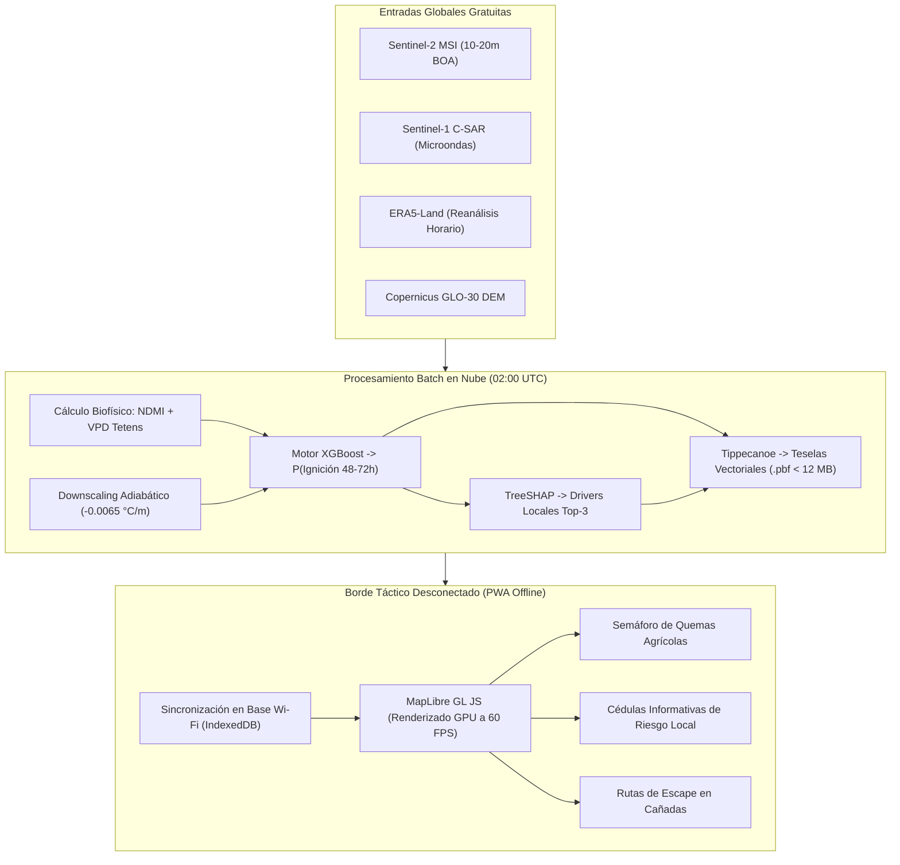

# 🚀 01. Concepto de Solución y Arquitectura Funcional
## TERRA-FIRE: Plataforma de Inteligencia Predictiva y Cartografía Táctica Forestal

---

## 1. Contexto y Continuidad Problema-Solución

A lo largo de las etapas previas de investigación interdisciplinaria—abarcando [[01 - Problem Definition & Context|Descubrimiento del Problema]], el [[01 - Research Problem & Questions|Reporte de Inteligencia Científica]], la [[01 - Data Requirements|Estrategia de Adquisición de Datos]] y la [[02 - Industrial Evolution & Tech Radar|Evaluación de Tecnologías Disruptivas]]—el proyecto **TERRA-FIRE** estableció que la principal falla sistémica en el combate y manejo de incendios forestales en México no es la falta de valentía física de las brigadas, sino una **aguda asimetría en la resolución y latencia de la información**.

Actualmente, los mecanismos institucionales de alerta temprana en México—específicamente el *Sistema de Predicción de Peligro de Incendios Forestales* (SPPIF) operado por la Comisión Nacional Forestal (CONAFOR) y las detecciones orbitales de anomalías térmicas de NASA FIRMS (VIIRS/MODIS)—operan bajo un paradigma estrictamente reactivo:
- Las alertas de incendios activos llegan con una **latencia temporal de 3 a 12 horas posteriores a la ignición**, cuando el fuego ya ha desarrollado comportamiento de copa (*crown fire*) y avances violentos en topografías montañosas escarpadas.
- Más del **80% de los incendios forestales catastróficos en México se originan por quemas agropecuarias tradicionales (roza y quema)** que escapan del control humano debido a pulsos no pronosticados de desecación microclimática ($\text{VPD} > 2.5\text{ kPa}$) en ecosistemas secos adyacentes (CONAFOR, 2024).

El concepto de solución **TERRA-FIRE** resuelve directamente esta deficiencia operativa, desplazando el paradigma de intervención desde la extinción de emergencias reactiva hacia una **prevención anticipatoria de 48 a 72 horas pre-ignición a escala espacial micro-topográfica (10 a 20 metros)**.

---

## 2. Definición Formal de la Solución y Arquitectura Funcional

**TERRA-FIRE** es una plataforma extremo a extremo de inteligencia predictiva y cartografía táctica para bordes desconectados (*edge*). Integra teledetección planetaria, reanálisis meteorológico de capa límite, aprendizaje supervisado por gradiente sobre datos tabulares, inteligencia artificial explicable local y cartografía web vectorial ligera en un pipeline de costo de infraestructura cero (**Zero-CapEx**):

---

## 3. Matriz de Declaración del Concepto de Solución (Deliverable 1)

| Elemento Arquitectónico | Descripción Formal de Ingeniería y Funcionalidad Operativa |
| :--- | :--- |
| **Problema Atendido** | Alta incidencia de incendios forestales y escapes catastróficos de quemas agrícolas en México (>80% del total nacional) causados por pulsos imprevistos de desecación microclimática ($\text{VPD} > 2.5\text{ kPa}$), exacerbados por la latencia de 3 a 12 horas en sistemas orbitales (SPPIF / NASA FIRMS) y la nula cobertura celular en sierras profundas. |
| **Usuario Destinatario** | Brigadas comunitarias ejidales (*combatientes de primera línea*), productores agropecuarios que ejecutan quemas controladas, coordinadores municipales de Protección Civil y despachadores tácticos de CONAFOR en áreas de interfaz urbano-forestal-agrícola sin señal celular. |
| **Solución Propuesta** | **TERRA-FIRE:** Plataforma de inteligencia predictiva y cartografía táctica para el borde desconectado que pronostica el riesgo de ignición con 48–72 horas de anticipación a resolución de 10–20 metros, entregada mediante una Progressive Web App (PWA) offline-first equipada con Cédulas Informativas TreeSHAP en lenguaje ciudadano. |
| **Función Principal** | Ingerir datos heterogéneos de satélite, clima y topografía; calcular proxies de humedad de combustible y demanda evaporativa downscaled; ejecutar inferencia de árboles de decisión por gradiente ($P(\text{Ignición}) \in [0, 1]$); y empaquetar predicciones en teselas vectoriales ultraligeras ($< 12\text{ MB}$) para renderizado offline en campo. |
| **Tecnologías Clave** | • **Observación Terrestre:** Copernicus Sentinel-2 MSI (óptico/SWIR) y Sentinel-1 C-SAR (piloto microondas todo clima). • **Clima y Terreno:** Reanálisis ECMWF ERA5-Land y Copernicus GLO-30 DEM (downscaling adiabático ambiental). • **ML y Borde:** XGBoost / LightGBM, TreeSHAP explicable, vectorización Tippecanoe, MapLibre GL y runtime PWA con Service Workers. |
| **Salida Esperada (Output)** | Capas de teselas vectoriales dinámicas (`.pbf`) que muestran superficies de riesgo a 20m ($[0, 1]$), Cédulas Informativas de Riesgo Local con los top-3 factores causales de TreeSHAP y corredores topográficos de escape seguro derivados de curvas de nivel y vectores de viento. |
| **Beneficio Esperado** | **Transición de la supresión reactiva a la prevención anticipatoria 72h**, eliminación de atrapamientos mortales en cañadas, costo cero de inversión en infraestructura pública (Zero-CapEx) y 100% de continuidad operativa en zonas sin señal de internet celular. |
| **Alineación del Concepto** | Conecta la línea base de necesidades del usuario directamente con una arquitectura de Machine Learning offline-first que avanza de TRL 2 a TRL 3. |

---

## 4. Usuarios Objetivo y Roles Operativos

1. **Beneficiarios Primarios (Brigadistas Ejidales y Productores):**
   - Requieren conocer si las condiciones de humedad y viento permitirán realizar su quema de desmonte sin riesgo de escape.
   - Acceden al sistema a través de un semáforo táctico (Verde: Quema permitida con precauciones; Amarillo: Precaución elevada; Rojo: Quema prohibida / Riesgo extremo).
   - Reciben las **Cédulas Informativas de Riesgo Local** explicadas en lenguaje natural:
     > *"Riesgo Extremo: Humedad de vegetación NDMI inferior a 0.12 y ráfagas vespertinas mayores a 38 km/h. Prohibido encender residuos agrícolas."*
2. **Usuarios Operativos (Protección Civil Municipal y Despacho CONAFOR):**
   - Utilizan la cartografía predictiva 72h para pre-desplegar pipas, herramientas y brigadas en los municipios con mayor densidad de píxeles rojos antes del fin de semana.
3. **Técnicos Forestales y Analistas de Riesgo:**
   - Emplean las atribuciones matemáticas de TreeSHAP para fundamentar técnicamente los permisos de uso del fuego bajo la **Norma Oficial Mexicana NOM-015-SEMARNAT/AGRICULTURA-2023**.

---
*Documentos relacionados:* [[00 - TERRA-FIRE Central Dashboard]] | [[02 - Conceptual Solution Model & Component Flow]] | [[03 - Critical Assumptions & Research Questions]] | [[08 - PoC Readiness Decision & Experimental Scope]]
