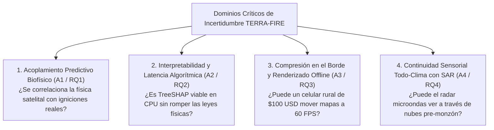

# 🔍 03. Supuestos Críticos y Preguntas de Investigación
## TERRA-FIRE: Auditoría Sistemática de Incertidumbres en TRL 2

---

## 1. Análisis Sistemático de Incertidumbres

Un concepto tecnológico en nivel **TRL 2 (Concepto Formulado)** representa una hipótesis técnica estructurada y no un hecho consumado. Antes de comprometer recursos de ingeniería de software, cómputo en la nube y pruebas de campo (TRL 3–4), los supuestos conceptuales que sostienen la arquitectura deben someterse a una auditoría rigurosa.

En **TERRA-FIRE**, las incertidumbres críticas se agrupan en **cuatro dominios primarios de vulnerabilidad o falla**:

1. **Validez Predictiva Biofísica:** Determinar si los algoritmos tabulares de árboles por gradiente (XGBoost) poseen la capacidad de modelar igniciones caóticas a partir de variables proxy satelitales y climáticas sin saturar de falsas alarmas al usuario.
2. **Interpretabilidad y Latencia Algorítmica:** Evaluar si las explicaciones aditivas de Shapley locales pueden computarse a escala masiva sin generar cuellos de botella computacionales y manteniendo coherencia con las reglas de la combustión forestal.
3. **Compresión en el Borde y Viabilidad de Dispositivos:** Demostrar que superficies ráster continuas densas pueden serializarse en teselas vectoriales ligeras ejecutables en teléfonos Android económicos de brigadistas en modo avión.
4. **Continuidad Sensorial Todo-Clima:** Evaluar si la retrodispersión de radar activo de apertura sintética (Sentinel-1 C-SAR) puede suplir la ceguera óptica provocada por tormentas secas en la transición pre-monzónica.

---

## 2. Matriz de Supuestos Críticos y Preguntas Enfocadas (Deliverable 3)

| # | Supuesto Crítico | Pregunta de Investigación Enfocada | Por Qué Importa (Impacto en Éxito / Falla) |
| :---: | :--- | :--- | :--- |
| **A1** | **Acoplamiento Predictivo Biofísico:** La combinación de proxies multiespectrales de humedad de combustible (NDMI 20m) con la demanda evaporativa atmosférica con downscaling topográfico ($\text{VPD kPa}$) y la pendiente del terreno provee suficiente poder discriminativo para que XGBoost pronostique la ignición con 48–72h de anticipación, superando significativamente las líneas base climatológicas regionales. | **RQ1:** ¿En qué grado la fusión de índices biofísicos de humedad de Sentinel-2 con la demanda evaporativa microclimática con downscaling mejora la exactitud de clasificación pre-ignición 48–72h (PR-AUC y F1-Score) comparado con la línea base institucional del SPPIF de CONAFOR en la compleja orografía mexicana? | Si la sequedad de la vegetación y el VPD local no se correlacionan fuertemente con eventos reales de ignición, el motor de ML generará tasas intolerables de falsas alarmas, causando fatiga de alertas en brigadistas y el abandono total de la herramienta por parte de CONAFOR. |
| **A2** | **Interpretabilidad Algorítmica y Latencia:** El algoritmo TreeSHAP puede descomponer predicciones continuas multivariables no lineales en los top-3 factores ambientales dominantes en $< 5\text{ ms}$ por vóxel en procesadores estándar (CPU), produciendo vectores de atribución matemáticamente estables y coherentes con los principios físicos de combustión forestal. | **RQ2:** ¿Puede la atribución local de características TreeSHAP calcular los factores dominantes de riesgo para vóxeles de alto riesgo en $< 5\text{ ms}$ por vóxel en hardware común, demostrando 100% de estabilidad matemática y consistencia física con las reglas expertas de combustión? | Los combatientes y campesinos no acatarán vedas ni recomendaciones basadas en \"cajas negras\" opacas. Si TreeSHAP es computacionalmente inviable o arroja contradicciones físicas (p. ej., asegurar que alta humedad aumentó el peligro), la confianza operativa colapsa. |
| **A3** | **Serialización en el Borde y Renderizado Offline:** Superficies de riesgo continuas municipales ($> 100,000$ vóxeles espaciales) pueden convertirse en polígonos vectoriales simplificados y compilarse en teselas vectoriales Protocol Buffer (`.pbf`) de menos de 15 MB, permitiendo renderizado interactivo offline vía MapLibre GL a $\ge 30\text{ FPS}$ en smartphones Android de gama baja. | **RQ3:** ¿Pueden las superficies de riesgo pre-ignición a escala municipal serializarse en teselas vectoriales que preserven la fidelidad topológica de 20m mientras cumplen presupuestos móviles estrictos ($< 15\text{ MB}$) y tiempos de carga $< 2.0\text{ s}$ a $\ge 30\text{ FPS}$ sin internet? | Si la carga de datos excede la memoria del dispositivo o bloquea el navegador WebGL del teléfono, el sistema queda completamente inoperante en las cordilleras de la Sierra Madre donde no existe señal celular. |
| **A4** | **Penetración de Nubes y Llenado de Brechas con SAR:** Cuando la imaginería óptica de Sentinel-2 queda oscurecida por nubosidad densa (máscara SCL $> 70\%$), la retrodispersión de Sentinel-1 C-SAR de polarización dual (VV, VH) acoplada a curvas de decaimiento de VPD puede sustituir al NDMI faltante, manteniendo el rendimiento del modelo ($\text{PR-AUC} \ge 0.70$). | **RQ4:** ¿Qué tan efectivamente puede la retrodispersión de microondas activas en banda C combinada con curvas de secado atmosférico sustituir al NDMI óptico nublado para sostener la confiabilidad de predicción durante periodos cubiertos de tormenta? | La temporada crítica previa a las lluvias en México presenta alta nubosidad acompañada de tormentas secas con relámpagos. Si las nubes ciegan el sistema, TERRA-FIRE fallaría precisamente en el momento de mayor crisis y riesgo de conflagración. |

---

## 3. Mapeo de Supuestos a Hipótesis Científicas

La formulación de estos cuatro supuestos críticos permite traducir directamente los temores de falla de ingeniería en cuatro experimentos de laboratorio controlados con métricas numéricas verificables, presentadas en [[04 - Hypotheses Formulation & Gating]]:

- **A1** $\longrightarrow$ **Hipótesis H1:** Benchmark de clasificación multivariada espacial vs. SPPIF.
- **A2** $\longrightarrow$ **Hipótesis H2:** Benchmark de latencia de reloj y consistencia física de TreeSHAP.
- **A3** $\longrightarrow$ **Hipótesis H3:** Benchmark de compresión Tippecanoe `.pbf` y renderizado MapLibre GL en modo avión.
- **A4** $\longrightarrow$ **Hipótesis H4:** Benchmark de retención de desempeño con Sentinel-1 SAR bajo nubosidad $>70\%$.

---
*Documentos relacionados:* [[01 - Solution Concept & System Architecture]] | [[02 - Conceptual Solution Model & Component Flow]] | [[04 - Hypotheses Formulation & Gating]] | [[05 - Validation Criteria & Performance Metrics]]
