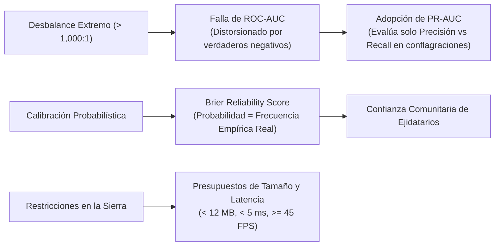

# 📊 05. Criterios de Validación y Métricas de Rendimiento
## TERRA-FIRE: Justificación Cuantitativa de Métricas y Líneas Base Operativas

---

## 1. Justificación de Métricas Cuantitativas

La evaluación de un sistema de pronóstico de amenazas geoespaciales requiere métricas diseñadas específicamente para el **desbalance espacial extremo de clases** y las restricciones de campo:

### 1. ¿Por qué PR-AUC en lugar de ROC-AUC?
En la modelación del peligro de incendios forestales, los píxeles no quemados (negativos) superan a los puntos de ignición positivos por más de **1,000 a 1**. 
- El área bajo la curva ROC tradicional (**ROC-AUC**) utiliza la Tasa de Falsos Positivos ($\text{FPR} = \text{FP} / (\text{FP} + \text{TN})$). Cuando $\text{TN}$ es masivo, $\text{FPR}$ permanece cercano a cero incluso si el modelo genera cientos de falsas alarmas, produciendo una ilusión engañosa de exactitud ($>0.95$).
- El **Área Bajo la Curva Precision-Recall (PR-AUC)** evalúa exclusivamente el compromiso entre **Precisión** ($\text{TP} / (\text{TP} + \text{FP})$) y **Recall** ($\text{TP} / (\text{TP} + \text{FN})$), castigando severamente cualquier falsa alarma en la clase positiva minoritaria (Davis & Goadrich, 2006). Es el estándar de oro en ciencia de datos espaciales para eventos raros.

### 2. Puntaje de Confiabilidad de Brier (Brier Score)
Mide el error cuadrático medio de las probabilidades calibradas:
$$\text{Brier} = \frac{1}{N} \sum_{t=1}^N (P_t - Y_t)^2$$
Un puntaje cercano a cero ($< 0.12$) indica que cuando el sistema emite una probabilidad de riesgo del 70%, empíricamente 7 de cada 10 vóxeles sufrirán ignición bajo esas mismas condiciones meteorológicas. Esto es indispensable para evitar el escepticismo de los ejidatarios y brigadistas.

### 3. Presupuestos de Tamaño de Archivo y Latencia de Renderizado
Derivados de las limitaciones físicas reales de smartphones Android de bajo costo comunes en comunidades rurales (3 a 4 GB de memoria RAM, procesadores de 4 a 8 núcleos de bajo consumo y renderizado WebGL 2.0).

---

## 2. Matriz de Criterios de Validación y Líneas Base (Deliverable 5)

| Hipótesis | Métrica de Evaluación | Línea Base Cuantitativa (Estado Actual) | Criterio Medible de Éxito (TERRA-FIRE) | Evidencia Empírica Requerida (Artefactos PoC) |
| :---: | :--- | :--- | :--- | :--- |
| **H1** | 1. Spatial Block PR-AUC 2. Macro F1-Score 3. Brier Reliability Score *(Precisión al 80% Recall)* | **Línea Base Institucional CONAFOR SPPIF:** • Spatial PR-AUC: 0.41 • Macro F1-Score: 0.38 • Brier Reliability Score: 0.24 *Línea Base Regresión Logística: PR-AUC 0.48* | • Spatial Block $\text{PR-AUC} \ge 0.75$ ($> 80\%$ de ganancia relativa sobre SPPIF) • Macro $\text{F1-Score} \ge 0.70$ en umbral óptimo • Brier Calibration $\text{Score} \le 0.12$ • **Ganancia estadísticamente significativa** ($p < 0.001$, DeLong) | Registros de prueba de 5-Fold Spatial Block Cross-Validation, curvas Precision-Recall, matrices de confusión y curvas de confiabilidad generadas con el histórico 2018–2024 de CONAFOR y NASA FIRMS. |
| **H2** | 1. Latencia TreeSHAP (ms/vóxel) 2. Concordancia Spearman ($\rho$) 3. Cumplimiento de Reglas Físicas de Combustión (%) | **Línea Base Model-Agnostic KernelSHAP:** • Latencia de Ejecución: ~450 ms/vóxel • Permutation Feature Importance: ~85 ms/vóxel *La permutación heurística introduce inestabilidad en el orden* | • Latencia media TreeSHAP $\le 5.0\text{ ms}$ por vóxel espacial • Desviación estándar $\sigma < 1.0\text{ ms}$ en CPU común • Concordancia determinista Spearman $\rho = 1.0$ • **Alineación física con reglas de fuego = 100%** (cero contradicciones) | Traza de ejecución de perfiles sobre 10,000 vóxeles de alto riesgo en CPU de un hilo; gráficos de distribución sumaria Shapley; script de auditoría automática que verifique que $\text{VPD} > 2.5\text{ kPa}$ y $\text{NDMI} < 0.15$ generen siempre atribuciones positivas ($\phi > 0$). |
| **H3** | 1. Tamaño del Paquete Vectorial (MB) 2. Tiempo Inicial de Carga Offline (s) 3. Tasa de Cuadros en Paneo/Zoom (FPS) | **Línea Base Ráster GeoTIFF Crudo:** • Peso de Archivo Municipal: 95.0 MB • Tiempo de Carga Móvil Inicial: 8.4 s • Cuadros por segundo en paneo: $< 15\text{ FPS}$ *Línea Base Teselas PNG: 38.0 MB, 22 FPS* | • Archivo de teselas vectoriales municipales $\le 12.0\text{ MB}$ (reducción $> 85\%$) • Tiempo inicial de render en canvas $\le 1.5\text{ s}$ • Tasa sostenida en paneo/zoom $\ge 45\text{ FPS}$ • **Cero pérdidas de contexto WebGL** en prueba de estrés de 60s | Registros de auditoría Chrome DevTools Network & Storage; reporte de consumo en disco de IndexedDB; auditoría Lighthouse Mobile; traza de registro de frame-time WebGL en teléfono físico en modo avión. |
| **H4** | 1. PR-AUC en Subconjunto Nublado 2. Razón de Retención Relativa ($\text{PR-AUC}_{\text{Nube}} / \text{Despejado}$) 3. Brier Score Nublado | **Línea Base Persistencia Óptica (Forward-Fill):** • PR-AUC Nublado: 0.54 • Razón de Retención: 68% • Brier Reliability Score: 0.22 *La reflectancia óptica desactualizada se degrada rápido tras 5 días* | • PR-AUC en nubosidad $>70\% \ge 0.70$ • Razón de Retención $\ge 90\%$ respecto a cielo despejado • Brier Score Nublado $\le 0.15$ • **Supera con significancia estadística** a la persistencia ($p < 0.01$) | Registros comparativos de PR-AUC en incendios históricos nublados verificados ($N \ge 150$); diagramas de dispersión de retrodispersión $\sigma^0_{\text{VH}} / \sigma^0_{\text{VV}}$ vs. humedad en tierra; pruebas estadísticas pareadas. |

---

## 3. Puertas de Control (Validation Gating)

Todas las métricas de éxito se comparan contra **sistemas operativos reales existentes**:
- El clasificador no compite contra un modelo aleatorio, sino contra la herramienta oficial del gobierno mexicano (**SPPIF de CONAFOR**).
- La explicabilidad no compite contra conjeturas, sino contra el estándar de la industria (**KernelSHAP**).
- La cartografía en el borde no compite contra mapas vacíos, sino contra el formato geoespacial estándar (**GeoTIFF** y teselas raster PNG).
- La cobertura radar no compite contra la ausencia de datos, sino contra el método por defecto de la teledetección (**Forward-Fill Persistence**).

---
*Documentos relacionados:* [[03 - Critical Assumptions & Research Questions]] | [[04 - Hypotheses Formulation & Gating]] | [[06 - Experimental Design & Validation Protocols]] | [[07 - Multi-Dimensional Conceptual Assessment]]
