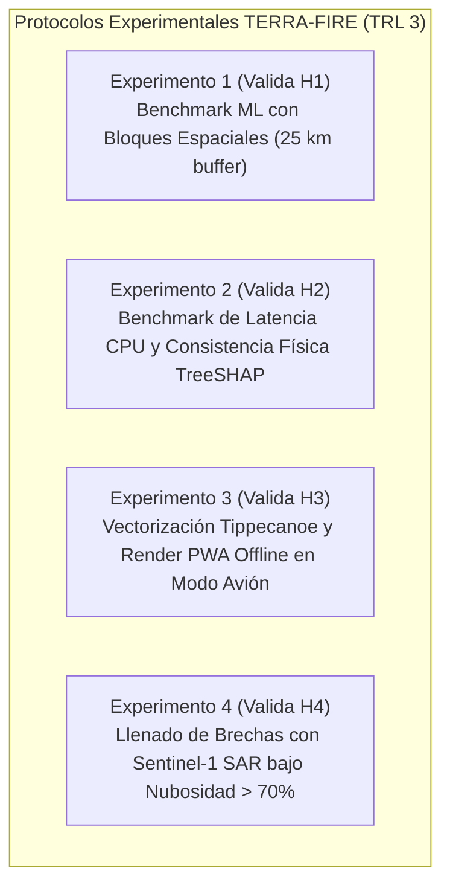

# 🔬 06. Diseño Experimental y Protocolos de Validación
## TERRA-FIRE: Arquitectura de Pruebas de Laboratorio para el Proof of Concept (TRL 3)

---

## 1. Estructura de la Arquitectura Experimental

Para preparar el desarrollo formal del Proof of Concept (PoC en TRL 3), se diseñaron planes experimentales estructurados e independientes para cada una de las cuatro hipótesis. Estos protocolos definen con exactitud:
- Insumos de datos y matrices tabulares.
- Procedimientos algorítmicos paso a paso.
- Aislamiento de variables y condiciones de control.
- Líneas base de comparación directa.
- Criterios numéricos de falsación y éxito.

---

## 2. Experimento 1: Benchmark de Machine Learning con Bloques Espaciales (Prueba de H1)

| Elemento Experimental | Protocolo Técnico y Parámetros de Implementación |
| :--- | :--- |
| **Objetivo del Experimento** | Validar que la fusión de proxies multiespectrales de humedad de combustible (NDMI/SAVI) con la demanda evaporativa microclimática con downscaling topográfico (VPD) y la pendiente del terreno en un clasificador XGBoost alcanza una discriminabilidad predictiva superior frente a las líneas base regionales. |
| **Hipótesis Objetivo** | **Hipótesis H1:** Spatial Block $\text{PR-AUC} \ge 0.75$, Macro $\text{F1-Score} \ge 0.70$ y $\text{Brier Score} \le 0.12$ en pliegues de validación no vistos. |
| **Entradas Requeridas** | 1. Matriz tabular histórica compilada: `terra_fire_spatiotemporal_matrix_v1.parquet` (registros 2018–2024 en Jalisco, Michoacán y Oaxaca). 2. Etiquetas target: Ocurrencia de ignición binaria ($Y=1$) derivada de bitácoras de CONAFOR cruzadas con clusters de fuego activo NASA FIRMS VIIRS 375m. 3. Muestras de fondo negativas: Pseudo-ausencias espaciotemporales muestreadas en proporción 100:1 en vóxeles vegetados no quemados. |
| **Variables del Experimento** | • **Manipuladas (Independientes):** Representación de características (Pila Multimodal Completa vs. Pila Meteorológica Base sin downscaling microclimático). • **Medidas (Dependientes):** Spatial PR-AUC, Macro F1-Score, Brier Calibration Score, Precisión al 80% Recall. • **Controladas:** Límites de validación cruzada por bloques espaciales ($> 25\text{ km}$ buffer); partición temporal (2018–22 entrenamiento, 2023–24 prueba); ratio de desbalance (1:100). |
| **Líneas Base de Comparación** | 1. Índice de Peligro SPPIF de CONAFOR (categorías mapeadas a probabilidades empíricas; línea base $\text{PR-AUC} \sim 0.41$). 2. Regresión Logística L2 regularizada entrenada con variables climáticas brutas de ERA5 sin downscaling (línea base $\text{PR-AUC} \sim 0.48$). |
| **Procedimiento Experimental** | 1. Cargar el dataset Parquet y verificar la integridad de columnas y ausencia de valores corruptos. 2. Particionar los datos en 5 bloques geográficos espaciales mediante K-Means con un buffer de exclusión de 25 km entre entrenamiento y prueba. 3. Entrenar el clasificador XGBoost en 4 pliegues y evaluar en el 5to; repetir 5 veces (Spatial Block Cross-Validation). 4. Generar curvas Precision-Recall, calcular PR-AUC, determinar el umbral F1 óptimo y evaluar la curva de calibración de Brier. 5. Ejecutar pruebas estadísticas pareadas de DeLong frente a SPPIF y Regresión Logística. |
| **Criterio de Éxito** | **Mediciones:** PR-AUC por pliegue, PR-AUC global, Precisión, Recall, F1, Brier Score, tiempo de entrenamiento. **Umbral de Éxito:** $\text{PR-AUC} \ge 0.75$, $\text{F1-Score} \ge 0.70$ y $\text{Brier Score} \le 0.12$, demostrando superioridad estadísticamente significativa sobre SPPIF ($p < 0.001$, DeLong). |
| **Garantía Metodológica** | Garantiza la evaluación bajo estricta independencia espacial, previniendo la fuga por autocorrelación espacial entre cuencas montañosas adyacentes (Roberts et al., 2017). |

---

## 3. Experimento 2: Benchmark de Latencia y Consistencia Física TreeSHAP (Prueba de H2)

| Elemento Experimental | Protocolo Técnico y Parámetros de Implementación |
| :--- | :--- |
| **Objetivo del Experimento** | Validar que la atribución de características TreeSHAP se ejecute dentro de un presupuesto de cómputo en tiempo real ($\le 5.0\text{ ms/vóxel}$) en CPUs estándar y genere explicaciones deterministas físicamente válidas para las cédulas tácticas de brigadistas. |
| **Hipótesis Objetivo** | **Hipótesis H2:** Latencia media $\le 5.0\text{ ms/vóxel}$ en un núcleo de CPU, concordancia de rango Spearman $\rho = 1.0$ y 100% de alineación física con reglas de fuego. |
| **Entradas Requeridas** | 1. Binario serializado del modelo XGBoost (`xgb_terra_fire_v1.json`) entrenado en el Experimento 1. 2. Subconjunto de prueba con 10,000 vóxeles de alto riesgo ($P(\text{Ignición}) \ge 0.50$). 3. Dataset de fondo resumido: $N=100$ instancias representativas generadas vía K-Means. |
| **Variables del Experimento** | • **Manipuladas (Independientes):** Algoritmo explicador (TreeSHAP vs. KernelSHAP vs. Heuristic Permutation). • **Medidas (Dependientes):** Latencia de ejecución por vóxel (milisegundos de reloj CPU), correlación de Spearman ($\rho$) de valores Shapley, porcentaje de cumplimiento de reglas de combustión. • **Controladas:** Entorno de hardware (un solo hilo a 2.4 GHz, 16 GB RAM, Linux); tamaño fijo de fondo ($N=100$). |
| **Líneas Base de Comparación** | 1. KernelSHAP agnóstico al modelo ($N=100$ muestras; latencia base $\sim 450\text{ ms/vóxel}$). 2. Permutation Feature Importance (latencia base $\sim 85\text{ ms/vóxel}$; sufre de inestabilidad estocástica en el ordenamiento). |
| **Procedimiento Experimental** | 1. Inicializar el explicador TreeSHAP con el modelo XGBoost y el conjunto de fondo. 2. Iterar sobre los 10,000 vóxeles de alto riesgo, midiendo el tiempo de cómputo individual mediante temporizadores de alta resolución (`time.perf_counter_ns()`). 3. Ordenar las variables por magnitud absoluta $|\phi_i|$ y registrar los top-3 factores para cada vóxel. 4. Repetir los cálculos en 10 ejecuciones idénticas para medir el determinismo numérico ($\rho$). 5. Ejecutar script de auditoría automática verificando que cuando $\text{VPD} > 2.5\text{ kPa}$ y $\text{NDMI} < 0.15$, los valores Shapley sean estrictamente positivos ($\phi > 0$). |
| **Criterio de Éxito** | **Mediciones:** Percentiles de latencia (p50, p90, p99), media, desviación estándar, matriz de Spearman, conteo de violaciones físicas. **Umbral de Éxito:** Latencia media $\le 5.0\text{ ms/vóxel}$ ($\sigma < 1.0\text{ ms}$), concordancia $\rho = 1.0$ y cero contradicciones físicas con las reglas de combustión. |
| **Confianza Operativa** | Sustituye salidas opacas por atribuciones de Shapley matemáticamente demostrables y explicadas en lenguaje natural a los ejidatarios. |

---

## 4. Experimento 3: Vectorización Táctica y Renderizado PWA Offline (Prueba de H3)

| Elemento Experimental | Protocolo Técnico y Parámetros de Implementación |
| :--- | :--- |
| **Objetivo del Experimento** | Validar que superficies continuas de probabilidad de riesgo puedan comprimirse en teselas vectoriales de menos de 12 MB y renderizarse fluidamente a $\ge 45\text{ FPS}$ en una PWA móvil offline en hardware de gama baja sin internet. |
| **Hipótesis Objetivo** | **Hipótesis H3:** Tamaño de paquete $\le 12.0\text{ MB}$, tiempo de render inicial $\le 1.5\text{ s}$ y fluidez sostenida de navegación $\ge 45\text{ FPS}$ en smartphones Android. |
| **Entradas Requeridas** | 1. Superficie ráster completa de riesgo para un municipio piloto ($1,500\text{ km}^2$, malla 20m, $3,750 \times 3,750$ celdas). 2. Pipeline de vectorización (`gdal_contour` + utilidades CLI `tippecanoe`). 3. Cliente de pruebas PWA táctica con MapLibre GL JS v3.x y caché de Service Workers. |
| **Variables del Experimento** | • **Manipuladas (Independientes):** Tolerancia de simplificación ($\varepsilon \in [0.00005^\circ, 0.0002^\circ]$) y formato de empaquetado (`.pbf` vs. GeoTIFF vs. PNG). • **Medidas (Dependientes):** Peso en disco (MB), huella en IndexedDB (MB), tiempo de carga inicial WebGL (s), FPS sostenidos en paneo y zoom. • **Controladas:** Dispositivo de prueba (MediaTek Helio G35, 3GB RAM, Android 11, WebGL 2.0); modo avión estrictamente activo (0 kbps). |
| **Líneas Base de Comparación** | 1. Descarga ráster GeoTIFF cruda sin comprimir (payload de 95.0 MB; carga inicial $\sim 8.4\text{ s}$; fluidez $< 15\text{ FPS}$). 2. Teselas PNG Slippy Map estándar (38.0 MB; 22 FPS; elevado consumo de memoria gráfica). |
| **Procedimiento Experimental** | 1. Contornear la superficie continua en 4 bandas discretas ($[0, 0.25)$, $[0.25, 0.50)$, $[0.50, 0.75)$, $[0.75, 1.0]$) vía GDAL. 2. Compilar polígonos en teselas vectoriales con Tippecanoe (zoom z10–z15, simplificación $\varepsilon = 0.0001^\circ$). 3. Medir el peso total del archivo comprimido `.pbf` empaquetado en un archivo ZIP de cliente. 4. Transferir al teléfono móvil, activar el Service Worker para persistir en IndexedDB y medir el tiempo de escritura. 5. Abrir la PWA en modo avión y registrar el tiempo desde la carga del DOM hasta el primer cuadro renderizado por WebGL. 6. Ejecutar script automatizado de 60 segundos de paneo y zoom continuo registrando los tiempos de cuadro vía `requestAnimationFrame`. |
| **Criterio de Éxito** | **Mediciones:** Tamaño de archivo (MB), huella IndexedDB, First Meaningful Render (s), FPS promedio, 1% low FPS, consumo de RAM. **Umbral de Éxito:** Tamaño total $\le 12.0\text{ MB}$ (reducción $> 85\%$), render inicial $\le 1.5\text{ s}$, fluidez $\ge 45\text{ FPS}$ y cero cuelgues por falta de memoria WebGL. |
| **Autonomía en el Borde** | Cierra la brecha digital rural, ofreciendo cartografía táctica fluida en valles y cañones donde no existe cobertura celular. |

---

## 5. Experimento 4: Estimación de Humedad con Radar SAR bajo Nubes (Prueba de H4)

| Elemento Experimental | Protocolo Técnico y Parámetros de Implementación |
| :--- | :--- |
| **Objetivo del Experimento** | Validar que la retrodispersión de microondas activas de Sentinel-1 C-SAR acoplada a splines de decaimiento termodinámico de VPD mantenga un alto rendimiento predictivo ($\text{PR-AUC} \ge 0.70$) cuando la imaginería óptica queda cegada por nubes. |
| **Hipótesis Objetivo** | **Hipótesis H4:** $\text{PR-AUC} \ge 0.70$ en pliegues nublados, razón de retención $\ge 90\%$ respecto al cielo despejado y $\text{Brier Score} \le 0.15$. |
| **Entradas Requeridas** | 1. Subconjunto histórico de $N=200$ incendios verificados ocurridos bajo nubosidad densa (máscara SCL $> 70\%$). 2. Retrodispersión de Sentinel-1 GRD SAR dual-pol ($\sigma^0_{\text{VV}}, \sigma^0_{\text{VH}}$, y razón cruzada $\sigma^0_{\text{VH}} / \sigma^0_{\text{VV}}$) con aplanamiento radiométrico. 3. Curvas horarias continuas de desecación atmosférica de ERA5-Land ($\sum \text{VPD}_{\text{diario}}$ en ventana previa de 14 días). |
| **Variables del Experimento** | • **Manipuladas (Independientes):** Modalidad de llenado de brechas bajo nubes (Modelo Sentinel-1 SAR + VPD spline vs. Persistencia óptica hacia adelante). • **Medidas (Dependientes):** PR-AUC, Macro F1-Score, Brier Score evaluados específicamente en casos con nubosidad. • **Controladas:** Algoritmo de corrección radiométrica (aplanamiento SNAP); geometría de pasadas descendentes; pliegues espaciales. |
| **Líneas Base de Comparación** | Persistencia óptica hacia adelante estándar (reutilizar la última toma óptica sin nubes de Sentinel-2, a menudo con 10 a 25 días de retraso; línea base $\text{PR-AUC} \sim 0.54$, retención cae al 68%). |
| **Procedimiento Experimental** | 1. Filtrar la base de datos histórica para aislar incendios con cobertura nubosa $> 70\%$ en la ventana de 48–72h pre-ignición. 2. Extraer los parámetros de retrodispersión de Sentinel-1 C-SAR coincidentes temporalmente con el evento. 3. Calcular el índice acumulativo de secado atmosférico: $\sum \text{VPD}_{\text{diario}}$ durante los 14 días anteriores. 4. Alimentar las variables SAR + VPD en la arquitectura XGBoost de doble rama y evaluar paralelamente la persistencia óptica. 5. Calcular curvas Precision-Recall, PR-AUC y Brier Score para ambos enfoques sobre la muestra nublada. |
| **Criterio de Éxito** | **Mediciones:** PR-AUC nublado, PR-AUC persistencia, razón de retención ($\text{PR-AUC}_{\text{Nube}} / \text{PR-AUC}_{\text{Despejado}}$), Brier Score. **Umbral de Éxito:** $\text{PR-AUC} \ge 0.70$ en nubes, retención $\ge 90\%$ y superioridad estadísticamente significativa sobre la persistencia óptica ($p < 0.01$). |
| **Continuidad Todo-Clima** | Previene apagones de datos durante las tormentas secas de transición pre-monzónica en México. |

---
*Documentos relacionados:* [[04 - Hypotheses Formulation & Gating]] | [[05 - Validation Criteria & Performance Metrics]] | [[07 - Multi-Dimensional Conceptual Assessment]] | [[08 - PoC Readiness Decision & Experimental Scope]]
