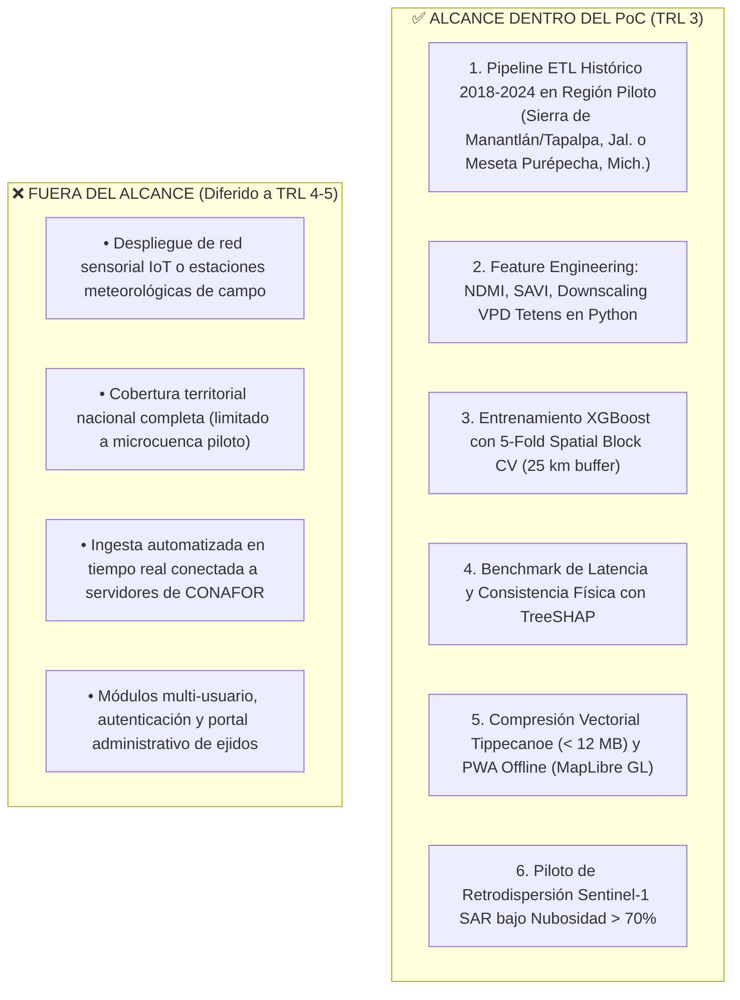

# 🏁 08. Decisión de Preparación para PoC y Alcance Experimental (TRL 3)
## TERRA-FIRE: Transición Formal de la Formulación Teórica al Prototipado de Laboratorio

---

## 1. Veredicto Formal de Preparación (PoC Readiness Decision)

Con base en la matriz de validación conceptual multidimensional unánime (**STRONG** en las 6 dimensiones), la formulación matemática rigurosa de las cuatro hipótesis de ingeniería, el inventario de datos de acceso libre verificado (2018–2024) y la ausencia total de barreras arquitectónicas no resueltas:

> [!important] Declaración Formal de Preparación (Deliverable 8)
> ### CLASIFICACIÓN: **READY FOR PROOF OF CONCEPT (PoC)**  
> **Nivel de Madurez:** **Transición Oficial de TRL 2 (Concepto Formulado) $\longrightarrow$ TRL 3 (Prueba de Concepto Analítica y Experimental)**
> 
> *Fundamentación de la Decisión:*
> 1. **Coherencia Problema-Solución:** Se aborda la causa raíz del 80% de los incendios en México mediante una ventana anticipatoria de 72h y entrega offline.
> 2. **Base Científica Validada:** Respaldada en ecuaciones termodinámicas psicrométricas de Tetens (VPD) y reflectancia SWIR/NIR de Sentinel-2 (NDMI).
> 3. **Viabilidad Tecnológica y Presupuestaria:** Arquitectura Zero-CapEx apoyada en APIs públicas de Copernicus y reanálisis ERA5-Land del ECMWF.
> 4. **Falsabilidad Experimental:** Cuatro planes de prueba detallados con métricas operativas directas (PR-AUC, Brier Score, latencia CPU en milisegundos y FPS de renderizado en modo avión).

---

## 2. Delimitación del Alcance del Proof of Concept (TRL 3)

Para optimizar los recursos computacionales y evitar desviaciones de alcance (*scope creep*) durante la fase de laboratorio de TRL 3, se establecen formalmente las fronteras de lo que **SÍ** y lo que **NO** se implementará:

### 2.1. Funcionalidades Incluidas en el PoC (In-Scope):
1. **Compilación de Dataset Histórico e Ingeniería de Características:**
   - Ensamble de matriz tabular unificada en formato Apache Parquet sobre una región piloto de alta incidencia de fuego (*Sierra de Manantlán / Tapalpa, Jalisco* o *Meseta Purépecha, Michoacán*) abarcando el periodo **2018–2024**.
   - Implementación algorítmica de NDMI, SAVI, downscaling adiabático por gradiente ambiental ($\Gamma = -0.0065\text{ }^\circ\text{C/m}$) y cálculo psicrométrico de VPD en Python (`rasterio`, `xarray`, `polars`).
2. **Entrenamiento y Validación Espacial Supervisada:**
   - Entrenamiento del clasificador XGBoost utilizando validación cruzada por bloques espaciales (*5-Fold Spatial Block Cross-Validation* con búfer de exclusión de 25 km).
   - Evaluación cuantitativa de Spatial Block PR-AUC, F1-Score y curvas de calibración Brier frente a SPPIF de CONAFOR y regresión logística (*Validación de H1*).
3. **Benchmark de Explicabilidad Local TreeSHAP:**
   - Integración del módulo TreeSHAP sobre el ensamble de árboles serializado.
   - Medición de tiempos de cómputo en CPU sobre 10,000 vóxeles de alto riesgo y auditoría de alineación física con reglas de combustión (*Validación de H2*).
4. **Prototipo de Vectorización y Renderizado Offline en el Borde:**
   - Conversión de rásters de riesgo en isolíneas poligonales vía GDAL y compilación a teselas vectoriales `.pbf` con Tippecanoe.
   - Despliegue de un arnés de prueba de la PWA con MapLibre GL en un teléfono Android físico de gama baja para verificar peso ($< 12\text{ MB}$), tiempo de render ($< 1.5\text{ s}$) y fluidez ($\ge 45\text{ FPS}$) en modo avión (*Validación de H3*).
5. **Piloto de Factibilidad de Radar Sentinel-1 SAR:**
   - Evaluación cuantitativa de la retención de rendimiento predictivo usando retrodispersión dual-pol ($\sigma^0_{\text{VV}}, \sigma^0_{\text{VH}}$) en un subconjunto histórico de días nublados ($N > 150$) (*Validación de H4*).

### 2.2. Elementos Fuera del Alcance (Out-of-Scope / Diferidos a TRL 4+):
- **Cero hardware en campo:** No se desplegarán estaciones meteorológicas físicas, torres repetidoras ni redes LoRaWAN. El proyecto se mantiene estrictamente en software y teledetección orbital abierta (Zero-CapEx).
- **Cobertura nacional continua:** La prueba experimental se restringe a la zona piloto seleccionada para maximizar la calidad de los datos y la calibración orográfica.
- **Conexión en tiempo real con despachos oficiales:** La automatización de cron-jobs de producción a las 02:00 UTC en nube comercial se abordará en TRL 4.

---

## 3. Conclusiones y Transición a la Siguiente Fase

La validación del concepto de solución de **TERRA-FIRE** culmina exitosamente el laboratorio de conceptualización:

1. **Formulación Conceptual Definitiva:** Se superó la etapa de ideas abstractas para establecer una arquitectura de sistemas concreta basada en datos satelitales abiertos, reanálisis de clima y aprendizaje automático tabular explicable.
2. **Rigor Científico y Falsabilidad:** Cuatro premisas clave quedaron blindadas mediante hipótesis matemáticas comprobables ($H_1$ a $H_4$), con métricas libres de ambigüedad.
3. **Madurez Defendible:** La evaluación multidimensional demostró solidez total (**STRONG** en todas las áreas), respaldando plenamente el inicio del PoC.
4. **Entrada a TRL 3:** El proyecto ingresa de manera formal a la programación de scripts en Python, entrenamiento de modelos con datos históricos reales y pruebas de renderizado en dispositivos móviles.

---
*Documentos relacionados:* [[00 - TERRA-FIRE Central Dashboard]] | [[TERRA-FIRE Executive Summary]] | [[01 - Solution Concept & System Architecture]] | [[06 - Experimental Design & Validation Protocols]] | [[07 - Multi-Dimensional Conceptual Assessment]]
