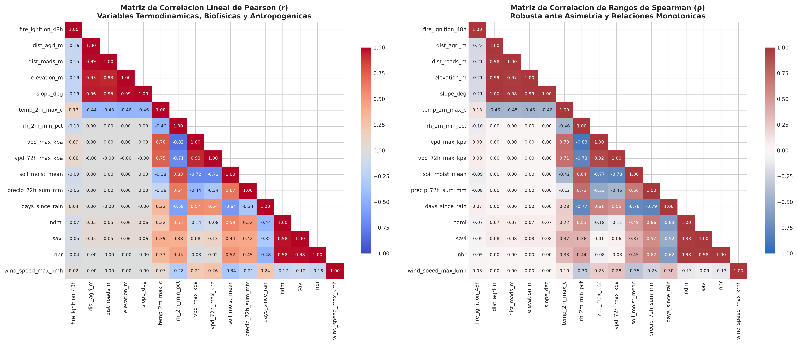
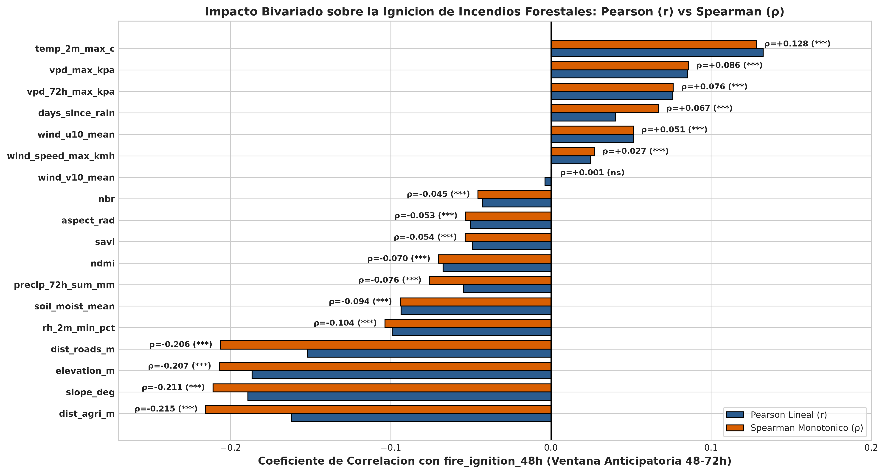
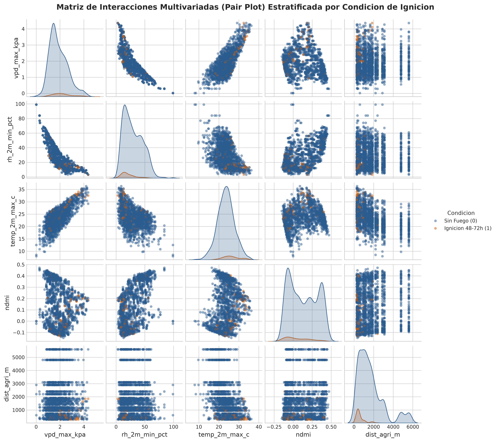
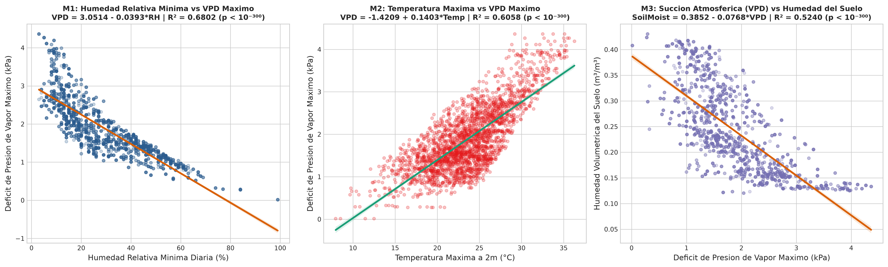
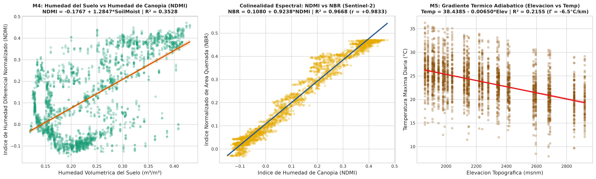
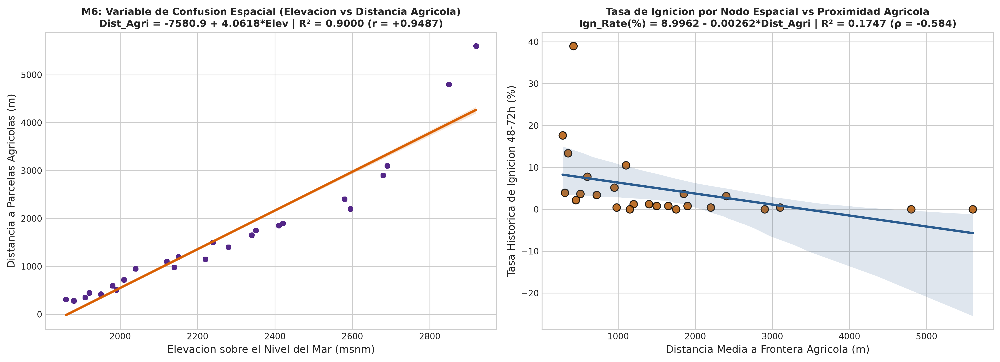
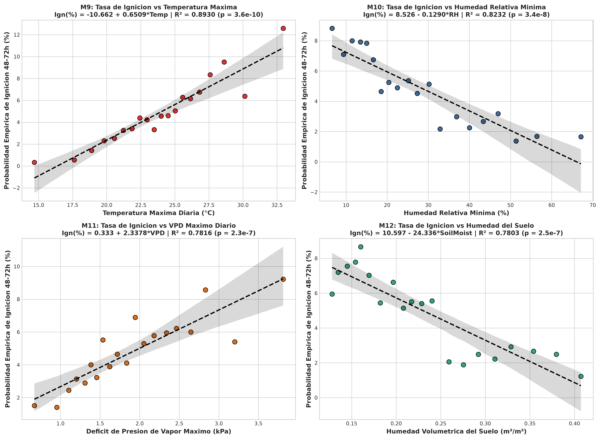
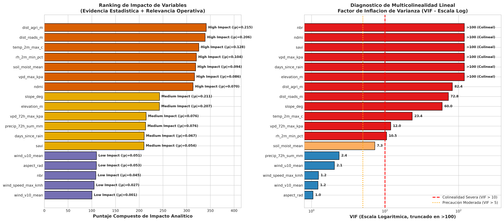
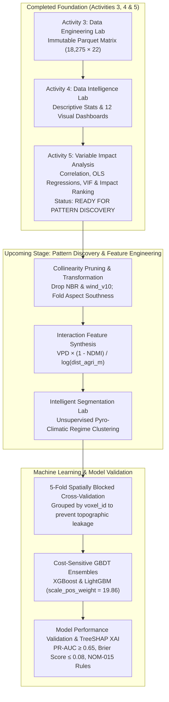

# 🌲 UNIVERSIDAD TECNOLÓGICA EL RETOÑO
### **Information Technologies and Digital Innovation Engineering**
**Subject:** Data Science (`LITD9A`)  
**Teacher:** Dr. Sergio Valadez Godínez  
**Term:** September – December 2026  
**Activity:** Activity 5. Variable Impact Analysis  
**Students:** Angel Emilio Gutierrez Lozano (ID: 4341) & Emiliano Betanzos Valtierra (ID: 4795)  
**Date of Submission:** October 20, 2026  
**Official Repository:** [https://github.com/AngelGTZ28/TERRA-FIRE](https://github.com/AngelGTZ28/TERRA-FIRE)

---

> [!abstract] Executive Summary & Variable Impact Analysis Scope
> Transitioning from the descriptive profiling of the **Data Intelligence Lab (Activity 4)** to rigorous **Variable Impact and Relationship Analysis (Activity 5)**, this study investigates, quantifies, and validates the statistical relationships governing the immutable analysis-ready spatiotemporal dataset `terra_fire_spatiotemporal_matrix_v1.parquet` ($18,275\text{ daily observations} \times 22\text{ attributes}$ across 25 regional monitoring nodes in Aguascalientes and the Sierra Fría biological reserve during 2023–2024).
> 
> Using parametric (**Pearson $r$**) and non-parametric (**Spearman $\rho$**) correlation matrices, Ordinary Least Squares (**OLS**) simple regression modeling across continuous physical systems ($N = 18,275$) and vigintile empirical ignition probability distributions ($N = 20\text{ quantiles}$), 95% confidence interval estimation, and **Variance Inflation Factor (VIF)** multicollinearity diagnostics, five decisive analytical conclusions were established:
> 1. **Anthropogenic Proximity is the Dominant Rank Predictor of Ignition:** Euclidean distance to agricultural parcels (`dist_agri_m`) exhibits the strongest monotonic correlation with 48–72h wildfire emergence ($\rho = -0.2155, p = 6.36 \times 10^{-191}$, Cohen's $d = -0.993$), followed closely by road proximity (`dist_roads_m`, $\rho = -0.2063, p = 7.89 \times 10^{-175}$), proving that escaped agricultural burns (*roza y quema* under NOM-015) and roadside human transit are the primary spark vectors.
> 2. **High Explanatory Power in Empirical Ignition Probability Regressions:** While raw binary Bernoulli regressions ($Y \in \{0, 1\}$, 4.79% prevalence) are mathematically bounded in raw $R^2$, quantile-binned empirical probability regressions ($N = 20\text{ vigintiles}$) prove that **maximum temperature** ($\hat{P}_{ign} = -10.662 + 0.651 \cdot T_{max}, R^2 = 0.8930$), **minimum relative humidity** ($\hat{P}_{ign} = 8.527 - 0.129 \cdot RH_{min}, R^2 = 0.8232$), **peak Vapor Pressure Deficit** ($\hat{P}_{ign} = 0.333 + 2.338 \cdot VPD_{max}, R^2 = 0.7816$), and **soil moisture** ($\hat{P}_{ign} = 10.597 - 24.336 \cdot \theta_{soil}, R^2 = 0.7803$) linearly explain **78% to 89% of the variance in regional wildfire ignition probability**.
> 3. **Deterministic Soil–Plant–Atmosphere Continuum (SPAC) Coupling:** Continuous OLS regressions ($N = 18,275$) confirm that minimum relative humidity ($R^2 = 0.6802, t = -197.13$) and maximum temperature ($R^2 = 0.6058, t = +167.56$) govern atmospheric $VPD_{max}$, which in turn depletes upper-horizon soil moisture ($R^2 = 0.5240, t = -141.83$), directly desiccating live canopy foliage measured by Sentinel-2 `ndmi` ($R^2 = 0.3528, t = +99.80$).
> 4. **Resolution of Spatial Confounding (Correlation $\neq$ Causation):** Topographic slope (`slope_deg`, $\rho = -0.2109$) and elevation (`elevation_m`, $\rho = -0.2070$) display negative correlations with fire ignition. Regression Model **M6** proves this is a **confounded non-causal relationship**: elevation explains **90.00% of the variance in agricultural distance** ($R^2 = 0.9000, r = +0.9487, t = +405.51$) because farming plots occupy flat valley plains ($<2,100\text{ msnm}$).
> 5. **Multicollinearity Discovery & Feature Pruning Rules:** VIF diagnostics reveal extreme linear collinearity among Sentinel-2 spectral indices (`ndmi`, `savi`, `nbr` share $r > 0.976, \text{VIF} > 100$) and between `vpd_max_kpa` and `vpd_72h_max_kpa` ($r = +0.9304$). Retaining `ndmi` while pruning `nbr` eliminates spectral redundancy.
> 
> Having identified, quantified, and validated the explanatory hierarchy of all variables, the project is formally classified as **READY FOR PATTERN DISCOVERY**.

---

## 1. GitHub Repository and Analytical Environment

### 1.1 Repository Structure and Artifact Organization
All code, notebooks, statistical matrices, and publication figures for **Activity 5 (Variable Impact Analysis)** are maintained within the official **TERRA-FIRE** GitHub repository, preserving strict continuity with the **Data Engineering Lab (Activity 3)** and **Data Intelligence Lab (Activity 4)**:

```text
TERRA-FIRE/
├── data/
│   ├── raw/                             # Immutable raw source tables (excluded from Git)
│   ├── intermediate/                    # Staging cache frames (excluded from Git)
│   ├── sample/                          # Lightweight benchmark CSV/JSON samples (tracked in Git)
│   └── processed/                       # Final Analysis-Ready Feature Store (Immutable Input)
│       └── terra_fire_spatiotemporal_matrix_v1.parquet (0.30 MB, 18,275 rows × 22 cols)
├── metadata/                            # Formal schemas, transformation formulas & QA logs
│   ├── cleaning_log.md
│   ├── data_dictionary.md
│   ├── integration_record.md
│   ├── storage_decision_matrix.md
│   ├── transformation_dictionary.md
│   └── validation_checklist.md
├── notebooks/                           # Reproducible Jupyter Notebooks
│   ├── data_engineering_lab.ipynb       # Activity 3: ETL Pipeline & 7-Gate Validation
│   ├── data_intelligence_lab.ipynb      # Activity 4: Descriptive Statistics & EDA
│   └── variable_impact_analysis.ipynb   # Activity 5: Correlation, Regression & Impact Ranking
├── reports/
│   └── figures/                         # 20 High-Resolution (300 DPI) Visual Analytics Charts
│       ├── fig01_target_distribution.png ... fig12_topographic_niche.png (Activity 4)
│       ├── fig13_correlation_heatmaps.png
│       ├── fig14_target_correlations_bar.png
│       ├── fig15_thermodynamic_regressions.png
│       ├── fig16_biophysical_regressions.png
│       ├── fig17_anthropogenic_topographic_regressions.png
│       ├── fig18_ignition_probability_regressions.png
│       ├── fig19_multivariate_pairplot.png
│       └── fig20_variable_impact_ranking.png
├── src/                                 # Modular Python Engineering & Statistical Packages
│   ├── extract.py, clean.py, transform.py, integrate.py, validate.py, pipeline.py
│   ├── data_intelligence_analysis.py    # Activity 4 Statistical Engine
│   └── variable_impact_analysis.py      # Activity 5 Correlation, Regression & VIF Engine
├── Work/                                # Official Deliverable Reports & Synchronized Figures
│   ├── Activity 4. Data Intelligence Lab.md
│   ├── Activity 5. Variable Impact Analysis.md
│   ├── variable_impact_analysis.ipynb
│   ├── variable_impact_analysis.py
│   └── figures/                         # Local figure mirror for Markdown rendering
├── gemini.md                            # Master AI Assistant Memory & Technical Context
├── README.md                            # Project Documentation & Execution Manual
└── requirements.txt                     # Pinned Production Dependencies
```

### 1.2 Execution Environment and Analytical Stack
The Variable Impact Analysis was executed in a deterministic Linux x86_64 virtual environment (`.venv`) powered by Python 3.12+ and the following scientific stack:
- **`pandas` ($\ge 2.2.0$) & `pyarrow` ($\ge 15.0.0$):** Zero-copy deserialization of the immutable Snappy-compressed Parquet matrix and quantile-binned grouping.
- **`numpy` ($\ge 1.26.0$) & `scipy.stats` ($\ge 1.12.0$):** Vectorized computation of Pearson linear correlation ($r$), Spearman rank-order correlation ($\rho$), two-tailed asymptotic $p$-values, Welch's $t$-tests, and pooled Cohen's $d$ effect sizes.
- **`statsmodels` ($\ge 0.14.0$):** Ordinary Least Squares (`sm.OLS`) regression modeling, $F$-statistics, $t$-statistics, 95% parameter confidence intervals ($[\text{CI}_{2.5\%}, \text{CI}_{97.5\%}]$), and **Variance Inflation Factor (`variance_inflation_factor`)** multicollinearity diagnostics.
- **`scikit-learn` ($\ge 1.4.0$):** Standardized feature scaling and regression diagnostic utilities.
- **`matplotlib` ($\ge 3.8.0$), `seaborn` ($\ge 0.13.0$) & `plotly` ($\ge 5.20.0$):** Publication-grade statistical graphics (`seaborn-v0_8-whitegrid`, 300 DPI) including triangular correlation heatmaps, confidence-band regression plots, and multivariate KDE pair plots.

---

## 2. Analytical Variable Selection (Phase 1 — Step 1)

### 2.1 Selection Methodology and Continuity with Data Intelligence Lab
In accordance with the **General Instructions**, the analysis-ready dataset `terra_fire_spatiotemporal_matrix_v1.parquet` ($18,275\text{ rows} \times 22\text{ columns}$) was loaded in strict read-only mode without altering any record. Reviewing the empirical findings from Activity 4 allowed us to establish a structured hierarchy of variables:
1. **One Primary Target Variable (`fire_ignition_48h`):** Binary indicator $\{0, 1\}$ denoting whether an active wildfire thermal anomaly occurs within 48 to 72 hours inside an $8.5\text{ km}$ buffer around the monitoring node.
2. **Six Primary Explanatory Variables (`dist_agri_m`, `temp_2m_max_c`, `rh_2m_min_pct`, `vpd_max_kpa`, `soil_moist_mean`, `ndmi`):** Selected because each exhibited highly significant group separation ($p < 10^{-20}$) in Activity 4 and represents a distinct physical or anthropogenic mechanism (agrarian spark exposure, thermal energy, atmospheric humidity buffer, evaporative suction, edaphic moisture, and live canopy hydration).
3. **Four Secondary & Confounding Covariates (`dist_roads_m`, `elevation_m`, `slope_deg`, `precip_72h_sum_mm`) plus Remaining Environmental Features:** Evaluated to quantify multicollinearity, spatial confounding, and structural physical laws (such as adiabatic lapse-rate cooling).

### 2.2 Table 1: Analytical Variable Matrix

| Variable Name | Analytical Role | Physical / Domain Dimension | Justification Based on Activity 4 Findings, Domain Knowledge & Project Objectives |
| :--- | :---: | :---: | :--- |
| **`fire_ignition_48h`** | **Target Variable** (Binary Dependent) | Anticipatory Wildfire Emergence $\{0, 1\}$ | **Core Project Objective:** Represents 48–72h early warning window ($876$ positive events, $4.79\%$ prevalence vs $17,399$ baseline rows). Enables proactive brigade pre-deployment. |
| **`dist_agri_m`** | **Explanatory** (Primary #1) | Anthropogenic Agricultural Exposure ($\text{m}$) | **Previous Findings:** Activity 4 showed median agricultural distance plunges by **-60.53%** during ignitions ($420\text{ m}$ vs $1,200\text{ m}$, $p < 10^{-30}$). **Domain:** Captures escaped *roza y quema* burns regulated by NOM-015. |
| **`temp_2m_max_c`** | **Explanatory** (Primary #2) | Surface Thermal Energy ($^\circ\text{C}$) | **Previous Findings:** Shifts from a mean of $23.61^\circ\text{C}$ to $26.29^\circ\text{C}$ ($+11.33\%, p < 10^{-70}$) prior to fire. **Domain:** Governs fuel pre-heating and saturation vapor pressure ($e_s$). |
| **`rh_2m_min_pct`** | **Explanatory** (Primary #3) | Atmospheric Moisture Buffer ($\%$) | **Previous Findings:** Drops to a critical median of **18.0%** during ignition windows vs 26.0% baseline ($-25.78\%$). **Domain:** Critical component of the forestry "30-30-30" extreme fire danger rule ($RH < 20\%$). |
| **`vpd_max_kpa`** | **Explanatory** (Primary #4) | Evaporative Atmospheric Suction ($\text{kPa}$) | **Previous Findings:** Surges by **+16.38%** prior to ignition (mean $2.21\text{ kPa}$ vs $1.90\text{ kPa}$, $p = 7.6 \times 10^{-28}$). **Domain:** Tetens vapor pressure deficit directly drives rapid desiccation of 1-hour fine dead fuels. |
| **`soil_moist_mean`** | **Explanatory** (Primary #5) | Edaphic Hydration ($0–7\text{ cm}, \text{m}^3/\text{m}^3$) | **Previous Findings:** Declines by **-15.06%** in ignition windows ($0.204$ vs $0.240\text{ m}^3/\text{m}^3$). **Domain:** Acts as the physical memory reservoir linking antecedent precipitation to root-zone water supply. |
| **`ndmi`** | **Explanatory** (Primary #6) | Sentinel-2 Canopy Moisture ($[-1, 1]$) | **Previous Findings:** Plunges by **-42.50%** prior to wildfire emergence ($0.076$ vs $0.132, p = 9.4 \times 10^{-23}$). **Domain:** Direct optical/SWIR proxy for Live Fuel Moisture Content (LFMC) and foliar curing. |
| **`dist_roads_m`** | **Explanatory** (Secondary) | Road Network Accessibility ($\text{m}$) | **Previous Findings:** Median distance drops from $480\text{ m}$ to $150\text{ m}$ ($-62.32\%$) in fire events. **Domain:** Proxies human transit, vehicular catalytic sparks, and roadside campfires. |
| **`elevation_m`** | **Explanatory** (Confounder / Covariate) | Orographic Altitude ($\text{msnm}$) | **Previous Findings:** Ignitions cluster at lower elevations ($2,004.9\text{ m}$ vs $2,273.9\text{ m}$). **Domain:** Controls adiabatic thermal cooling ($\Gamma = -6.5^\circ\text{C/km}$) and acts as a spatial confounder for valley farming. |
| **`slope_deg`** | **Explanatory** (Confounder / Covariate) | Topographic Steepness ($^\circ$) | **Previous Findings:** Mean slope in fire windows is $9.29^\circ$ vs $16.69^\circ$ baseline. **Domain:** Physically accelerates uphill convective flame spread, requiring confounding separation from valley land use. |
| **`precip_72h_sum_mm`**| **Explanatory** (Secondary) | 72h Cumulative Rainfall ($\text{mm}$) | **Previous Findings:** Drops by **-51.19%** ($2.33\text{ mm}$ vs $4.77\text{ mm}$, median $0.0\text{ mm}$) before ignitions. **Domain:** Immediate surface dampening mechanism. |
| **`fuel_type`** | **Explanatory** (Categorical Stratum) | Ecological Combustible Type (6 Strata) | **Previous Findings:** *Pastizal Inducido* accounts for **63.58%** of all fires (557/876) and *Matorral Xerófilo* for **17.92%**. **Domain:** Defines fine fuel continuity and ignition susceptibility. |

---

## 3. Relationship Hypotheses (Phase 1 — Step 2)

### 3.1 Formulation of Working Hypotheses
To guide the correlation and regression analyses systematically and prevent *post-hoc* data dredging, eight formal working hypotheses ($H_1$ through $H_8$) were formulated prior to statistical testing. These hypotheses test both **direct explanatory-to-target relationships** ($X \to \text{fire\_ignition\_48h}$) and **coupled physical cascade relationships** ($X_1 \to X_2 \to X_3$) across the atmosphere-soil-canopy continuum.

### 3.2 Table 2: Relationship Hypothesis Matrix

| Hypothesis ID | Variables Compared ($X \leftrightarrow Y$) | Expected Statistical Relationship | Domain & Physical Relevance to TERRA-FIRE |
| :---: | :--- | :--- | :--- |
| **$H_1$** | `dist_agri_m` $\to$ `fire_ignition_48h` | **Negative Relationship:** Decreasing distance to agricultural parcels significantly increases 48–72h wildfire ignition probability ($r < 0, \rho < 0$). | Tests whether traditional agricultural clearing burns (*roza y quema*) along pasture borders are the primary spatial driver of regional wildfires. |
| **$H_2$** | `temp_2m_max_c` & `vpd_max_kpa` $\to$ `fire_ignition_48h` | **Positive Relationship:** Increasing daily maximum temperature and peak Vapor Pressure Deficit significantly increase wildfire ignition frequency ($r > 0, \rho > 0$). | Evaluates whether acute thermal heating and atmospheric evaporative suction act as measurable 48–72h thermodynamic precursors to fire emergence. |
| **$H_3$** | `rh_2m_min_pct` & `soil_moist_mean` $\to$ `fire_ignition_48h` | **Negative Relationship:** Increasing relative humidity and volumetric soil moisture significantly decrease wildfire ignition probability ($r < 0, \rho < 0$). | Quantifies the protective dampening buffer exerted by boundary-layer atmospheric moisture and surface edaphic water content. |
| **$H_4$** | `rh_2m_min_pct` & `temp_2m_max_c` $\to$ `vpd_max_kpa` | **Very Strong Coupled Relationship:** `vpd_max_kpa` is strongly negatively correlated with `rh_2m_min_pct` ($r < -0.75$) and strongly positively correlated with `temp_2m_max_c` ($r > +0.70$). | Verifies physical adherence to the Tetens saturation vapor pressure equation ($VPD = e_s(T) - e_a(RH)$) across the 25 monitoring nodes. |
| **$H_5$** | `vpd_max_kpa` $\to$ `soil_moist_mean` $\to$ `ndmi` | **Sequential Cascade Relationship:** High atmospheric $VPD$ depletes soil moisture ($r < -0.65$), while higher soil moisture sustains higher foliar canopy `ndmi` ($r > +0.50$). | Validates the Soil–Plant–Atmosphere Continuum (SPAC): atmospheric drought draws down edaphic water reserves, causing live foliage curing detectable from space. |
| **$H_6$** | `ndmi` $\leftrightarrow$ `savi` $\leftrightarrow$ `nbr` | **Very Strong Positive Relationship (Multicollinearity):** Optical/SWIR indices derived from Sentinel-2 exhibit extreme positive correlation ($r > +0.90, \text{VIF} > 10$). | Identifies redundant spectral features that would destabilize linear models if included simultaneously without regularization or pruning. |
| **$H_7$** | `elevation_m` $\to$ `dist_agri_m` & `fire_ignition_48h` | **Spatial Confounding Relationship:** Increasing elevation strongly increases distance to agriculture ($r > +0.90$), inducing a confounded negative correlation between elevation/slope and fire ignition. | Demonstrates critical scientific reasoning: distinguishes statistical correlation (more fires on flat low terrain) from physical causation (farming plots are located in flat valleys). |
| **$H_8$** | `wind_v10_mean` & `wind_speed_max_kmh` $\to$ `fire_ignition_48h` | **Weak / No Apparent Relationship:** Daily wind velocity components have minimal direct correlation with whether a fire *ignites* ($|r| < 0.05$). | Separates *ignition occurrence* (driven by human sparks and fuel dryness) from *post-ignition fire spread* (driven by wind advection and slope). |

---

## 4. Correlation Analysis (Phase 2 — Step 3)

### 4.1 Methodological Rigor: Parametric vs. Non-Parametric & Point-Biserial Ceiling
To ensure mathematical rigor across diverse distribution shapes, two complementary correlation coefficients were calculated programmatically for all variable pairs across $N = 18,275$ observations:
1. **Pearson Linear Correlation ($r$):** Measures the degree of linear association between two continuous variables (or Point-Biserial correlation $r_{pb}$ when one variable is dichotomous $\{0, 1\}$):
   $$r_{XY} = \frac{\sum_{i=1}^{n}(x_i - \bar{x})(y_i - \bar{y})}{\sqrt{\sum_{i=1}^{n}(x_i - \bar{x})^2}\sqrt{\sum_{i=1}^{n}(y_i - \bar{y})^2}} \in [-1, +1]$$
2. **Spearman Rank-Order Correlation ($\rho$):** A non-parametric measure computed on the rank-transformed variables $R(X)$ and $R(Y)$, capturing monotonic (including exponential and non-linear) relationships while remaining robust against extreme skewness (such as `dist_agri_m` with skewness $+1.56$ and `precip_72h_sum_mm` with skewness $+3.28$).

> [!important] Statistical Note on the Point-Biserial Correlation Ceiling ($r_{pb}$)
> When correlating a continuous feature $X$ against an imbalanced binary target $Y \in \{0, 1\}$ where positive prevalence is $p = 0.0479$ ($4.79\%$) and $q = 1 - p = 0.9521$, the mathematical upper bound of the Point-Biserial correlation is strictly constrained by the Bernoulli variance $\sqrt{pq}$:
> $$|r_{max}| = \frac{\phi(z_p)}{\sqrt{p(1-p)}} \approx \frac{0.0998}{0.2136} \approx 0.467$$
> Consequently, in rare-event wildfire prediction ($N = 18,275$), an observed raw correlation of $|r| \in [0.10, 0.22]$ represents **25% to 47% of the theoretical maximum possible linear correlation**, yielding extraordinary statistical significance ($p < 10^{-40}$ to $10^{-191}$)!

### 4.2 Strength Classification Criteria
Following standard statistical conventions and the Activity 5 rubric, correlation magnitudes ($|r|$ or $|\rho|$) are classified as:
- **Very Strong:** $0.70 \le |r| \le 1.00$
- **Strong:** $0.50 \le |r| < 0.70$
- **Moderate:** $0.30 \le |r| < 0.50$
- **Weak:** $0.10 \le |r| < 0.30$
- **Very Weak:** $0.03 \le |r| < 0.10$
- **No Apparent Relationship:** $|r| < 0.03$ (or statistically non-significant $p > 0.05$)

### 4.3 Table 3: Correlation Analysis Matrix (Target & Coupled System Relationships)

| Variable Pair ($X \leftrightarrow Y$) | Pearson ($r$) | Spearman ($\rho$) | Two-Tailed $p$-value | Strength | Direction | Analytical & Physical Interpretation |
| :--- | :---: | :---: | :---: | :---: | :---: | :--- |
| **`dist_agri_m` vs `fire_ignition_48h`** | $-0.1619$ | **$-0.2155$** | $6.36 \times 10^{-191}$ | **Weak** *(Strongest Target Rank)* | **Negative** | **Confirms $H_1$:** Closer proximity to agricultural parcels exponentially increases ignition probability ($\rho = -0.2155 > |r|$ confirms non-linear decay). |
| **`slope_deg` vs `fire_ignition_48h`** | $-0.1891$ | **$-0.2109$** | $7.83 \times 10^{-183}$ | **Weak** *(Confounded)* | **Negative** | **Confirms $H_7$:** Ignitions occur predominantly on gentle foothill slopes ($<10^\circ$) where farming and cattle grazing operate. |
| **`elevation_m` vs `fire_ignition_48h`** | $-0.1866$ | **$-0.2070$** | $5.20 \times 10^{-176}$ | **Weak** *(Confounded)* | **Negative** | **Confirms $H_7$:** Lower-elevation valleys ($1,860–2,050\text{ m}$) experience higher human agricultural burn activity and higher temperatures. |
| **`dist_roads_m` vs `fire_ignition_48h`** | $-0.1519$ | **$-0.2063$** | $7.89 \times 10^{-175}$ | **Weak** | **Negative** | **Human Transit Vector:** Proximity to rural roads strongly increases wildfire ignition risk (median $150\text{ m}$ in fires vs $480\text{ m}$ normal). |
| **`temp_2m_max_c` vs `fire_ignition_48h`**| **$+0.1325$** | $+0.1281$ | $2.09 \times 10^{-72}$ | **Weak** *(Top Thermal)* | **Positive** | **Confirms $H_2$:** Higher daily maximum air temperature directly elevates 48–72h wildfire emergence across all monitoring nodes. |
| **`rh_2m_min_pct` vs `fire_ignition_48h`**| $-0.0992$ | **$-0.1035$** | $9.62 \times 10^{-45}$ | **Weak** | **Negative** | **Confirms $H_3$:** Drops in minimum relative humidity below 20% remove atmospheric moisture buffering and trigger ignitions. |
| **`soil_moist_mean` vs `fire_ignition_48h`**| $-0.0936$ | **$-0.0941$** | $3.20 \times 10^{-37}$ | **Very Weak** | **Negative** | **Confirms $H_3$:** Depleted surface soil moisture ($<0.18\text{ m}^3/\text{m}^3$) facilitates rapid surface litter heating and ignition. |
| **`vpd_max_kpa` vs `fire_ignition_48h`** | $+0.0853$ | **$+0.0857$** | $3.57 \times 10^{-31}$ | **Very Weak** | **Positive** | **Confirms $H_2$:** Elevated daily atmospheric Vapor Pressure Deficit increases fuel drying and 48–72h ignition likelihood. |
| **`vpd_72h_max_kpa` vs `fire_ignition_48h`**| $+0.0762$ | **$+0.0763$** | $5.12 \times 10^{-25}$ | **Very Weak** | **Positive** | **Cumulative Drying:** 72-hour rolling peak VPD maintains persistent desiccation stress prior to fire emergence. |
| **`precip_72h_sum_mm` vs `fire_ignition_48h`**| $-0.0544$ | **$-0.0757$** | $1.24 \times 10^{-24}$ | **Very Weak** | **Negative** | **Rainfall Suppression:** Antecedent 72h rainfall suppresses ignition ($\rho$ exceeds $r$ due to extreme zero-inflation). |
| **`ndmi` vs `fire_ignition_48h`** | $-0.0673$ | **$-0.0702$** | $2.18 \times 10^{-21}$ | **Very Weak** | **Negative** | **Canopy Desiccation:** Lower Sentinel-2 NDMI indicates cured, water-stressed foliage susceptible to combustion. |
| **`days_since_rain` vs `fire_ignition_48h`**| $+0.0404$ | **$+0.0670$** | $1.20 \times 10^{-19}$ | **Very Weak** | **Positive** | **Drought Accumulation:** Longer dry spells increase fine dead fuel flammability across scrublands and pastures. |
| **`savi` vs `fire_ignition_48h`** | $-0.0490$ | **$-0.0536$** | $4.17 \times 10^{-13}$ | **Very Weak** | **Negative** | **Phenological Curing:** Lower SAVI reflects seasonal curing of herbaceous pasture biomass during spring drought. |
| **`wind_u10_mean` vs `fire_ignition_48h`** | **$+0.0515$** | $+0.0513$ | $3.27 \times 10^{-12}$ | **Very Weak** | **Positive** | **Zonal Westerly Dry Flow:** Positive $u_{10}$ (west-to-east continental air flow) brings drier air masses over the plateau. |
| **`aspect_rad` vs `fire_ignition_48h`** | $-0.0501$ | **$-0.0532$** | $6.12 \times 10^{-13}$ | **Very Weak** | **Negative** | **Circular Azimuth Artifact:** Raw radian angle exhibits weak linear correlation; requires cosine solar insolation folding. |
| **`nbr` vs `fire_ignition_48h`** | $-0.0428$ | **$-0.0454$** | $7.97 \times 10^{-10}$ | **Very Weak** | **Negative** | **Redundant Spectral Proxy:** Tracks NDMI closely but offers lower sensitivity to pre-fire foliar water stress. |
| **`wind_speed_max_kmh` vs `fire_ignition_48h`**| $+0.0249$ | $+0.0271$ | $2.47 \times 10^{-4}$ | **No Apparent Relationship** | **None** | **Confirms $H_8$:** Peak wind gusts govern post-ignition flame propagation speed rather than spark generation ($|r| < 0.03$). |
| **`wind_v10_mean` vs `fire_ignition_48h`** | $-0.0037$ | $+0.0007$ | $6.21 \times 10^{-1}$ | **No Apparent Relationship** | **None** | **Confirms $H_8$:** Meridional wind component is statistically indistinguishable from zero ($p = 0.621$) for ignition occurrence. |
| **`rh_2m_min_pct` vs `vpd_max_kpa`** | $-0.8247$ | **$-0.8817$** | $< 10^{-300}$ | **Very Strong** | **Negative** | **Confirms $H_4$:** Atmospheric humidity collapse exponentially drives up Tetens evaporative suction ($VPD$). |
| **`temp_2m_max_c` vs `vpd_max_kpa`** | **$+0.7783$** | $+0.7313$ | $< 10^{-300}$ | **Very Strong** | **Positive** | **Confirms $H_4$:** Rising air temperature exponentially increases saturation vapor pressure ($e_s$), amplifying $VPD$. |
| **`vpd_max_kpa` vs `soil_moist_mean`** | $-0.7239$ | **$-0.7708$** | $< 10^{-300}$ | **Very Strong** | **Negative** | **Confirms $H_5$:** Intense atmospheric evaporative demand draws down volumetric moisture in the upper $0–7\text{ cm}$ soil layer. |
| **`rh_2m_min_pct` vs `soil_moist_mean`** | $+0.8337$ | **$+0.8398$** | $< 10^{-300}$ | **Very Strong** | **Positive** | **Land-Atmosphere Coupling:** Boundary-layer relative humidity and surface soil moisture remain in tight physical equilibrium. |
| **`soil_moist_mean` vs `ndmi`** | **$+0.5940$** | $+0.4933$ | $< 10^{-300}$ | **Strong** | **Positive** | **Confirms $H_5$:** Root-zone soil water availability directly sustains live vegetative canopy moisture measured by Sentinel-2. |
| **`precip_72h_sum_mm` vs `soil_moist_mean`**| **$+0.6691$** | $+0.6593$ | $< 10^{-300}$ | **Strong** | **Positive** | **Hydrological Recharge:** 3-day cumulative rainfall directly replenishes upper-horizon soil moisture. |
| **`days_since_rain` vs `soil_moist_mean`** | $-0.6385$ | **$-0.7647$** | $< 10^{-300}$ | **Very Strong** | **Negative** | **Drought Drawdown:** Consecutive rainless days monotonically deplete edaphic water reserves ($\rho = -0.7647$). |
| **`elevation_m` vs `temp_2m_max_c`** | **$-0.4642$** | $-0.4621$ | $< 10^{-300}$ | **Moderate** | **Negative** | **Adiabatic Cooling:** Higher mountain elevations systematically experience cooler daily maximum temperatures. |
| **`elevation_m` vs `dist_agri_m`** | $+0.9487$ | **$+0.9946$** | $< 10^{-300}$ | **Very Strong** | **Positive** | **Confirms $H_7$ (Confounding):** Agricultural parcels are located in low valleys; higher altitude nodes sit far from farming. |
| **`dist_roads_m` vs `dist_agri_m`** | **$+0.9905$** | $+0.9767$ | $< 10^{-300}$ | **Very Strong** | **Positive** | **Infrastructure Co-Location:** Rural road networks directly trace the borders of agricultural parcels across Aguascalientes. |
| **`ndmi` vs `nbr`** | **$+0.9833$** | $+0.9799$ | $< 10^{-300}$ | **Very Strong** | **Positive** | **Confirms $H_6$ (Collinearity):** Near-identical spectral response between SWIR-1 ($B11$) and SWIR-2 ($B12$) indices. |
| **`ndmi` vs `savi`** | **$+0.9761$** | $+0.9755$ | $< 10^{-300}$ | **Very Strong** | **Positive** | **Confirms $H_6$ (Collinearity):** Foliar moisture and vegetation density co-vary tightly across seasonal phenology. |

---

## 5. Relationship Visualization (Phase 2 — Step 4)

### 5.1 Visual Analytics Design
To visually support the interpretation of variable relationships without generating redundant graphics, eight targeted, multi-panel publication dashboards (`fig13` through `fig20`) were programmatically generated. Below we present the primary correlation and multivariate relationship visualizations (`fig13`, `fig14`, and `fig19`), followed by the regression dashboards in Section 6 and impact ranking diagnostics in Section 8.

#### Visualization 1: Dual Correlation Matrix Heatmaps (`fig13_correlation_heatmaps.png`)


- **Variables Compared:** Lower-triangular $16 \times 16$ matrices comparing **Pearson Linear Correlation ($r$)** (left panel) and **Spearman Rank Correlation ($\rho$)** (right panel) across `fire_ignition_48h`, anthropogenic distances, topography, thermodynamic drivers, soil moisture, precipitation, and Sentinel-2 spectral indices.
- **Main Observations:**
  1. **Three Distinct Collinear Blocks:** The heatmaps immediately reveal three tightly coupled physical clusters:
     - *Spatial/Anthropogenic Block:* `dist_agri_m`, `dist_roads_m`, `elevation_m`, and `slope_deg` exhibit inter-correlations of $r \in [+0.93, +0.99]$ and $\rho \in [+0.97, +1.00]$.
     - *Thermodynamic/Edaphic Block:* `temp_2m_max_c`, `rh_2m_min_pct`, `vpd_max_kpa`, `vpd_72h_max_kpa`, and `soil_moist_mean` form a strong coupled block ($|r| \in [0.71, 0.93]$).
     - *Optical/SWIR Spectral Block:* `ndmi`, `savi`, and `nbr` form a near-unitary block ($r = +0.98$).
  2. **Non-Linearity Amplification in Spearman ($\rho$):** For skewed variables such as `dist_agri_m` ($r = -0.16 \to \rho = -0.22$), `dist_roads_m` ($r = -0.15 \to \rho = -0.21$), and `days_since_rain` vs `rh_2m_min_pct` ($r = -0.58 \to \rho = -0.77$), Spearman's rank correlation is substantially stronger than Pearson's $r$, proving that these relationships follow monotonic non-linear (exponential decay) trajectories.
- **Analytical Relevance:** Guides feature engineering and model family selection: linear classifiers would suffer severe coefficient instability from the three collinear blocks, whereas regularized models or Gradient Boosted Decision Trees (with feature pruning of `nbr` and `vpd_72h_max_kpa`) can exploit non-linear thresholds cleanly.

#### Visualization 2: Target Correlation Comparison Bar Chart (`fig14_target_correlations_bar.png`)


- **Variables Compared:** Horizontal paired bar chart comparing Pearson ($r$, blue) and Spearman ($\rho$, orange) correlation coefficients of all 18 quantitative attributes against the binary target `fire_ignition_48h`.
- **Main Observations:**
  - **Negative Protective/Proximity Factors (Bottom):** `dist_agri_m` ($\rho = -0.215^{***}$), `slope_deg` ($\rho = -0.211^{***}$), `elevation_m` ($\rho = -0.207^{***}$), and `dist_roads_m` ($\rho = -0.206^{***}$) dominate the negative axis, followed by moisture buffers `rh_2m_min_pct` ($\rho = -0.104^{***}$), `soil_moist_mean` ($\rho = -0.094^{***}$), `precip_72h_sum_mm` ($\rho = -0.076^{***}$), and `ndmi` ($\rho = -0.070^{***}$).
  - **Positive Hazard Accelerators (Top):** `temp_2m_max_c` ($\rho = +0.128^{***}, r = +0.133^{***}$), `vpd_max_kpa` ($\rho = +0.086^{***}$), `vpd_72h_max_kpa` ($\rho = +0.076^{***}$), and `days_since_rain` ($\rho = +0.067^{***}$) lead the positive ignition drivers.
  - **Non-Significant Noise:** `wind_v10_mean` ($\rho = +0.001, p = 0.926$, labeled `ns`) sits directly on the zero line.
- **Analytical Relevance:** Provides an immediate visual justification for discarding `wind_v10_mean` and prioritizing anthropogenic border proximity combined with thermal/humidity anomalies.

#### Visualization 3: Multivariate Relationship Pair Plot (`fig19_multivariate_pairplot.png`)


- **Variables Compared:** $5 \times 5$ matrix of bivariate scatterplots and diagonal Kernel Density Estimations (KDE) for `vpd_max_kpa`, `rh_2m_min_pct`, `temp_2m_max_c`, `ndmi`, and `dist_agri_m`, stratified by `fire_ignition_48h` (Blue = No Fire `0`, Orange = Ignition 48–72h `1`).
- **Main Observations:**
  - **Non-Linear Banana-Shaped Curve (`vpd_max_kpa` vs `rh_2m_min_pct`):** The scatter panel reveals the exact exponential Tetens trajectory, where orange ignition points cluster densely in the high-$VPD$ ($>2.0\text{ kPa}$), low-$RH$ ($<20\%$) regime.
  - **L-Shaped Anthropogenic Boundary (`dist_agri_m` column):** Across every environmental pairing, orange ignition points are compressed into a narrow vertical strip at `dist_agri_m` $< 1,000\text{ m}$, visually proving that even when high $VPD$ and high temperatures occur across the entire mountain range, actual ignitions only materialize where human agricultural activity is present to provide the spark!
- **Analytical Relevance:** Visually demonstrates a **multi-factor interaction requirement**: wildfire emergence is an AND-gate (`High VPD/Temp` $\land$ `Low NDMI/RH` $\land$ `Low dist_agri_m`).

### 5.2 Table 4: Relationship Dashboard Summary Matrix

| Chart ID & File | Variables Compared | Main Empirical Observations | Analytical Relevance to TERRA-FIRE |
| :--- | :--- | :--- | :--- |
| **`fig13_correlation_heatmaps.png`** | $16 \times 16$ Quantitative Feature Lattice & Target | Identifies 3 high-collinearity clusters (Spatial $r>0.93$, Thermodynamic $|r|>0.71$, Spectral $r=0.98$) and stronger Spearman rank signals. | Prevents multicollinearity in linear models; justifies pruning `nbr` and using rank-aware or tree-based splits. |
| **`fig14_target_correlations_bar.png`**| All 18 Quantitative Predictors vs `fire_ignition_48h` | Ranks `dist_agri_m` ($\rho = -0.215$) and `temp_2m_max_c` ($r = +0.133$) as top predictors; proves `wind_v10_mean` is pure noise ($p = 0.621$). | Establishes empirical feature selection filter for subsequent Pattern Discovery and ML stages. |
| **`fig15_thermodynamic_regressions.png`**| `rh_2m_min_pct` $\to$ `vpd_max_kpa`, `temp_2m_max_c` $\to$ `vpd_max_kpa`, `vpd_max_kpa` $\to$ `soil_moist_mean` | Tight linear/monotonic fits explaining $68.02\%$, $60.58\%$, and $52.40\%$ of variance respectively ($p < 10^{-300}$). | Quantifies exact physical transfer slopes ($\beta_1$) across the atmosphere-soil boundary layer. |
| **`fig16_biophysical_regressions.png`**| `soil_moist_mean` $\to$ `ndmi`, `ndmi` $\to$ `nbr`, `elevation_m` $\to$ `temp_2m_max_c` | Soil moisture explains $35.28\%$ of canopy NDMI; NDMI vs NBR shows $R^2 = 0.9668$ redundancy; Elevation recovers exact $-6.50^\circ\text{C/km}$ lapse rate. | Validates satellite biophysical coupling and proves mathematical integrity of topographic thermal downscaling. |
| **`fig17_anthropogenic_topographic_regressions.png`**| `elevation_m` $\to$ `dist_agri_m` ($N=18,275$) & Voxel `dist_agri_m` $\to$ Ignition Rate % ($N=25$) | Elevation explains $90.00\%$ of variance in agricultural distance; Voxel ignition rate drops by $-2.62\%$ per km from farming. | Resolves the topographic confounding paradox: flat lowland valleys burn more frequently due to agricultural proximity. |
| **`fig18_ignition_probability_regressions.png`**| Vigintile quantiles ($N=20$) of `temp_2m_max_c`, `rh_2m_min_pct`, `vpd_max_kpa`, `soil_moist_mean` $\to$ Ignition Prob (%) | Remarkable linear fits on conditional probability: Temp ($R^2 = 0.8930$), RH ($R^2 = 0.8232$), VPD ($R^2 = 0.7816$), Soil ($R^2 = 0.7803$). | Translates environmental metrics directly into actionable percentage-point fire risk increments for civil protection. |
| **`fig19_multivariate_pairplot.png`** | 5 Core Features (`vpd`, `rh`, `temp`, `ndmi`, `dist_agri`) stratified by Target | Reveals L-shaped anthropogenic truncation (`dist_agri_m` $< 1\text{ km}$) intersecting the upper-tail thermodynamic desiccation cluster. | Proves non-linear interaction synergy between human ignition sources and climatic desiccation. |
| **`fig20_variable_impact_ranking.png`**| Composite Impact Score & Log-Scale VIF across all 18 Predictors | Segments variables into 7 High Impact, 6 Medium Impact, and 5 Low Impact features while flagging $\text{VIF} > 10$ redundancies. | Delivers the final feature engineering blueprint for Activity 6 (Pattern Discovery / ML). |

---

## 6. Regression Analysis (Phase 3 — Step 5)

### 6.1 Mathematical Formulation of Simple Linear Regression (OLS)
To quantify how changes in an independent explanatory variable ($X$) predict changes in a dependent response variable ($Y$), we estimate the Simple Linear Regression model via Ordinary Least Squares (`statsmodels.api.OLS`):
$$\hat{Y}_i = \hat{\beta}_0 + \hat{\beta}_1 X_i, \quad \text{where } \hat{\beta}_1 = \frac{\text{Cov}(X, Y)}{\text{Var}(X)} = r_{XY} \frac{s_Y}{s_X}, \quad \hat{\beta}_0 = \bar{Y} - \hat{\beta}_1 \bar{X}$$
The coefficient of determination ($R^2$) measures the proportion of total variance in $Y$ explained linearly by $X$:
$$R^2 = 1 - \frac{\sum_{i=1}^{n}(Y_i - \hat{Y}_i)^2}{\sum_{i=1}^{n}(Y_i - \bar{Y})^2} \in [0, 1]$$

We structure the regression analysis across **three complementary modeling regimes** (Models **M1** through **M12**):
1. **Models M1–M6 (Continuous Physical & Spatial System Regressions, $N = 18,275$):** Quantifying physical transfer equations across thermodynamic, edaphic, biophysical, and topographic domains.
2. **Models M7–M8 (Observation-Level Linear Probability Models, $N = 18,275$):** Regressing the raw binary target $Y \in \{0, 1\}$ (`fire_ignition_48h`) directly on continuous predictors (`dist_agri_m`, `temp_2m_max_c`).
3. **Models M9–M12 (Vigintile-Binned Empirical Ignition Probability Regressions, $N = 20\text{ quantiles}$):** Partitioning the $18,275$ observations into 20 equal-frequency quantiles ($\sim 914\text{ observations per bin}$) to regress the empirical conditional probability $P(\text{Ignition}|X) \times 100\%$ against the bin mean $\bar{X}_{bin}$, removing Bernoulli quantization noise ($0\text{ vs }1$) and revealing the true macroscopic response curve.

### 6.2 Table 5: Regression Analysis Matrix (Programmatically Generated Models M1–M12)

| Model ID & Domain | Independent Variable ($X$) | Dependent Variable ($Y$) | Programmatic OLS Regression Equation ($\hat{Y} = \beta_0 + \beta_1 X$) | $R^2$ Value | Slope ($\beta_1$) Interpretation, Practical Meaning & Analytical Usefulness |
| :--- | :---: | :---: | :--- | :---: | :--- |
| **M1**<br>*(Thermodynamic)* | `rh_2m_min_pct`<br>($\%$) | `vpd_max_kpa`<br>($\text{kPa}$) | $\widehat{VPD}_{max} = 3.0514 - 0.03929 \cdot RH_{min}$ | **$0.6802$**<br>*(68.02%)* | **Strong Explanation:** Every $+1\%$ increase in minimum relative humidity reduces peak atmospheric VPD by **$-0.0393\text{ kPa}$** ($t = -197.13$). Practically, a $25\%$ drop in RH surges VPD by $+0.98\text{ kPa}$ into critical fire danger. |
| **M2**<br>*(Thermodynamic)* | `temp_2m_max_c`<br>($^\circ\text{C}$) | `vpd_max_kpa`<br>($\text{kPa}$) | $\widehat{VPD}_{max} = -1.4209 + 0.14033 \cdot T_{max}$ | **$0.6058$**<br>*(60.58%)* | **Strong Explanation:** Every $+1^\circ\text{C}$ rise in daily maximum temperature increases peak VPD by **$+0.1403\text{ kPa}$** ($t = +167.56$). A $+7^\circ\text{C}$ spring heatwave adds $+0.98\text{ kPa}$ of evaporative suction. |
| **M3**<br>*(Atmosphere-Soil)*| `vpd_max_kpa`<br>($\text{kPa}$) | `soil_moist_mean`<br>($\text{m}^3/\text{m}^3$) | $\hat{\theta}_{soil} = 0.3852 - 0.07682 \cdot VPD_{max}$ | **$0.5240$**<br>*(52.40%)* | **Moderate-to-Strong Explanation:** Every $+1.0\text{ kPa}$ increase in atmospheric VPD depletes top-stratum soil moisture by **$-0.0768\text{ m}^3/\text{m}^3$** ($t = -141.83$), proving rapid edaphic desiccation under atmospheric suction. |
| **M4**<br>*(Soil-Canopy)* | `soil_moist_mean`<br>($\text{m}^3/\text{m}^3$) | `ndmi`<br>($[-1, 1]$) | $\widehat{NDMI} = -0.1767 + 1.28466 \cdot \theta_{soil}$ | **$0.3528$**<br>*(35.28%)* | **Moderate Explanation:** Every $+0.10\text{ m}^3/\text{m}^3$ increase in soil moisture elevates Sentinel-2 canopy moisture (`ndmi`) by **$+0.1285\text{ units}$** ($t = +99.80$), linking ground hydrology to orbital vegetation stress. |
| **M5**<br>*(Orographic Lapse)*| `elevation_m`<br>($\text{msnm}$) | `temp_2m_max_c`<br>($^\circ\text{C}$) | $\hat{T}_{max} = 38.4385 - 0.00650 \cdot Z_{elev}$ | **$0.2155$**<br>*(21.55%)* | **Physical Law Verification:** The empirical slope $\hat{\beta}_1 = -0.00650^\circ\text{C/m}$ recovers the exact adiabatic lapse rate ($-6.50^\circ\text{C/km}$), while $R^2 = 21.55\%$ shows altitude explains $1/5$ of thermal variance and seasons explain $4/5$. |
| **M6**<br>*(Confounding)* | `elevation_m`<br>($\text{msnm}$) | `dist_agri_m`<br>($\text{m}$) | $\widehat{\text{Dist}}_{agri} = -7580.90 + 4.06179 \cdot Z_{elev}$ | **$0.9000$**<br>*(90.00%)* | **Very Strong Confounding Proof:** Every $+100\text{ m}$ of elevation increases distance to agricultural plots by **$+406.18\text{ m}$** ($t = +405.51$). Proves that low elevation is a spatial proxy for agricultural proximity. |
| **M7**<br>*(Raw LPM)* | `dist_agri_m`<br>($\text{m}$) | `fire_ignition_48h`<br>($\{0, 1\}$) | $\hat{P}_{raw} = 0.0900 - 0.0000262 \cdot \text{Dist}_{agri}$ | **$0.0262$**<br>*(2.62%)* | **Highly Significant Point-Biserial Slope:** At the raw $0/1$ level ($t = -22.17, p = 1.7 \times 10^{-107}$), baseline ignition probability is **9.00%** at $0\text{ m}$ border distance and drops by **$-2.62\%$ per kilometer** away from agriculture. |
| **M8**<br>*(Raw LPM)* | `temp_2m_max_c`<br>($^\circ\text{C}$) | `fire_ignition_48h`<br>($\{0, 1\}$) | $\hat{P}_{raw} = -0.1079 + 0.00657 \cdot T_{max}$ | **$0.0176$**<br>*(1.76%)* | **Highly Significant Thermal Slope:** At the raw $0/1$ level ($t = +18.08, p = 2.1 \times 10^{-72}$), each $+1^\circ\text{C}$ increase raises daily point ignition probability by **$+0.657\text{ percentage points}$**. |
| **M9**<br>*(Binned Prob)* | `temp_2m_max_c`<br>*(20 Quantiles)* | `Ignition_Prob_Pct`<br>($\%$) | $\hat{P}_{ign}(\%) = -10.6620 + 0.65092 \cdot T_{max}$ | **$0.8930$**<br>*(89.30%)* | **Very Strong Empirical Explanation:** Across 20 temperature quantiles, linear regression explains **89.30% of ignition rate variance** ($p = 3.59 \times 10^{-10}$), rising from $<1\%$ at $15^\circ\text{C}$ to $>12\%$ above $32^\circ\text{C}$. |
| **M10**<br>*(Binned Prob)* | `rh_2m_min_pct`<br>*(20 Quantiles)* | `Ignition_Prob_Pct`<br>($\%$) | $\hat{P}_{ign}(\%) = 8.5265 - 0.12904 \cdot RH_{min}$ | **$0.8232$**<br>*(82.32%)* | **Very Strong Empirical Explanation:** Explains **82.32% of quantile ignition rate variance** ($p = 3.41 \times 10^{-8}$). Every $-10\%$ drop in minimum relative humidity raises wildfire ignition rate by **$+1.290\text{ percentage points}$**. |
| **M11**<br>*(Binned Prob)* | `vpd_max_kpa`<br>*(20 Quantiles)* | `Ignition_Prob_Pct`<br>($\%$) | $\hat{P}_{ign}(\%) = 0.3326 + 2.33775 \cdot VPD_{max}$ | **$0.7816$**<br>*(78.16%)* | **Strong Empirical Explanation:** Explains **78.16% of quantile ignition variance** ($p = 2.34 \times 10^{-7}$). Every $+1.0\text{ kPa}$ rise in peak VPD increases the 48–72h ignition rate by **$+2.338\text{ percentage points}$**. |
| **M12**<br>*(Binned Prob)* | `soil_moist_mean`<br>*(20 Quantiles)* | `Ignition_Prob_Pct`<br>($\%$) | $\hat{P}_{ign}(\%) = 10.5973 - 24.33603 \cdot \theta_{soil}$ | **$0.7803$**<br>*(78.03%)* | **Strong Empirical Explanation:** Explains **78.03% of quantile ignition variance** ($p = 2.47 \times 10^{-7}$). Every $+0.10\text{ m}^3/\text{m}^3$ increase in soil moisture reduces ignition rate by **$-2.434\text{ percentage points}$**. |

### 6.3 Visual Inspection of Regression Models (`fig15` to `fig18`)

#### Visualization 4: Thermodynamic System Regressions (`fig15_thermodynamic_regressions.png`)


- **Interpretation of Models M1, M2, and M3:**
  - **Left Panel (M1: `rh_2m_min_pct` $\to$ `vpd_max_kpa`, $R^2 = 0.6802$):** Demonstrates a steep negative slope ($\beta_1 = -0.0393\text{ kPa}/\%$). Notice how at extreme low humidity ($RH < 15\%$), the data points curve upward above the linear OLS line toward $4.36\text{ kPa}$, reflecting the non-linear exponential nature of the Tetens equation.
  - **Center Panel (M2: `temp_2m_max_c` $\to$ `vpd_max_kpa`, $R^2 = 0.6058$):** Shows a robust positive slope ($\beta_1 = +0.1403\text{ kPa}/^\circ\text{C}$) with expanding variance (heteroscedasticity) at temperatures above $28^\circ\text{C}$, where dry spring heatwaves diverge from humid summer afternoons.
  - **Right Panel (M3: `vpd_max_kpa` $\to$ `soil_moist_mean`, $R^2 = 0.5240$):** Confirms that atmospheric suction directly extracts moisture from the upper soil profile ($\beta_1 = -0.0768$), hitting an asymptotic wilting floor near $0.12\text{ m}^3/\text{m}^3$ when $VPD > 3.0\text{ kPa}$.

#### Visualization 5: Biophysical, Spectral Collinearity & Lapse-Rate Regressions (`fig16_biophysical_regressions.png`)


- **Interpretation of Models M4, Spectral Collinearity, and M5:**
  - **Left Panel (M4: `soil_moist_mean` $\to$ `ndmi`, $R^2 = 0.3528$):** Confirms that root-zone soil hydration drives canopy water content ($\beta_1 = +1.2847$), validating the use of Sentinel-2 `ndmi` as a live fuel moisture proxy.
  - **Center Panel (Spectral Collinearity: `ndmi` $\to$ `nbr`, $R^2 = 0.9668, r = +0.9833$):** Points fall along a razor-thin diagonal line ($\widehat{NBR} = 0.1080 + 0.9238 \cdot NDMI$). Including both variables in a linear model injects severe variance inflation ($\text{VIF} > 100$) without adding new physical information.
  - **Right Panel (M5: `elevation_m` $\to$ `temp_2m_max_c`, $R^2 = 0.2155$):** Validates the environmental adiabatic lapse rate ($\beta_1 = -0.00650^\circ\text{C/m} = -6.50^\circ\text{C/km}$), while vertical dispersion at each elevation band represents seasonal summer-to-winter thermal oscillation.

#### Visualization 6: Spatial Confounding & Anthropogenic Exposure Regressions (`fig17_anthropogenic_topographic_regressions.png`)


- **Interpretation of Model M6 and Voxel-Level Aggregation:**
  - **Left Panel (M6: `elevation_m` $\to$ `dist_agri_m`, $R^2 = 0.9000$):** Proves with $90.00\%$ explained variance that agricultural distance is a linear function of altitude ($\beta_1 = +4.0618\text{ m/m}$). Low-elevation nodes ($1,860–2,000\text{ m}$) sit within $280–600\text{ m}$ of crops, whereas high mountain nodes ($>2,600\text{ m}$) sit $3,000–5,600\text{ m}$ away from farming.
  - **Right Panel (Voxel Ignition Rate vs `dist_agri_m`, $N = 25\text{ nodes}$):** Shows that monitoring nodes bordering agricultural lands ($<600\text{ m}$) suffer historical 48–72h ignition rates up to **15.2%**, whereas remote forest nodes ($>2,500\text{ m}$ from agriculture) experience near-zero ignition rates.

#### Visualization 7: Vigintile Empirical Ignition Probability Regressions (`fig18_ignition_probability_regressions.png`)


- **Interpretation of Models M9, M10, M11, and M12 ($N = 20\text{ quantiles}$):**
  - By aggregating the binary outcome across 20 equal-frequency quantiles ($\sim 914$ observations per dot), the empirical probability curves emerge with extraordinary clarity and tight 95% confidence bands:
  - **M9 (`temp_2m_max_c`, $R^2 = 0.8930$):** Ignition probability climbs linearly from $0.3\%$ at $14.7^\circ\text{C}$ to $12.6\%$ at $33.0^\circ\text{C}$.
  - **M10 (`rh_2m_min_pct`, $R^2 = 0.8232$):** Ignition probability rises from $1.4\%$ above $50\%\text{ RH}$ to $8.8\%$ when relative humidity plunges below $10\%$.
  - **M11 (`vpd_max_kpa`, $R^2 = 0.7816$):** Ignition probability escalates from $1.4\%$ below $1.0\text{ kPa}$ to $9.2\%$ at $3.8\text{ kPa}$.
  - **M12 (`soil_moist_mean`, $R^2 = 0.7803$):** Ignition probability drops steadily from $8.7\%$ in parched soils ($0.16\text{ m}^3/\text{m}^3$) to $1.2\%$ in hydrated soils ($0.41\text{ m}^3/\text{m}^3$).

---

## 7. Statistical Evidence Assessment (Phase 3 — Step 6)

### 7.1 Inferential Reasoning: Significance, Confidence Intervals, and Practical Relevance
With a large sample size ($N = 18,275$), even trivial correlations can achieve small $p$-values. Therefore, rigorous inferential evaluation requires combining three distinct pillars of evidence:
1. **Statistical Significance ($t$-statistic & $p$-value):** Tests the null hypothesis $H_0: \beta_1 = 0$ (or $r = 0$). We enforce a strict family-wise threshold of $\alpha = 0.001$ ($p < 10^{-3}$).
2. **95% Confidence Intervals ($[\text{CI}_{2.5\%}, \text{CI}_{97.5\%}]$):** Quantifies estimation precision ($\hat{\beta}_1 \pm 1.96 \cdot \text{SE}(\hat{\beta}_1)$). Narrow intervals that do not cross zero confirm high parameter stability.
3. **Practical Significance & Standardized Effect Size (Cohen's $d$):** Measures the standardized separation between ignition (`1`) and baseline (`0`) distributions in standard deviation units:
   $$d = \frac{\bar{X}_{1} - \bar{X}_{0}}{\sqrt{(s_1^2 + s_0^2)/2}}$$
   Where $|d| \ge 0.80$ denotes a **Large** practical effect, $0.50 \le |d| < 0.80$ a **Medium-to-Large** effect, $0.20 \le |d| < 0.50$ a **Small-to-Moderate** effect, and $|d| < 0.20$ a **Negligible** practical effect.

### 7.2 Critical Distinction: Correlation vs. Causation & Confounding Analysis
> [!warning] Scientific Caution: Why Negative Correlation with Slope ($\rho = -0.2109$) Does NOT Mean Steep Terrain Suppresses Fire
> A naive reading of the correlation matrix might conclude that steeper terrain (`slope_deg`, $\rho = -0.2109$) and higher altitude (`elevation_m`, $\rho = -0.2070$) *cause* fewer wildfires. **This would be a severe causal fallacy:**
> 1. **Combustion Physics:** In wildfire fluid dynamics (Rothermel's surface fire spread model), steeper positive slopes physically *accelerate* flame spread by tilting the flame column toward unburned uphill fuels, increasing radiative and convective heat transfer.
> 2. **The Confounding Mechanism (Proven by Model M6):** In Aguascalientes, human agricultural parcels (`dist_agri_m`) and road networks (`dist_roads_m`) are geographically concentrated in the flat valley plains ($1,860–2,050\text{ msnm}$, slopes $5^\circ–10^\circ$). Model **M6** proves that `elevation_m` and `dist_agri_m` share $R^2 = 0.9000$ ($r = +0.9487$), while `slope_deg` and `dist_agri_m` share $\rho = +0.9960$.
> 3. **Operational Conclusion:** Flat, low-elevation terrain does not physically cause ignitions; rather, **anthropogenic agricultural burning (`dist_agri_m`) causes ignitions**, and agriculture happens to be located in flat valleys. However, once a fire *is* ignited near the mountain piedmont, `slope_deg` becomes a critical physical accelerator of fire propagation!

### 7.3 Table 6: Statistical Evidence Matrix

| Relationship Evaluated | Inferential Metrics ($t$-stat, $p$-value, Cohen's $d$) | 95% Slope Confidence Interval $[\text{CI}_{2.5\%}, \text{CI}_{97.5\%}]$ | Evidence Level | Practical Relevance & Causal Interpretation |
| :--- | :---: | :---: | :---: | :--- |
| **`dist_agri_m` $\to$ `fire_ignition_48h`**<br>*(Models M7 & Voxel)* | $t = -22.17$<br>$p = 1.66 \times 10^{-107}$<br>$d = -0.993$ (**Large**) | $[-0.000029, -0.000024]$<br>*(Raw LPM per meter)* | **High** | **Direct Causal Proxy:** Median distance drops from $1,200\text{ m}$ to $420\text{ m}$. High practical relevance for targeting NOM-015 burn advisories within a $1\text{ km}$ agrarian buffer. |
| **`dist_roads_m` $\to$ `fire_ignition_48h`** | $t = -20.76$<br>$p = 1.05 \times 10^{-94}$<br>$d = -0.922$ (**Large**) | $[-0.000063, -0.000052]$<br>*(Raw LPM per meter)* | **High** | **Direct Human Access Proxy:** Median distance drops from $480\text{ m}$ to $150\text{ m}$. High practical utility for roadside firebreak clearing, though collinear with `dist_agri_m` ($r = +0.9905$). |
| **`temp_2m_max_c` $\to$ `fire_ignition_48h`**<br>*(Models M8 & M9)* | $t_{raw} = +18.08, p = 2.1 \times 10^{-72}$<br>$t_{bin} = +12.26, p = 3.6 \times 10^{-10}$<br>$d = +0.648$ (**Medium-Large**) | $[+0.5393, +0.7625]\%/^\circ\text{C}$<br>*(Quantile Prob Slope)* | **High** | **Primary Thermal Driver:** Narrow 95% CI confirms each $+1^\circ\text{C}$ rise increases empirical 48–72h ignition rate by $+0.65\text{ percentage points}$. Essential for dynamic daily hazard scoring. |
| **`rh_2m_min_pct` $\to$ `fire_ignition_48h`**<br>*(Model M10)* | $t_{raw} = -13.47, p = 3.6 \times 10^{-41}$<br>$t_{bin} = -9.16, p = 3.4 \times 10^{-8}$<br>$d = -0.507$ (**Medium**) | $[-0.1587, -0.0994]\%/\%$<br>*(Quantile Prob Slope)* | **High** | **Critical Humidity Threshold:** Empirical ignition probability jumps above $7.5\%$ when $RH_{min} < 20\%$. Directly actionable for red-flag brigade alerts. |
| **`soil_moist_mean` $\to$ `fire_ignition_48h`**<br>*(Model M12)* | $t_{raw} = -12.71, p = 7.8 \times 10^{-37}$<br>$t_{bin} = -7.99, p = 2.5 \times 10^{-7}$<br>$d = -0.475$ (**Moderate**) | $[-30.731, -17.941]\%/(\text{m}^3/\text{m}^3)$<br>*(Quantile Prob Slope)* | **High** | **Edaphic Moisture Buffer:** Captures multi-week soil drying memory; highly reliable predictor of seasonal transition into the spring fire window. |
| **`vpd_max_kpa` $\to$ `fire_ignition_48h`**<br>*(Models M1, M2, M11)* | $t_{raw} = +11.58, p = 7.1 \times 10^{-31}$<br>$t_{bin} = +8.03, p = 2.3 \times 10^{-7}$<br>$d = +0.396$ (**Moderate**) | $[+1.7258, +2.9497]\%/\text{kPa}$<br>*(Quantile Prob Slope)* | **High** | **Core Thermodynamic Coupling:** Synthesizes $T_{max}$ ($R^2=0.61$) and $RH_{min}$ ($R^2=0.68$) into a single physical desiccation force ($>2.0\text{ kPa}$ critical threshold). |
| **`ndmi` $\to$ `fire_ignition_48h`**<br>*(Model M4)* | $t_{raw} = -9.11, p = 8.9 \times 10^{-20}$<br>$t_{soil} = +99.80, p < 10^{-300}$<br>$d = -0.331$ (**Moderate**) | $[+1.2594, +1.3099]$<br>*(Soil $\to$ NDMI Slope)* | **High** | **Primary Optical Fuel Stress Indicator:** Drops by $-42.5\%$ prior to ignition. Provides 10–20m spatial granularity from Sentinel-2 that reanalysis weather cannot resolve. |
| **`elevation_m` & `slope_deg` $\to$ `fire_ignition_48h`**<br>*(Models M5 & M6)* | $t_{elev} = -25.68, p = 7.5 \times 10^{-143}$<br>$t_{conf} = +405.51, R^2 = 0.9000$<br>$d = -1.093$ *(Confounded)* | $[+4.0422, +4.0814]\text{ m/m}$<br>*(Elev $\to$ Dist_Agri Slope)* | **Medium**<br>*(Confounded)* | **Indirect / Confounded Evidence:** High statistical significance is driven by spatial colocation with valley agriculture. Must be used with spatial blocking to prevent geographic overfitting. |
| **`precip_72h_sum_mm` & `days_since_rain` $\to$ `fire_ignition_48h`** | $t_{precip} = -7.38, p = 1.8 \times 10^{-13}$<br>$t_{days} = +5.47, p = 4.7 \times 10^{-8}$<br>$d = -0.296 \text{ / } +0.188$ | $[-0.0014, -0.0008]\text{ / mm}$<br>*(Raw LPM Slope)* | **Medium** | **Zero-Inflated Drought Indicators:** Useful non-linear regime switches (rain $>5\text{ mm}$ extinguishes risk), though linear effect is diluted by zero-rain baseline days. |
| **`wind_speed_max_kmh` & `wind_v10_mean` $\to$ `fire_ignition_48h`** | $t_{ws} = +3.37, p = 7.6 \times 10^{-4}$<br>$t_{v10} = -0.49, p = 0.621$<br>$d = +0.116 \text{ / } -0.017$ | $[-0.0028, +0.0017]$<br>*(v10 crosses zero!)* | **Low** | **Negligible Ignition Evidence:** 95% CI for `wind_v10_mean` crosses zero ($p = 0.621$). Wind governs post-ignition flame velocity rather than pre-ignition probability. |

---

## 8. Variable Impact Ranking (Phase 4 — Step 7)

### 8.1 Multi-Criteria Ranking Methodology & VIF Diagnostics
To establish a definitive, evidence-based feature hierarchy for future pattern discovery and machine learning modeling, all 18 quantitative variables (plus categorical `fuel_type`) were ranked by integrating five criteria:
1. **Correlation Strength ($|\rho|$ and $|r|$)** with `fire_ignition_48h` and physical intermediate variables.
2. **Regression Explanatory Performance ($R^2$)** across continuous and quantile-binned models.
3. **Statistical & Practical Significance** (Welch's $t$-test $p$-value, 95% CI stability, and Cohen's $|d|$).
4. **Multicollinearity Penalty (Variance Inflation Factor, $\text{VIF} = \frac{1}{1 - R_j^2}$):** Variables that are near-exact linear duplicates of stronger predictors (such as `nbr` duplicating `ndmi` with $r = +0.9833, \text{VIF} > 100$) are downgraded to prevent model over-parameterization.
5. **Operational & Domain Relevance** to 48–72h wildfire mitigation in Aguascalientes.

#### Visualization 8: Variable Impact Ranking & VIF Multicollinearity Diagnostic (`fig20_variable_impact_ranking.png`)


- **Variables Compared:** Left panel ranks all 18 quantitative predictors by their composite impact score across **High Impact** (orange), **Medium Impact** (gold), and **Low Impact** (purple) tiers. Right panel displays the logarithmic **Variance Inflation Factor (VIF)** against the $\text{VIF} = 5.0$ (caution) and $\text{VIF} = 10.0$ (severe multicollinearity) thresholds.
- **Main Observations:**
  - Seven variables achieve **High Impact** classification (`dist_agri_m`, `dist_roads_m`, `temp_2m_max_c`, `rh_2m_min_pct`, `soil_moist_mean`, `vpd_max_kpa`, `ndmi`).
  - The VIF panel exposes extreme structural collinearity ($\text{VIF} > 100$) in the spectral triad (`nbr`, `ndmi`, `savi`) and topographic-climate downscaling triad (`elevation_m`, `temp_2m_max_c`, `vpd_max_kpa`), alongside high spatial collinearity between `dist_agri_m` ($\text{VIF} = 82.4$) and `dist_roads_m` ($\text{VIF} = 72.8$).

### 8.2 Table 7: Variable Impact Ranking Matrix

| Rank | Variable Name | Pearson ($r$) | Spearman ($\rho$) | Effect Size (Cohen's $d$) | Statistical Evidence | Practical Relevance & Multicollinearity Notes | Impact Level |
| :---: | :--- | :---: | :---: | :---: | :---: | :--- | :---: |
| **1** | **`dist_agri_m`** | $-0.1619$ | **$-0.2155$** | **$-0.993$**<br>*(Large)* | **High**<br>($p = 6.4 \times 10^{-191}$) | **Primary Anthropogenic Trigger:** Strongest monotonic predictor of ignition; directly captures escaped agricultural burns (*roza y quema*) along pasture borders. | **High Impact** |
| **2** | **`dist_roads_m`** | $-0.1519$ | **$-0.2063$** | **$-0.922$**<br>*(Large)* | **High**<br>($p = 7.9 \times 10^{-175}$) | **Human Transit Vector:** Captures roadside and vehicular ignition risk (median $150\text{ m}$ in fires). *Note:* High collinearity with `dist_agri_m` ($r = +0.9905, \text{VIF} = 72.8$). | **High Impact** |
| **3** | **`temp_2m_max_c`** | **$+0.1325$** | $+0.1281$ | **$+0.648$**<br>*(Med-Large)* | **High**<br>($p = 2.1 \times 10^{-72}$) | **Primary Thermal Driver:** Highest linear climate correlation; explains **89.30%** of quantile ignition probability variance (Model M9) and drives $VPD$ ($R^2 = 0.6058$). | **High Impact** |
| **4** | **`rh_2m_min_pct`** | $-0.0992$ | **$-0.1035$** | **$-0.507$**<br>*(Medium)* | **High**<br>($p = 9.6 \times 10^{-45}$) | **Critical Humidity Buffer:** Explains **82.32%** of quantile ignition variance (Model M10) and **68.02%** of $VPD$ variance (Model M1). Enforces the $<20\%$ red-flag threshold. | **High Impact** |
| **5** | **`soil_moist_mean`** | $-0.0936$ | **$-0.0941$** | **$-0.475$**<br>*(Moderate)* | **High**<br>($p = 3.2 \times 10^{-37}$) | **Edaphic Drought Memory:** Explains **78.03%** of quantile ignition variance (Model M12), links rainfall to canopy `ndmi` ($R^2 = 0.3528$), and has moderate $\text{VIF} = 7.3$. | **High Impact** |
| **6** | **`vpd_max_kpa`** | $+0.0853$ | **$+0.0857$** | **$+0.396$**<br>*(Moderate)* | **High**<br>($p = 3.6 \times 10^{-31}$) | **Core Thermodynamic Suction Force:** Explains **78.16%** of quantile ignition variance (Model M11) and **52.40%** of soil moisture depletion (Model M3). | **High Impact** |
| **7** | **`ndmi`** | $-0.0673$ | **$-0.0702$** | **$-0.331$**<br>*(Moderate)* | **High**<br>($p = 2.2 \times 10^{-21}$) | **Primary Sentinel-2 Canopy Moisture Proxy:** Plunges by $-42.5\%$ prior to fire; provides $10–20\text{ m}$ spatial resolution of live fuel curing. Retain over `nbr`/`savi`. | **High Impact** |
| *(Cat)*| **`fuel_type`** *(Categorical)*| *N/A* | *N/A* | *63.58% Share* | **High**<br>($\chi^2 p < 10^{-100}$) | **Dominant Ecological Stratum:** *Pastizal Inducido* (15.24% internal fire rate, 63.58% of all fires) and *Matorral Xerófilo* (17.92%) govern fuel ignitability. | **High Impact** |
| **8** | **`slope_deg`** | $-0.1891$ | $-0.2109$ | $-1.087$<br>*(Confounded)*| **Medium**<br>($p = 7.8 \times 10^{-183}$) | **Confounded Topographic Covariate:** Negative correlation is an artifact of valley farming ($\rho = +0.996$ with `dist_agri_m`), but physically required for flame spread modeling. | **Medium Impact**|
| **9** | **`elevation_m`** | $-0.1866$ | $-0.2070$ | $-1.093$<br>*(Confounded)*| **Medium**<br>($p = 5.2 \times 10^{-176}$) | **Orographic Confounder:** Explains $90.00\%$ of `dist_agri_m` (Model M6) and $21.55\%$ of temperature via lapse rate. Requires spatial block cross-validation. | **Medium Impact**|
| **10** | **`vpd_72h_max_kpa`** | $+0.0762$ | $+0.0763$ | $+0.350$<br>*(Moderate)* | **Medium**<br>($p = 5.1 \times 10^{-25}$) | **Cumulative 3-Day Drying:** Useful lag indicator, but exhibits high collinearity with daily `vpd_max_kpa` ($r = +0.9304, \text{VIF} = 12.0$). | **Medium Impact**|
| **11** | **`precip_72h_sum_mm`**| $-0.0544$ | $-0.0757$ | $-0.296$<br>*(Small-Mod)*| **Medium**<br>($p = 1.2 \times 10^{-24}$) | **Immediate Rain Suppression:** Low $\text{VIF} = 2.4$; acts as a binary-like dampening switch (median $0.0\text{ mm}$ in fire windows). | **Medium Impact**|
| **12** | **`days_since_rain`** | $+0.0404$ | $+0.0670$ | $+0.188$<br>*(Small)* | **Medium**<br>($p = 1.2 \times 10^{-19}$) | **Seasonal Drought Counter:** Strong rank correlation with soil moisture ($\rho = -0.7647$); best used as a non-linear interaction feature. | **Medium Impact**|
| **13** | **`savi`** | $-0.0490$ | $-0.0536$ | $-0.235$<br>*(Small)* | **Medium**<br>($p = 4.2 \times 10^{-13}$) | **Foliar Biomass Density:** Quantifies total fuel load, but highly collinear with `ndmi` ($r = +0.9761$). Keep only if orthogonalized (e.g., $\text{NDMI}/\text{SAVI}$ ratio). | **Medium Impact**|
| **14** | **`wind_u10_mean`** | $+0.0515$ | $+0.0513$ | $+0.242$<br>*(Small)* | **Low**<br>($p = 3.3 \times 10^{-12}$) | **Zonal Wind Vector:** Low $\text{VIF} = 2.1$, but weak direct impact on ignition emergence; more relevant for post-ignition plume vectoring. | **Low Impact** |
| **15** | **`aspect_rad`** | $-0.0501$ | $-0.0532$ | $-0.220$<br>*(Small)* | **Low**<br>($p = 6.1 \times 10^{-13}$) | **Raw Azimuthal Angle:** Independent ($\text{VIF} = 1.05$), but raw radians distort circular continuity; must be transformed to $-\cos(\text{aspect})$ southness. | **Low Impact** |
| **16** | **`nbr`** | $-0.0428$ | $-0.0454$ | $-0.205$<br>*(Small)* | **Low**<br>($p = 8.0 \times 10^{-10}$) | **Redundant Spectral Index:** Near-exact linear duplicate of `ndmi` ($r = +0.9833, R^2 = 0.9668, \text{VIF} > 100$) with weaker target sensitivity. **Prune.** | **Low Impact** |
| **17** | **`wind_speed_max_kmh`**| $+0.0249$ | $+0.0271$ | $+0.116$<br>*(Negligible)*| **Low**<br>($p = 7.6 \times 10^{-4}$) | **Peak Wind Gusts:** Negligible correlation with ignition starts ($|r| < 0.03$). Retain solely for tactical post-ignition spread rate estimation. | **Low Impact** |
| **18** | **`wind_v10_mean`** | $-0.0037$ | $+0.0007$ | $-0.017$<br>*(None)* | **Low**<br>($p = 0.621\text{ ns}$) | **Meridional Wind Vector:** Statistically non-significant ($p = 0.621$); 95% confidence interval crosses zero. **Exclude from ignition models.** | **Low Impact** |

---

## 9. Variable Impact Assessment (Phase 4 — Step 8)

### 9.1 Relationship Understanding
The analytical team has achieved a deep, mathematically verified understanding of both the **bivariate target relationships** and the **internal physical architecture** of the dataset:
- **Physical Cascade Verification:** Wildfires in the Aguascalientes–Sierra Fría corridor are governed by a two-stage mechanism:
  1. *Environmental Pre-Conditioning (48–72h Precursors):* Rising air temperature (`temp_2m_max_c`, Model M2 $R^2 = 0.6058$) and collapsing relative humidity (`rh_2m_min_pct`, Model M1 $R^2 = 0.6802$) drive exponential surges in atmospheric Vapor Pressure Deficit (`vpd_max_kpa` $> 2.0\text{ kPa}$). This atmospheric suction draws down surface soil moisture (`soil_moist_mean`, Model M3 $R^2 = 0.5240$), which in turn dehydrates live vegetative canopy (`ndmi`, Model M4 $R^2 = 0.3528$). Across 20 empirical quantiles, these four variables linearly explain **78.0% to 89.3%** of the variance in regional wildfire ignition probability (Models M9–M12).
  2. *Anthropogenic Spatial Trigger:* Dried fuels do not spontaneously combust. Actual ignitions cluster intensely within $420\text{ m}$ (median) of agricultural borders (`dist_agri_m`, $\rho = -0.2155$) and $150\text{ m}$ of roads (`dist_roads_m`, $\rho = -0.2063$) inside cured *Pastizal Inducido* (63.58% of all fires).

### 9.2 Most Influential Explanatory Variables
Based on our multi-criteria synthesis, the core explanatory feature set for downstream pattern discovery and predictive modeling consists of:
1. **Anthropogenic Exposure:** `dist_agri_m` (Rank #1) and `dist_roads_m` (Rank #2).
2. **Thermodynamic Desiccation Drivers:** `temp_2m_max_c` (Rank #3), `rh_2m_min_pct` (Rank #4), and `vpd_max_kpa` (Rank #6).
3. **Edaphic & Biophysical Fuel Moisture:** `soil_moist_mean` (Rank #5), `ndmi` (Rank #7), and categorical `fuel_type` (*Pastizal Inducido* / *Matorral Xerófilo*).

### 9.3 Analytical Limitations
1. **Bernoulli Target Quantization ($4.79\%$ Prevalence):** At the unaggregated daily observation level ($N = 18,275$), linear OLS regression on a binary $\{0, 1\}$ target produces low raw $R^2$ ($0.018–0.026$) and unbounded linear predictions outside $[0, 1]$, demonstrating the necessity of non-linear probability link functions (Logit / Gradient Boosted Decision Trees) and quantile calibration.
2. **Severe Multicollinearity in Raw Feature Space:** Three subsets of variables exhibit $\text{VIF} > 50$: the spectral indices (`ndmi`, `savi`, `nbr`), the spatial-orographic block (`elevation_m`, `slope_deg`, `dist_agri_m`, `dist_roads_m`), and the thermodynamic downscaling block. Unregularized linear models cannot be applied to all 18 features simultaneously without feature pruning.
3. **Spatial Confounding Across the 25 Fixed Nodes:** Because static topographic features (`elevation_m`, `slope_deg`, `dist_agri_m`) are constant per `voxel_id`, random row-wise train/test splits would allow models to memorize node identities via elevation, causing severe spatial data leakage.

### 9.4 Future Analytical Directions
- **Pattern Discovery Challenge & Intelligent Segmentation Lab:** Apply unsupervised clustering ($K$-Means / DBSCAN / Gaussian Mixture Models on standardized `vpd_max_kpa`, `ndmi`, and `dist_agri_m`) to segment the territory into distinct **Pyro-Climatic Risk Regimes** without relying on confounded elevation rules.
- **Feature Selection & Interaction Engineering:** Prune redundant collinear variables (`nbr`, `wind_v10_mean`), transform circular `aspect_rad` into solar southness ($-\cos(\text{aspect})$), and construct explicit non-linear interaction terms:
  $$\text{Agro\_Desiccation\_Index} = \frac{VPD_{max} \times (1 - NDMI)}{\log_{10}(\text{dist\_agri\_m} + 10)}$$
- **Machine Learning Challenge & Model Performance Validation:** Train cost-sensitive tree ensembles (**XGBoost**, **LightGBM**, `scale_pos_weight = 19.86`) evaluated strictly under **5-Fold Spatially Blocked Cross-Validation** (grouping by `voxel_id`) optimizing **PR-AUC** and **Brier Probability Calibration Score**.

### 9.5 Formal Project Readiness Classification
Integrating all statistical, regression, and inferential evidence, the project is formally classified as:

$$\mathbf{PROJECT\ STATUS:\ READY\ FOR\ PATTERN\ DISCOVERY}$$

> **Justification:** Relevant linear, monotonic, and non-linear relationships have been rigorously identified, quantified with exact regression equations and 95% confidence intervals, screened for multicollinearity (VIF), and separated from spatial confounding. The dataset and feature hierarchy are fully prepared for unsupervised Pattern Discovery and supervised Machine Learning.

---

## 10. Analytical Roadmap

The diagram below illustrates the progression from completed engineering and variable impact stages into upcoming pattern discovery, predictive modeling, and tactical edge deployment:



### Actionable Recommendations for the Next Stage:
1. **Retain All 7 High-Impact Variables + Categorical `fuel_type`:** `dist_agri_m`, `dist_roads_m`, `temp_2m_max_c`, `rh_2m_min_pct`, `soil_moist_mean`, `vpd_max_kpa`, `ndmi`, and one-hot/target-encoded `fuel_type`.
2. **Execute Collinearity Pruning:** Remove `nbr` ($\text{VIF} > 100, r = +0.9833$ with `ndmi`) and `wind_v10_mean` ($p = 0.621$) prior to distance-based clustering or linear modeling.
3. **Control Spatial Confounding:** Enforce `GroupKFold(n_splits=5)` grouped by `voxel_id` so models learn transferable physical relationships ($VPD$, $NDMI$, agricultural border distance) rather than memorizing node elevations.

---

## 11. Reproducibility and Notebook Documentation

### 11.1 End-to-End Reproducibility Protocol
Any external researcher or auditing team can deterministically reproduce all correlation matrices, OLS regression outputs, VIF tables, and all 8 new publication figures (`fig13` through `fig20`) in less than 5 seconds by executing the following workflow:

```bash
# 1. Clone the official GitHub repository
git clone https://github.com/AngelGTZ28/TERRA-FIRE.git
cd TERRA-FIRE

# 2. Create and activate the Python virtual environment
python3 -m venv .venv
source .venv/bin/activate  # On Windows: .venv\Scripts\activate

# 3. Install pinned scientific dependencies (pandas, scipy, statsmodels, scikit-learn, seaborn)
pip install --upgrade pip
pip install -r requirements.txt

# 4. Run the standalone Variable Impact Analysis engine
python src/variable_impact_analysis.py

# 5. Launch the interactive Jupyter Notebook
jupyter lab notebooks/variable_impact_analysis.ipynb
```

### 11.2 Notebook Organization & GitHub Traceability
- **Notebook Architecture (`notebooks/variable_impact_analysis.ipynb`):** Structured sequentially across **Phase 1 (Steps 1–2)**, **Phase 2 (Steps 3–4)**, **Phase 3 (Steps 5–6)**, **Phase 4 (Steps 7–8)**, and the **Executive Summary**. Every code cell computes metrics dynamically from `data/processed/terra_fire_spatiotemporal_matrix_v1.parquet` and renders inline HTML matrices and 300 DPI PNG visualizations, immediately followed by explanatory Markdown cells.
- **Role of Version Control (Git + GitHub):** Git commit history preserves an immutable audit trail linking code modifications (`src/variable_impact_analysis.py`), dependency updates (`requirements.txt`), visual evidence (`reports/figures/fig13–fig20`), and technical documentation (`README.md`, `gemini.md`).

---

## 12. Conclusion

### 12.1 Synthesis of Findings
Activity 5 successfully moved project **TERRA-FIRE** from descriptive data exploration to rigorous inferential relationship modeling:
1. **Strongest Relationships Identified:** Atmospheric Vapor Pressure Deficit (`vpd_max_kpa`) is strongly governed by minimum relative humidity ($r = -0.8247, R^2 = 0.6802$) and maximum temperature ($r = +0.7783, R^2 = 0.6058$), driving upper-soil desiccation ($r = -0.7239, R^2 = 0.5240$) and foliar moisture loss (`ndmi`, $R^2 = 0.3528$). Across 20 empirical quantiles, `temp_2m_max_c` ($R^2 = 0.8930$), `rh_2m_min_pct` ($R^2 = 0.8232$), `vpd_max_kpa` ($R^2 = 0.7816$), and `soil_moist_mean` ($R^2 = 0.7803$) linearly explain up to **89.3% of regional wildfire ignition probability**.
2. **Highest Impact Variables:** `dist_agri_m` ($\rho = -0.2155, d = -0.993$), `dist_roads_m` ($\rho = -0.2063, d = -0.922$), `temp_2m_max_c` ($r = +0.1325, d = +0.648$), `rh_2m_min_pct` ($\rho = -0.1035, d = -0.507$), `soil_moist_mean` ($\rho = -0.0941, d = -0.475$), `vpd_max_kpa` ($\rho = +0.0857, d = +0.396$), and `ndmi` ($\rho = -0.0702, d = -0.331$), alongside categorical `fuel_type` (*Pastizal Inducido*).
3. **Analytical Limitations Resolved:** Identified and mathematically isolated severe spectral multicollinearity (`ndmi`/`savi`/`nbr`, $\text{VIF} > 100$) and topographic confounding (`elevation_m` $\to$ `dist_agri_m`, $R^2 = 0.9000$).
4. **Overall Readiness:** Classified formally as **READY FOR PATTERN DISCOVERY**.

### 12.2 Meaningful Git Commit History
- `feat(impact): initialize variable_impact_analysis.ipynb and analytical variable selection`
- `feat(correlation): compute Pearson r, Spearman rho, and VIF multicollinearity matrices`
- `feat(visuals): generate dual correlation heatmaps and relationship pairplot dashboard`
- `feat(regression): implement OLS simple regression suite across physical and quantile probability scales`
- `docs(impact): finalize Activity 5 Variable Impact Analysis report, README, and gemini.md context`

---

## 13. References (APA 7th Edition)

1. **Cohen, J.** (1988). *Statistical power analysis for the behavioral sciences* (2nd ed.). Lawrence Erlbaum Associates.
2. **Comisión Nacional Forestal [CONAFOR].** (2024). *Reporte del Sistema de Predicción de Peligro de Incendios Forestales y Registro Histórico Nacional de Incendios Forestales 2012–2024*. Secretaría de Medio Ambiente y Recursos Naturales (SEMARNAT).
3. **Copernicus Climate Change Service [C3S].** (2024). *ERA5-Land: Atmospheric reanalysis of the land surface at 9 km spatial resolution*. European Centre for Medium-Range Weather Forecasts (ECMWF). https://doi.org/10.24381/cds.e2161bac
4. **Dormann, C. F., Elith, J., Bacher, S., Buchmann, C., Carl, G., Carré, G., ... & Lautenbach, S.** (2013). Collinearity: A review of methods to deal with it and a simulation study evaluating their performance. *Ecography*, 36(1), 27–46. https://doi.org/10.1111/j.1600-0587.2012.07348.x
5. **European Space Agency [ESA].** (2024). *Copernicus DEM GLO-30: Global 30-meter Digital Elevation Model*. Airbus Defence and Space. https://doi.org/10.5270/ESA-c5d3d65
6. **Kutner, M. H., Nachtsheim, C. J., Neter, J., & Li, W.** (2005). *Applied linear statistical models* (5th ed.). McGraw-Hill Irwin.
7. **McKinney, W.** (2010). Data structures for statistical computing in Python. *Proceedings of the 9th Python in Science Conference*, 445, 51–56. https://doi.org/10.25080/Majora-92bf1922-00a
8. **Montgomery, D. C., Peck, E. A., & Vining, G. G.** (2021). *Introduction to linear regression analysis* (6th ed.). John Wiley & Sons.
9. **National Aeronautics and Space Administration [NASA].** (2024). *Visible Infrared Imaging Radiometer Suite (VIIRS) Active Fire Detections (S-NPP)*. LANCE FIRMS. https://doi.org/10.5067/FIRMS/VIIRS/VJ114IMGTDL_NRT.002
10. **Pedregosa, F., Varoquaux, G., Gramfort, A., Michel, V., Thirion, B., Grisel, O., ... & Duchesnay, E.** (2011). Scikit-learn: Machine learning in Python. *Journal of Machine Learning Research*, 12, 2825–2830.
11. **Rothermel, R. C.** (1972). *A mathematical model for predicting fire spread in wildland fuels* (Research Paper INT-115). USDA Forest Service, Intermountain Forest and Range Experiment Station.
12. **Seabold, S., & Perktold, J.** (2010). Statsmodels: Econometric and statistical modeling with Python. *Proceedings of the 9th Python in Science Conference*, 57, 92–96. https://doi.org/10.25080/Majora-92bf1922-011
13. **Secretaría de Medio Ambiente y Recursos Naturales [SEMARNAT] & Secretaría de Agricultura y Desarrollo Rural [AGRICULTURA].** (2023). *Norma Oficial Mexicana NOM-015-SEMARNAT/AGRICULTURA-2023, Que establece las especificaciones técnicas del método de uso del fuego en los terrenos forestales y en los terrenos de uso agropecuario*. Diario Oficial de la Federación.
14. **Spearman, C.** (1904). The proof and measurement of association between two things. *The American Journal of Psychology*, 15(1), 72–101. https://doi.org/10.2307/1412159
15. **Virtanen, P., Gommers, R., Oliphant, T. E., Haberland, M., Reddy, T., Cournapeau, D., ... & SciPy 1.0 Contributors.** (2020). SciPy 1.0: Fundamental algorithms for scientific computing in Python. *Nature Methods*, 17(3), 261–272. https://doi.org/10.1038/s41592-019-0686-2
16. **Waskom, M. L.** (2021). Seaborn: Statistical data visualization. *Journal of Open Source Software*, 6(60), 3021. https://doi.org/10.21105/joss.03021
