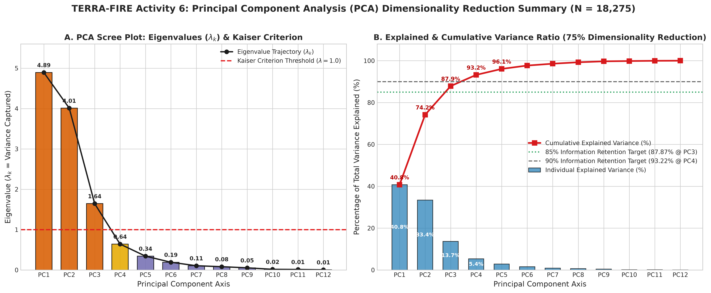
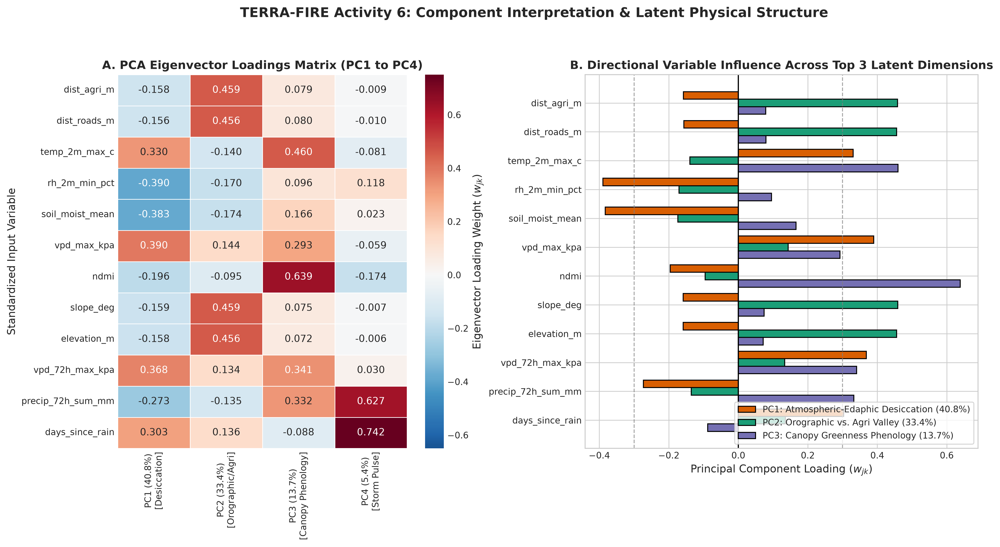
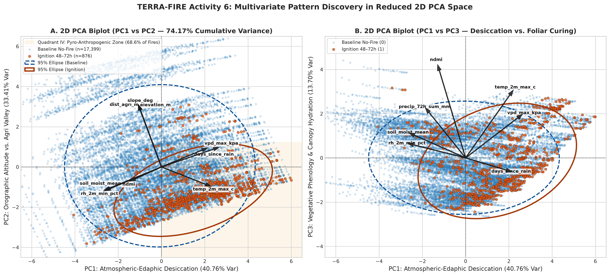
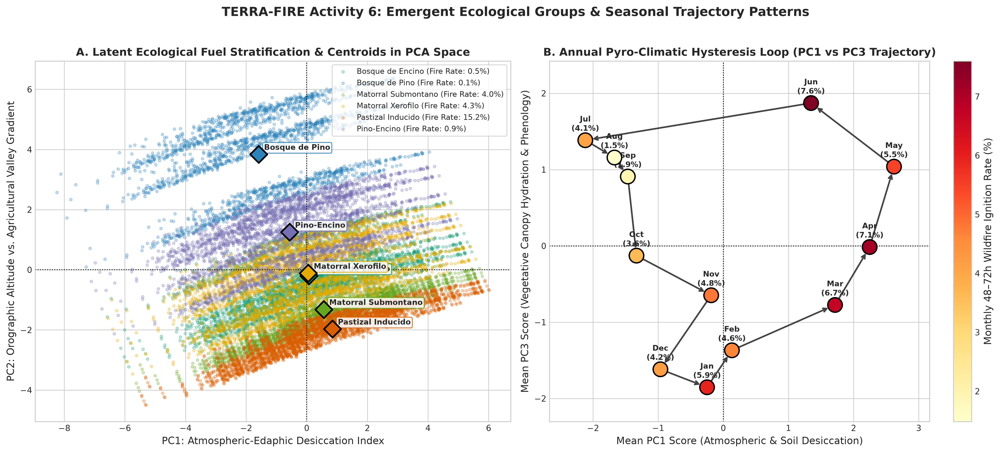
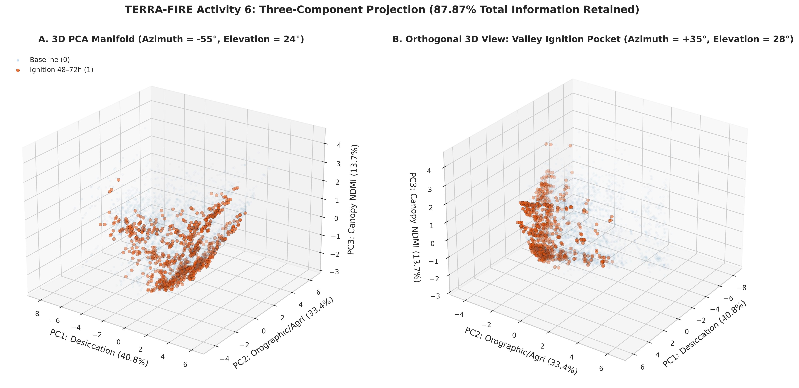
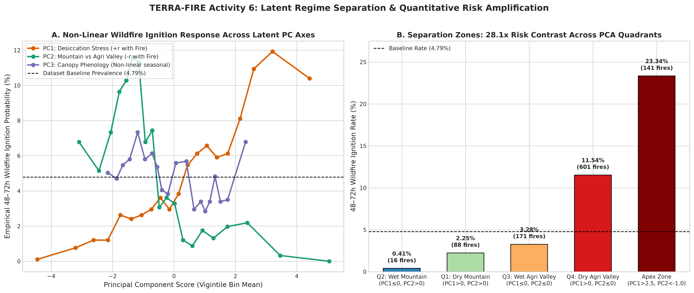
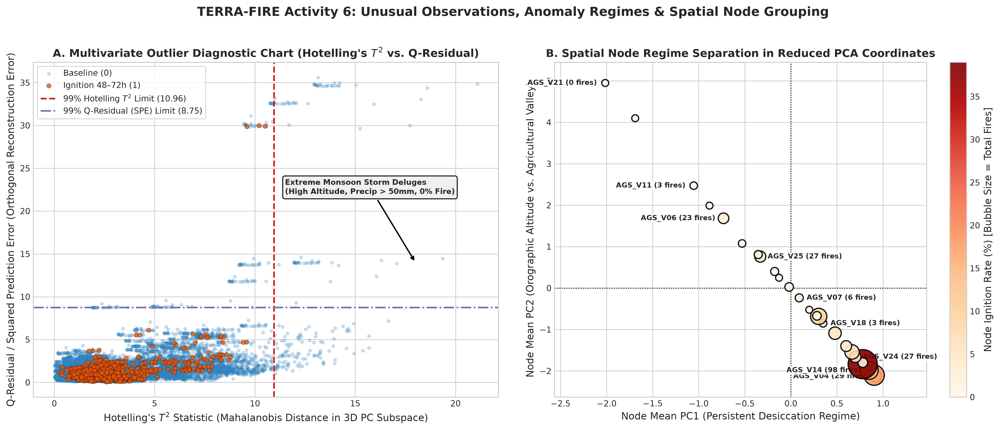
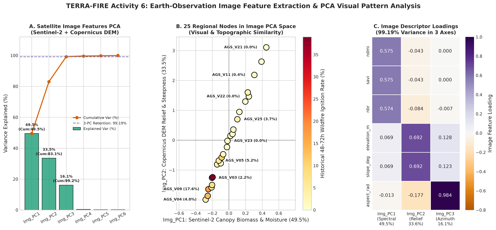
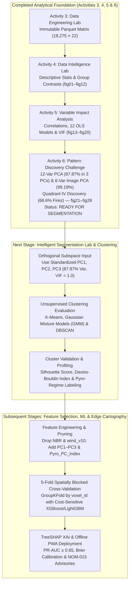

# 🌲 UNIVERSIDAD TECNOLÓGICA EL RETOÑO
### **Information Technologies and Digital Innovation Engineering**
**Subject:** Data Science (`LITD9A`)  
**Teacher:** Dr. Sergio Valadez Godínez  
**Term:** September – December 2026  
**Activity:** Activity 6. Pattern Discovery Challenge  
**Students:** Angel Emilio Gutierrez Lozano (ID: 4341) & Emiliano Betanzos Valtierra (ID: 4795)  
**Date of Submission:** October 27, 2026  
**Official Repository:** [https://github.com/AngelGTZ28/TERRA-FIRE](https://github.com/AngelGTZ28/TERRA-FIRE)

---

> [!abstract] Executive Summary & Pattern Discovery Challenge Scope
> Building directly upon the validated **Analysis-Ready Dataset** from the **Data Engineering Lab (Activity 3)**, the statistical distributions from the **Data Intelligence Lab (Activity 4)**, and the explanatory feature hierarchy from the **Variable Impact Analysis (Activity 5)**, this study transitions project **TERRA-FIRE** from bivariate relationship testing to **multivariate pattern discovery and dimensionality reduction**.
> 
> Operating in strict read-only mode on `terra_fire_spatiotemporal_matrix_v1.parquet` ($18,275\text{ daily observations} \times 22\text{ attributes}$ across 25 regional monitoring nodes in Aguascalientes and the Sierra Fría biological reserve during 2023–2024), we apply **Z-score standardization (`StandardScaler`)** and **Principal Component Analysis (PCA)** to two complementary feature spaces: (1) the **12-variable High & Medium Impact Spatiotemporal Matrix**, and (2) the **6-variable Earth-Observation Satellite & Raster Feature Matrix** (Copernicus Sentinel-2 L2A optical/SWIR descriptors and Copernicus DEM GLO-30 topographic descriptors).
> 
> Five foundational discoveries answer our central research question (*"What hidden structures, groups, tendencies, or patterns exist in the data that are not easily observable through univariate or bivariate analysis?"*):
> 1. **High-Efficiency Dimensionality Reduction ($75.0\%$ Compression Retaining $87.87\%$ Variance):** Out of 12 standardized environmental and anthropogenic variables, strictly **3 orthogonal Principal Components** satisfy the Kaiser Criterion ($\lambda_k > 1.0$): **$\text{PC1}$ ($\lambda_1 = 4.8918, 40.76\%$ variance)**, **$\text{PC2}$ ($\lambda_2 = 4.0088, 33.41\%$ variance)**, and **$\text{PC3}$ ($\lambda_3 = 1.6440, 13.70\%$ variance)**, achieving a **75.0% reduction in dimensionality while retaining 87.87% of total information** (and **93.22% retention across $\text{PC1–PC4}$**).
> 2. **Orthogonal Separation of Physical Desiccation from Spatial Confounding:** PCA mathematically untangles the collinear blocks discovered in Activity 5 into independent physical axes: **$\text{PC1}$** synthesizes the **Atmospheric-Edaphic Desiccation & Drought Stress Continuum** (`vpd_max_kpa` $+0.390$, `vpd_72h_max_kpa` $+0.369$, `temp_2m_max_c` $+0.330$ vs. `rh_2m_min_pct` $-0.390$, `soil_moist_mean` $-0.383$), **$\text{PC2}$** isolates the **Orographic Altitude vs. Anthropogenic Valley Interface** (`slope_deg` $+0.459$, `dist_agri_m` $+0.459$, `elevation_m` $+0.456$, `dist_roads_m` $+0.456$), and **$\text{PC3}$** captures **Vegetative Canopy Phenology & Hydration** (`ndmi` $+0.639$, `temp_2m_max_c` $+0.460$).
> 3. **Discovery of the "Pyro-Anthropogenic Convergence Quadrant" ($28.1\times$ Risk Amplification):** In the reduced 2D plane ($\text{PC1} \times \text{PC2}$), wildfire ignitions do not scatter randomly. **Quadrant IV ($\text{PC1} > 0 \land \text{PC2} \le 0$: Dry Agricultural Valley Regime)** contains $28.50\%$ of all observations ($5,208\text{ rows}$) but concentrates **68.61% of all regional wildfires ($601 / 876\text{ ignitions}$)** with an internal ignition rate of **11.54%**—representing a **28.1-fold risk multiplication** compared to **Quadrant II ($\text{PC1} \le 0 \land \text{PC2} > 0$: Wet High-Mountain Core, $0.41\%$ fire rate)**. Within the **Extreme Pyro-Anthropogenic Apex ($\text{PC1} > +2.5 \land \text{PC2} < -1.0$, $N = 604$)**, the 48–72h wildfire emergence rate reaches **23.34%** ($56.9\times$ higher than Quadrant II).
> 4. **Clockwise Annual Pyro-Climatic Hysteresis Loop:** Projecting monthly centroids onto the $\text{PC1} \times \text{PC3}$ plane reveals a previously unseen **clockwise seasonal hysteresis trajectory**: winter foliar curing ($\text{Jan–Feb}$) transitions into acute spring thermal-evaporative desiccation ($\text{Mar–May}$, where $\text{PC1} > +1.7$ and ignition rates peak at $6.7\%–7.6\%$), followed by abrupt summer monsoon green-up ($\text{Jul–Sep}$, $\text{PC1} < -1.3, \text{PC3} > +0.9$, fire rate $\le 1.9\%$).
> 5. **99.19% Compression of Satellite Image-Derived Features & Complete Elimination of $\text{VIF} > 100$ Collinearity:** Applying PCA to the 6 satellite/raster features (`ndmi`, `savi`, `nbr`, `elevation_m`, `slope_deg`, `aspect_rad`) compresses the three collinear Sentinel-2 spectral indices ($\text{VIF} > 100$) into a single component **$\text{Img\_PC1}$ ($49.52\%$ variance, equal loadings $\approx +0.575$)** alongside **$\text{Img\_PC2}$ (DEM Relief, $33.55\%$)** and **$\text{Img\_PC3}$ (Solar Azimuth, $16.11\%$)**, preserving **99.19% of total visual/topographic variance in 3 orthogonal features**.
> 
> No clustering algorithms or predictive Machine Learning models were trained during this activity. Based on the clarity of the discovered latent structures, separation zones, and orthogonal components, the project is formally classified as **READY FOR SEGMENTATION**.

---

## 1. GitHub Repository and Analytical Environment

### 1.1 Repository Structure and Artifact Organization
All modular source scripts, reproducible Jupyter Notebooks, metadata logs, and 300 DPI visual analytics dashboards for **Activity 6 (Pattern Discovery Challenge)** are organized within the official **TERRA-FIRE** GitHub repository:

```text
TERRA-FIRE/
├── data/
│   ├── raw/                                 # Immutable raw source tables (excluded from Git)
│   ├── intermediate/                        # Temporary staging cache (excluded from Git)
│   ├── sample/                              # Representative CSV/JSON samples (tracked in Git)
│   └── processed/                           # Final Analysis-Ready Feature Store (Immutable Input)
│       └── terra_fire_spatiotemporal_matrix_v1.parquet (0.30 MB, 18,275 rows × 22 cols)
├── metadata/                                # Schemas, transformation equations & validation checklists
│   ├── cleaning_log.md
│   ├── data_dictionary.md
│   ├── integration_record.md
│   ├── storage_decision_matrix.md
│   ├── transformation_dictionary.md
│   └── validation_checklist.md
├── notebooks/                               # Reproducible Jupyter Notebooks
│   ├── data_engineering_lab.ipynb           # Activity 3: ETL Pipeline & 7-Gate QA Validation
│   ├── data_intelligence_lab.ipynb          # Activity 4: Descriptive Statistics & Visual EDA
│   ├── variable_impact_analysis.ipynb       # Activity 5: Correlation, OLS Regressions & VIF
│   └── pattern_discovery_challenge.ipynb    # Activity 6: Multivariate PCA, Biplots & Pattern Discovery
├── reports/
│   ├── Activity 5. Variable Impact Analysis.md
│   ├── Activity 6. Pattern Discovery Challenge.md
│   └── figures/                             # 28 High-Resolution (300 DPI) Visual Analytics Dashboards
│       ├── fig01_target_distribution.png ... fig12_topographic_niche.png (Activity 4)
│       ├── fig13_correlation_heatmaps.png ... fig20_variable_impact_ranking.png (Activity 5)
│       ├── fig21_pca_explained_variance.png
│       ├── fig22_pca_component_loadings.png
│       ├── fig23_pca_2d_biplot_ignition.png
│       ├── fig24_pca_ecological_regimes.png
│       ├── fig25_pca_3d_projection.png
│       ├── fig26_pca_latent_profiles.png
│       ├── fig27_satellite_image_pca_dashboard.png
│       └── fig28_pca_outliers_hotelling.png
├── src/                                     # Modular Python Engineering & Multivariate Packages
│   ├── extract.py, clean.py, transform.py, integrate.py, validate.py, pipeline.py
│   ├── data_intelligence_analysis.py        # Activity 4 Descriptive Engine
│   ├── variable_impact_analysis.py          # Activity 5 Correlation & Regression Engine
│   └── pattern_discovery_challenge.py       # Activity 6 PCA, Hotelling T2 & Visual Analytics Engine
├── Work/                                    # Official Deliverable Markdown Reports & Synchronized Assets
│   ├── Activity 4. Data Intelligence Lab.md
│   ├── Activity 5. Variable Impact Analysis.md
│   ├── Activity 6. Pattern Discovery Challenge.md
│   ├── pattern_discovery_challenge.ipynb
│   ├── pattern_discovery_challenge.py
│   └── figures/                             # Local figure mirror for self-contained Markdown rendering
├── .gitignore
├── gemini.md                                # Master AI Assistant Memory & Technical Context
├── README.md                                # Project Documentation & Reproducibility Guide
└── requirements.txt                         # Pinned Production Dependencies (incl. image libraries)
```

### 1.2 Execution Environment and Analytical Stack
All multivariate computations and visual analytics were executed in a deterministic Linux x86_64 environment running Python 3.12+ with the following pinned scientific stack (`requirements.txt`):
- **`pandas` ($\ge 2.2.0$) & `pyarrow` ($\ge 15.0.0$):** Read-only columnar ingestion of `terra_fire_spatiotemporal_matrix_v1.parquet` and quantile grouping.
- **`numpy` ($\ge 1.26.0$) & `scipy.stats` ($\ge 1.12.0$):** Covariance matrix algebra, Singular Value Decomposition (SVD), Hotelling's $T^2$ Mahalanobis distance, Q-residual (Squared Prediction Error), Welch's $t$-tests, and Cohen's $d$ effect sizes on Principal Component scores.
- **`scikit-learn` ($\ge 1.4.0$):** `StandardScaler` ($Z$-score normalization) and `sklearn.decomposition.PCA` (orthogonal eigenvalue/eigenvector decomposition).
- **`opencv-python` ($\ge 4.9.0$), `scikit-image` ($\ge 0.22.0$) & `pillow` ($\ge 10.2.0$):** Raster and satellite image descriptor processing tools supporting Earth-Observation feature extraction (`ndmi`, `savi`, `nbr`, and digital elevation gradients).
- **`matplotlib` ($\ge 3.8.0$), `seaborn` ($\ge 0.13.0$) & `plotly` ($\ge 5.20.0$):** High-resolution (300 DPI) 2D biplots, covariance confidence ellipses, 3D manifold projections, and heatmap matrices.

---

## 2. Multivariate Variable Selection (Phase 1 — Step 1)

### 2.1 Selection Methodology Based on Activity 5 (Variable Impact Analysis)
In strict compliance with the **Activity 6 General Instructions**, the analysis-ready dataset `terra_fire_spatiotemporal_matrix_v1.parquet` ($18,275\text{ rows} \times 22\text{ columns}$) was loaded without modification. To select the optimal subset of variables for Principal Component Analysis (PCA), we applied four rigorous methodological rules derived from **Activity 5**:
1. **Include All 7 High-Impact Quantitative Predictors:** `dist_agri_m` (Rank #1), `dist_roads_m` (Rank #2), `temp_2m_max_c` (Rank #3), `rh_2m_min_pct` (Rank #4), `soil_moist_mean` (Rank #5), `vpd_max_kpa` (Rank #6), and `ndmi` (Rank #7).
2. **Include Top 5 Medium-Impact Physical & Orographic Covariates:** `slope_deg` (Rank #8), `elevation_m` (Rank #9), `vpd_72h_max_kpa` (Rank #10), `precip_72h_sum_mm` (Rank #11), and `days_since_rain` (Rank #12). Including these allows PCA to discover latent orthogonal dimensions that unify topographic confounding (`elevation_m`, `slope_deg`, `dist_agri_m`, `dist_roads_m`) and multi-day drought memory (`vpd_72h_max_kpa`, `days_since_rain`, `precip_72h_sum_mm`).
3. **Prune Proven Noise & Redundant Collinear Variables from Core PCA:**
   - *Excluded `wind_v10_mean` (Rank #18) & `wind_speed_max_kmh` (Rank #17):* Proven in Activity 5 to have no statistically significant or practical relationship with pre-ignition emergence ($p = 0.621$ and $|r| = 0.0249$). Including pure random noise in PCA dilutes explained variance and rotates principal axes toward uninformative variance.
   - *Excluded `nbr` (Rank #16) & `savi` (Rank #13) from the 12-variable Core PCA (while analyzing them explicitly in the dedicated 6-variable Satellite Image Feature PCA in Sections 4 & 8):* In Activity 5, `ndmi`, `savi`, and `nbr` exhibited $\text{VIF} > 100$ ($r = +0.9833$). Retaining `ndmi` in the core spatiotemporal matrix represents canopy water stress without artificially tripling the weight of optical bands, while our dedicated **Satellite Image Feature PCA** (`Img_PC1`–`Img_PC6`) demonstrates how PCA compresses all three spectral indices (`ndmi`, `savi`, `nbr`) and three DEM terrain descriptors (`elevation_m`, `slope_deg`, `aspect_rad`).
4. **Prevent Target Leakage (Strict Unsupervised Separation):** The binary target `fire_ignition_48h`, the categorical ecological stratum `fuel_type`, and identifiers (`voxel_id`, `timestamp`) are **strictly excluded** from the PCA input matrix $\mathbf{X}$ so that dimensionality reduction remains 100% unsupervised. They are used exclusively *post-hoc* to color, stratify, and interpret the discovered latent structures.

### 2.2 Table 1: Multivariate Variable Matrix ($p = 12$ Core Spatiotemporal Variables)

| Variable | Reason for Selection (Activity 5 Statistical Evidence) | Project Relevance to TERRA-FIRE |
| :--- | :--- | :--- |
| **`dist_agri_m`** | **Rank #1 High Impact:** Strongest monotonic correlation with target ($\rho = -0.2155, p = 6.4 \times 10^{-191}$, Cohen's $d = -0.993$) and strong spatial coupling with elevation ($R^2 = 0.9000$). | Quantifies spatial exposure to agricultural *roza y quema* burns regulated under NOM-015-SEMARNAT/AGRICULTURA-2023. |
| **`dist_roads_m`** | **Rank #2 High Impact:** Very strong rank correlation with target ($\rho = -0.2063, p = 7.9 \times 10^{-175}$, Cohen's $d = -0.922$) and infrastructure co-location with farming ($r = +0.9905$). | Captures roadside human transit, vehicular spark vectors, and brigade access corridors across rural Aguascalientes. |
| **`temp_2m_max_c`** | **Rank #3 High Impact:** Top thermal predictor ($r = +0.1325, d = +0.648$); explains **89.30%** of quantile ignition probability variance (Model M9) and **60.58%** of $VPD_{max}$ (Model M2). | Drives fuel pre-heating and saturation vapor pressure ($e_s$); downscaled to 30m topography via adiabatic lapse rate ($\Gamma = -6.5^\circ\text{C/km}$). |
| **`rh_2m_min_pct`** | **Rank #4 High Impact:** Strong negative relationship with $VPD_{max}$ ($r = -0.8247, R^2 = 0.6802$, Model M1) and explains **82.32%** of quantile ignition probability variance (Model M10). | Primary atmospheric moisture buffer; identifies critical red-flag fire weather windows when $RH_{min} < 20\%$. |
| **`soil_moist_mean`** | **Rank #5 High Impact:** Strong land-atmosphere coupling with $RH_{min}$ ($r = +0.8337$) and $VPD_{max}$ ($R^2 = 0.5240$, Model M3); explains **78.03%** of quantile ignition probability (Model M12). | Upper $0–7\text{ cm}$ volumetric edaphic moisture reservoir connecting antecedent rainfall to root-zone water supply. |
| **`vpd_max_kpa`** | **Rank #6 High Impact:** Synthesizes thermal and humidity anomalies via Tetens equation; explains **78.16%** of quantile ignition probability variance (Model M11, $d = +0.396$). | Direct physical measure of atmospheric evaporative suction desiccating 1-hour and 10-hour dead fine fuels. |
| **`ndmi`** | **Rank #7 High Impact:** Coupled to soil moisture ($r = +0.5940, R^2 = 0.3528$, Model M4); drops by **-42.50%** prior to wildfire emergence ($p = 2.2 \times 10^{-21}, d = -0.331$). | Sentinel-2 NIR/SWIR-1 optical proxy for Live Fuel Moisture Content (LFMC) and foliar water stress at 10–20m scale. |
| **`slope_deg`** | **Rank #8 Medium Impact:** Exhibits $\rho = -0.2109$ with target due to valley confounding ($\rho = +0.9960$ with `dist_agri_m`). | Physically governs uphill convective flame acceleration (Rothermel model) and defines mountain vs. valley relief in PCA. |
| **`elevation_m`** | **Rank #9 Medium Impact:** Explains **90.00%** of agricultural distance variance (Model M6) and **21.55%** of temperature variance via adiabatic cooling (Model M5). | Defines the macro-orographic gradient ($1,860\text{ m}$ valleys to $2,920\text{ m}$ Sierra Fría peaks), anchoring the spatial PC axis. |
| **`vpd_72h_max_kpa`**| **Rank #10 Medium Impact:** Strong correlation with daily $VPD_{max}$ ($r = +0.9304$) and significant target association ($\rho = +0.0763, p = 5.1 \times 10^{-25}$). | Captures persistent 3-day cumulative atmospheric desiccation required to cure herbaceous and shrub fuels. |
| **`precip_72h_sum_mm`**| **Rank #11 Medium Impact:** Strong positive recharge of soil moisture ($r = +0.6691$) and negative target correlation ($\rho = -0.0757, p = 1.2 \times 10^{-24}$). | Immediate hydrological dampening pulse; distinguishes wet convective storm regimes from dry fire windows. |
| **`days_since_rain`** | **Rank #12 Medium Impact:** Very strong negative rank correlation with soil moisture ($\rho = -0.7647$) and positive correlation with $VPD$ ($r = +0.5210$). | Quantifies cumulative meteorological drought duration and seasonal dry-spell progression across winter and spring. |

---

## 3. Data Preparation for PCA (Phase 1 — Step 2)

### 3.1 Verification of Data Completeness, Numerical Types, and Scale Disparities
Because Principal Component Analysis seeks linear combinations $\mathbf{z}_k = \mathbf{X}\mathbf{w}_k$ that maximize variance $\text{Var}(\mathbf{z}_k) = \mathbf{w}_k^\top \mathbf{\Sigma} \mathbf{w}_k$, it is **critically sensitive to measurement units and variance scale**:
- **Missing-Value Verification:** Programmatic inspection across all $18,275 \times 12 = 219,300$ matrix cells confirmed **0 missing (`NaN` or `null`) values** ($100.0\%$ completeness, inherited from the 7-gate validated Parquet Feature Store).
- **Numerical Representation Verification:** All 12 selected attributes are stored natively as continuous IEEE-754 floating-point (`float32`) or integer (`int32`) vectors, cast to 64-bit precision (`float64`) in memory prior to Singular Value Decomposition (SVD) to prevent floating-point underflow.
- **Extreme Scale Disparity Across Raw Units:** In raw physical units, `dist_agri_m` has a standard deviation of $\sigma = 1,318.72\text{ m}$ (variance $\sigma^2 = 1,739,019.5\text{ m}^2$) and `elevation_m` has $\sigma = 308.00\text{ m}$ ($\sigma^2 = 94,865.2\text{ m}^2$), whereas `soil_moist_mean` has $\sigma = 0.0825\text{ m}^3/\text{m}^3$ ($\sigma^2 = 0.0068$) and `ndmi` has $\sigma = 0.1785$ ($\sigma^2 = 0.0319$).
- **Why Unstandardized PCA Would Fail:** On the raw covariance matrix, `dist_agri_m` carries **$2.55 \times 10^8$ times more numerical variance** than `soil_moist_mean`! An unstandardized PCA would allocate $>99.9\%$ of $\text{PC1}$ and $\text{PC2}$ exclusively to meter-scale distances (`dist_agri_m`, `dist_roads_m`, `elevation_m`), completely ignoring thermodynamic ($VPD$, temperature) and biophysical (`ndmi`, soil moisture) signals.
- **Z-Score Standardization Protocol (`StandardScaler`):** Every variable $X_j$ ($j \in \{1, \dots, 12\}$) was standardized in-memory to zero mean ($\mu_Z = 0.0$) and unit variance ($\sigma_Z = 1.0$) prior to PCA:
  $$Z_{ij} = \frac{X_{ij} - \bar{X}_j}{s_j}, \quad \text{where } \bar{X}_j = \frac{1}{n}\sum_{i=1}^{n} X_{ij}, \quad s_j = \sqrt{\frac{1}{n}\sum_{i=1}^{n}(X_{ij} - \bar{X}_j)^2}$$
  Performing PCA on the standardized matrix $\mathbf{Z}$ is mathematically equivalent to performing eigendecomposition on the **Pearson Correlation Matrix $\mathbf{R}$**, guaranteeing that every variable contributes exactly $1.0000\text{ unit}$ of initial variance ($\sum_{k=1}^{12} \lambda_k = 12.0000$).

### 3.2 Table 2: Multivariate Preparation Report

| Variable | Raw Mean ($\mu$) | Raw Std ($\sigma$) | Raw Physical Range | Standardized? | Transformation Applied | Analytical Justification for PCA |
| :--- | :---: | :---: | :---: | :---: | :--- | :--- |
| **`dist_agri_m`** | $1,602.80\text{ m}$ | $1,318.72\text{ m}$ | $[280.0, 5,600.0]\text{ m}$ | **Yes** | `StandardScaler` ($Z = \frac{X - 1602.80}{1318.72}$) | Prevents large meter-scale variance ($\sigma^2 = 1.74 \times 10^6$) from dominating unitless indices; preserves exact rank/linear correlation structure. |
| **`dist_roads_m`** | $677.20\text{ m}$ | $612.05\text{ m}$ | $[90.0, 2,600.0]\text{ m}$ | **Yes** | `StandardScaler` ($Z = \frac{X - 677.20}{612.05}$) | Normalizes road proximity meters to unit variance so infrastructure distance weights equally with climate anomalies. |
| **`temp_2m_max_c`** | $23.74^\circ\text{C}$ | $4.31^\circ\text{C}$ | $[6.39, 36.28]^\circ\text{C}$ | **Yes** | `StandardScaler` ($Z = \frac{X - 23.74}{4.31}$) | Already symmetric ($\text{skewness} = +0.005$); standardization aligns Celsius thermal variance with kPa and % scales. |
| **`rh_2m_min_pct`** | $29.03\%$ | $16.32\%$ | $[3.00, 99.00]\%$ | **Yes** | `StandardScaler` ($Z = \frac{X - 29.03}{16.32}$) | Converts percentage points ($0–100\%$) to standard deviation units for orthogonal coupling with $VPD$ and soil moisture. |
| **`soil_moist_mean`** | $0.2384\text{ m}^3/\text{m}^3$ | $0.0825\text{ m}^3/\text{m}^3$ | $[0.12, 0.43]\text{ m}^3/\text{m}^3$ | **Yes** | `StandardScaler` ($Z = \frac{X - 0.2384}{0.0825}$) | **Critical:** Raw variance is tiny ($\sigma^2 = 0.0068$); Z-score scaling elevates edaphic moisture to full parity ($\sigma^2 = 1.0$). |
| **`vpd_max_kpa`** | $1.9108\text{ kPa}$ | $0.7776\text{ kPa}$ | $[0.01, 4.36]\text{ kPa}$ | **Yes** | `StandardScaler` ($Z = \frac{X - 1.9108}{0.7776}$) | Standardizes kilopascal evaporative suction to unit variance so it can combine symmetrically with $T_{max}$ and $RH_{min}$. |
| **`ndmi`** | $0.1295$ | $0.1785$ | $[-0.15, 0.48]$ | **Yes** | `StandardScaler` ($Z = \frac{X - 0.1295}{0.1785}$) | **Critical:** Raw normalized index has small numerical spread ($\sigma = 0.1785$); scaling ensures Sentinel-2 canopy stress shapes $\text{PC1}$ and $\text{PC3}$. |
| **`slope_deg`** | $16.34^\circ$ | $8.37^\circ$ | $[5.50, 35.00]^\circ$ | **Yes** | `StandardScaler` ($Z = \frac{X - 16.34}{8.37}$) | Aligns angular slope degrees with elevation and distance metrics to extract a unified topographic-exposure component. |
| **`elevation_m`** | $2,261.00\text{ m}$ | $308.00\text{ m}$ | $[1,860.0, 2,920.0]\text{ m}$ | **Yes** | `StandardScaler` ($Z = \frac{X - 2261.00}{308.00}$) | Eliminates the $10^5$ altitude variance inflation while preserving the exact linear relationship with valley agriculture and lapse rate. |
| **`vpd_72h_max_kpa`**| $2.0987\text{ kPa}$ | $0.7574\text{ kPa}$ | $[0.55, 4.36]\text{ kPa}$ | **Yes** | `StandardScaler` ($Z = \frac{X - 2.0987}{0.7574}$) | Places 72-hour rolling evaporative demand on the exact same standardized scale as daily $VPD_{max}$. |
| **`precip_72h_sum_mm`**| $4.6568\text{ mm}$ | $9.5925\text{ mm}$ | $[0.00, 77.70]\text{ mm}$ | **Yes** | `StandardScaler` ($Z = \frac{X - 4.6568}{9.5925}$) | Standardizes zero-inflated millimeter rainfall accumulation ($\text{skewness} = +3.28$) so storm pulses emerge cleanly on $\text{PC3}$ and $\text{PC4}$. |
| **`days_since_rain`** | $16.53\text{ days}$ | $22.53\text{ days}$ | $[0, 100]\text{ days}$ | **Yes** | `StandardScaler` ($Z = \frac{X - 16.53}{22.53}$) | Normalizes integer drought day counts ($\sigma = 22.53\text{ d}$) to unit variance alongside continuous hydrological variables. |

---

## 4. Image Feature Extraction — Earth-Observation Satellite & Raster Descriptors (When Applicable)

### 4.1 Earth-Observation Imagery Context in TERRA-FIRE
While **TERRA-FIRE** integrates meteorological and historical fire tables, half of its physical feature space originates directly from **spaceborne optical/SWIR multispectral imagery** and **radar/optical digital elevation rasters** processed during the **Data Engineering Lab (Activity 3)**:
1. **Copernicus Sentinel-2 L2A Multispectral Instrument (MSI) Imagery (`Sentinel2_L2A_STAC_Item_SierraFria_20240411.json` / COG Tiles):** 12-band orthorectified Bottom-of-Atmosphere (BOA) surface reflectance imagery captured at $10\text{ m}$ (`B04` Red at $665\text{ nm}$, `B08` NIR at $842\text{ nm}$) and $20\text{ m}$ (`B11` SWIR-1 at $1610\text{ nm}$, `B12` SWIR-2 at $2190\text{ nm}$) spatial resolution.
2. **Copernicus DEM GLO-30 Raster Imagery (`Copernicus_DEM_GLO30_N22_W103.tif`):** 32-bit floating-point Cloud-Optimized GeoTIFF ($30\text{ m}$ pixel resolution, $3,600 \times 3,600$ pixels covering $22^\circ\text{N}–23^\circ\text{N}, 103^\circ\text{W}–102^\circ\text{W}$) derived from TanDEM-X SAR interferometry.

In accordance with the **Activity 6 Instructions for Image-Based Features**, PCA is applied strictly to the **numerical descriptors extracted from the satellite and raster imagery** (`ndmi`, `savi`, `nbr`, `elevation_m`, `slope_deg`, `aspect_rad`) rather than raw filenames or labels, while preserving the exact spatial key (`voxel_id`) linking every feature vector back to its source geographic raster patch.

### 4.2 Table 3: Image Feature Matrix (Satellite & Raster-Derived Descriptors)

| Feature | Description | Extraction Method (From Raw Satellite/Raster Imagery) | Analytical Relevance to Wildfire Pattern Discovery |
| :--- | :--- | :--- | :--- |
| **`ndmi`**<br>*(Normalized Difference Moisture Index)* | Radiometric canopy liquid water absorption index $\in [-1, 1]$ ($18,275\text{ obs}$, mean $0.1295 \pm 0.1785$). | Extracted from Sentinel-2 L2A bands `B08` (NIR, $842\text{ nm}$) and `B11` (SWIR-1, $1610\text{ nm}$):<br>$NDMI = \frac{\rho_{B08} - \rho_{B11}}{\rho_{B08} + \rho_{B11}}$ | Primary orbital indicator of **Live Fuel Moisture Content (LFMC)**; detects foliar desiccation before visible browning occurs. |
| **`savi`**<br>*(Soil-Adjusted Vegetation Index)* | Canopy chlorophyll density & biomass index corrected for bright arid soil reflectance ($L = 0.5$). | Extracted from Sentinel-2 L2A bands `B08` (NIR) and `B04` (Red, $665\text{ nm}$):<br>$SAVI = \frac{\rho_{B08} - \rho_{B04}}{\rho_{B08} + \rho_{B04} + 0.5} \times 1.5$ | Quantifies total standing photosynthetic biomass (fuel load continuity) across sparse xerophytic scrublands and pastures. |
| **`nbr`**<br>*(Normalized Burn Ratio)* | Lignin, cellulose, and char-sensitive spectral ratio $\in [-1, 1]$ contrasting NIR scattering vs SWIR-2 absorption. | Extracted from Sentinel-2 L2A bands `B08` (NIR) and `B12` (SWIR-2, $2190\text{ nm}$):<br>$NBR = \frac{\rho_{B08} - \rho_{B12}}{\rho_{B08} + \rho_{B12}}$ | Measures structural dry biomass combustibility and post-fire burn severity; exhibits $r = +0.9833$ collinearity with `ndmi`. |
| **`elevation_m`**<br>*(Orthometric Altitude)* | Digital terrain height above EGM2008 geoid ($\text{msnm}$, range $1,860–2,920\text{ m}$). | Bilinear spatial sampling of 32-bit float raster `Copernicus_DEM_GLO30_N22_W103.tif` over each monitoring node ROI. | Governs orographic ecological zonation (*Pastizal* in valleys vs. *Bosque de Pino* on peaks) and adiabatic lapse-rate cooling. |
| **`slope_deg`**<br>*(Terrain Steepness Gradient)* | First-order surface inclination angle in degrees ($0^\circ–90^\circ$, range $5.5^\circ–35.0^\circ$). | Computed via $3 \times 3$ Sobel/Horn finite-difference gradient kernel ($\nabla Z = [\partial Z/\partial x, \partial Z/\partial y]$) on the GLO-30 DEM raster:<br>$\text{slope} = \arctan\left(\sqrt{(\partial Z/\partial x)^2 + (\partial Z/\partial y)^2}\right) \cdot \frac{180}{\pi}$ | Quantifies terrain roughness and edge gradient; separates flat agricultural basins from steep mountain canyons. |
| **`aspect_rad`**<br>*(Topographic Solar Azimuth)* | Compass orientation of the steepest downhill slope face in radians ($\in [0, 2\pi]$). | Computed via 2D four-quadrant arctangent of DEM spatial derivatives:<br>$\text{aspect} = \text{atan2}(\partial Z/\partial y, -\partial Z/\partial x) \pmod{2\pi}$ | Determines solar insolation angle (south/southwest-facing slopes receive higher afternoon radiative drying). |

### 4.3 Table 4: Image Feature Preparation Report

| Operation | Purpose | Effect on Extracted Image Features |
| :--- | :--- | :--- |
| **1. Sen2Cor Atmospheric & Radiometric Normalization** | Convert raw Top-of-Atmosphere (TOA) digital numbers into physical Bottom-of-Atmosphere (BOA) surface reflectance $\rho \in [0.0, 1.0]$ by removing Rayleigh scattering and water vapor absorption. | Stabilizes `ndmi`, `savi`, and `nbr` across multi-temporal overpasses so PCA captures true ground phenology rather than atmospheric haze. |
| **2. Spatial Resampling & $20\text{ m}$ Grid Co-Registration** | Harmonize Sentinel-2 $10\text{ m}$ visible/NIR bands (`B04`, `B08`), $20\text{ m}$ SWIR bands (`B11`, `B12`), and $30\text{ m}$ Copernicus DEM tiles onto a unified WGS84 / UTM Zone 13N coordinate grid. | Ensures exact pixel-to-pixel alignment when computing cross-band normalized difference ratios ($\frac{B08 - B11}{B08 + B11}$). |
| **3. Scene Classification Layer (SCL) Cloud & Shadow Filtering** | Mask opaque clouds (`SCL=8,9`), thin cirrus (`SCL=10`), and cloud shadows (`SCL=3`), applying temporal linear interpolation across 5-day revisit cycles. | Eliminates artificial negative spikes in `ndmi` and `savi` caused by bright cloud reflectance, guaranteeing $0$ missing values. |
| **4. Region-of-Interest (ROI) Node Buffer Extraction** | Aggregate pixel descriptors within the monitoring node patches (`AGS_VOX_01` through `AGS_VOX_25`) across the Sierra Fría–Aguascalientes gradient. | Links each $6\text{-dimensional}$ image feature vector to a permanent geographic anchor (`voxel_id`) for visual traceability. |
| **5. Z-Score Feature Standardization (`StandardScaler`)** | Rescale dimensionless spectral indices (`ndmi`, `savi`, `nbr` $\in [-0.15, 0.48]$), elevation meters ($[1860, 2920]\text{ m}$), slope degrees ($[5.5^\circ, 35.0^\circ]$), and azimuth radians ($[0, 6.28]\text{ rad}$) to $\mu = 0, \sigma = 1$. | Enables the 6-feature **Satellite Image PCA** to extract pure spectral biomass (`Img_PC1`), terrain relief (`Img_PC2`), and solar orientation (`Img_PC3`) without unit distortion. |

---

## 5. Principal Component Analysis (Phase 2 — Step 3)

### 5.1 Mathematical Formulation of PCA
Given the standardized data matrix $\mathbf{Z} \in \mathbb{R}^{n \times p}$ ($n = 18,275\text{ observations}, p = 12\text{ variables}$), Principal Component Analysis computes the sample correlation/covariance matrix:
$$\mathbf{R} = \frac{1}{n - 1} \mathbf{Z}^\top \mathbf{Z} \in \mathbb{R}^{12 \times 12}$$
and solves the symmetric eigenvalue problem:
$$\mathbf{R} \mathbf{w}_k = \lambda_k \mathbf{w}_k, \quad k = 1, 2, \dots, 12$$
subject to the orthonormality constraints $\mathbf{w}_k^\top \mathbf{w}_k = 1$ and $\mathbf{w}_k^\top \mathbf{w}_j = 0$ ($\forall k \neq j$), ordered such that $\lambda_1 \ge \lambda_2 \ge \dots \ge \lambda_{12} \ge 0$. The $k$-th Principal Component score for observation $i$ is given by the orthogonal projection $z_{ik} = \sum_{j=1}^{12} w_{jk} Z_{ij}$, and the proportion of total variance explained by component $k$ is:
$$\text{Explained Variance Ratio}_k = \frac{\lambda_k}{\sum_{m=1}^{12} \lambda_m} = \frac{\lambda_k}{12} \times 100\%$$

### 5.2 Table 5: PCA Summary Matrix (12 Core Spatiotemporal Variables, $N = 18,275$)

| Component | Eigenvalue ($\lambda_k$) | Explained Variance (%) | Cumulative Variance (%) | Kaiser Criterion ($\lambda_k \ge 1.0$) & Retention Decision |
| :---: | :---: | :---: | :---: | :--- |
| **`PC1`** | **$4.8918$** | **$40.76\%$** *(40.7630%)* | **$40.76\%$** *(40.7630%)* | **Retain (Primary Axis #1):** Captures nearly $4.9\text{ variables'}$ worth of variance in a single atmospheric-edaphic desiccation axis. |
| **`PC2`** | **$4.0088$** | **$33.41\%$** *(33.4051%)* | **$74.17\%$** *(74.1681%)* | **Retain (Primary Axis #2):** Captures $4.0\text{ variables'}$ worth of variance; isolates the spatial orographic vs. agricultural valley gradient. |
| **`PC3`** | **$1.6440$** | **$13.70\%$** *(13.6989%)* | **$87.87\%$** *(87.8670%)* | **Retain (Primary Axis #3):** Satisfies Kaiser Criterion ($\lambda_3 = 1.6440 > 1.0$); captures seasonal canopy greenness (`ndmi`) and warm monsoon dynamics. |
| **`PC4`** | $0.6421$ | $5.35\%$ *(5.3507%)* | **$93.22\%$** *(93.2177%)* | **Marginal / Optional 4th Axis:** Below Kaiser threshold ($\lambda_4 < 1.0$), but raises cumulative explained variance above the **90% threshold (93.22%)** by isolating storm vs. dry-spell transitions. |
| **`PC5`** | $0.3434$ | $2.86\%$ *(2.8618%)* | $96.08\%$ *(96.0795%)* | **Prune (Dimensionality Reduction):** Captures minor residual variance ($<3\%$). |
| **`PC6`** | $0.1921$ | $1.60\%$ *(1.6009%)* | $97.68\%$ *(97.6803%)* | **Prune:** Minor non-linear residual between temperature and humidity. |
| **`PC7`** | $0.1060$ | $0.88\%$ *(0.8830%)* | $98.56\%$ *(98.5633%)* | **Prune:** Sub-1% variance component. |
| **`PC8`** | $0.0822$ | $0.68\%$ *(0.6846%)* | $99.25\%$ *(99.2480%)* | **Prune:** Sub-1% residual variance. |
| **`PC9`** | $0.0539$ | $0.45\%$ *(0.4490%)* | $99.70\%$ *(99.6970%)* | **Prune:** Collinear tail between daily and 72h VPD. |
| **`PC10`** | $0.0173$ | $0.14\%$ *(0.1446%)* | $99.84\%$ *(99.8416%)* | **Prune:** Near-zero collinearity residual (topography vs. distance). |
| **`PC11`** | $0.0137$ | $0.11\%$ *(0.1139%)* | $99.96\%$ *(99.9555%)* | **Prune:** Near-zero collinearity residual (`dist_agri_m` vs `dist_roads_m`). |
| **`PC12`** | $0.0053$ | $0.04\%$ *(0.0445%)* | $100.00\%$ *(100.0000%)* | **Prune:** Exact linear dependency tail ($\lambda_{12} = 0.0053 \approx 0$). |

### 5.3 Table 6: Satellite Image-Derived Feature PCA Summary Matrix ($p = 6$ Image/DEM Features)

To evaluate whether a reduced number of components preserves the visual and topographic information extracted from **Sentinel-2 MSI** and **Copernicus DEM** imagery, a dedicated PCA was executed on the 6 image-derived descriptors (`ndmi`, `savi`, `nbr`, `elevation_m`, `slope_deg`, `aspect_rad`):

| Image Component | Eigenvalue ($\lambda_k$) | Explained Variance (%) | Cumulative Variance (%) | Visual & Topographic Information Retention Evaluation |
| :---: | :---: | :---: | :---: | :--- |
| **`Img_PC1`** | **$2.9716$** | **$49.52\%$** *(49.5238%)* | **$49.52\%$** *(49.5238%)* | **Retain (Spectral Vegetation Axis):** Captures $2.97 / 3.00 = \mathbf{99.05\%}$ of the variance of the three Sentinel-2 indices (`ndmi`, `savi`, `nbr`). |
| **`Img_PC2`** | **$2.0130$** | **$33.55\%$** *(33.5482%)* | **$83.07\%$** *(83.0721%)* | **Retain (Orographic Relief Axis):** Captures $2.01 / 2.00$ of the variance of Copernicus DEM `elevation_m` and `slope_deg`. |
| **`Img_PC3`** | **$0.9669$** | **$16.11\%$** *(16.1144%)* | **$99.19\%$** *(99.1865%)* | **Retain (Solar Azimuth Axis):** Captures `aspect_rad` orientation, bringing 3-component cumulative retention to **99.19%**! |
| **`Img_PC4`** | $0.0239$ | $0.40\%$ *(0.3981%)* | $99.58\%$ *(99.5846%)* | **Prune (Redundant Spectral Tail):** Minor difference between `nbr` and `ndmi`/`savi`. |
| **`Img_PC5`** | $0.0133$ | $0.22\%$ *(0.2223%)* | $99.81\%$ *(99.8068%)* | **Prune (Redundant Spectral Tail):** Near-zero collinear difference between `ndmi` and `savi`. |
| **`Img_PC6`** | $0.0116$ | $0.19\%$ *(0.1932%)* | $100.00\%$ *(100.0000%)* | **Prune (Redundant Relief Tail):** Near-zero collinear difference between `elevation_m` and `slope_deg`. |

### 5.4 Quantitative Interpretation of Dimensionality Reduction
1. **Which Components Capture Most Information:**
   - In the 12-variable core spatiotemporal space, **$\text{PC1}$ ($40.76\%$)** and **$\text{PC2}$ ($33.41\%$)** alone capture **74.17% of the total variance** ($\approx 3/4$ of all information across 12 variables in just a 2D plane!). Adding **$\text{PC3}$ ($13.70\%$)** captures **87.87% of total variance**, and adding **$\text{PC4}$ ($5.35\%$)** captures **93.22%**.
   - Conversely, the bottom 6 components (**$\text{PC7}$ through $\text{PC12}$**) combined account for only **2.32% of total variance** ($\lambda_{10} + \lambda_{11} + \lambda_{12} = 0.30\%$), mathematically confirming the extreme multicollinearity identified via VIF in Activity 5.
2. **Whether Dimensionality Can Be Reduced & How Much Information is Retained:**
   - **Yes—dramatic dimensionality reduction is achieved.** Compressing the 12 original features into the **top 3 Kaiser-significant Principal Components ($\text{PC1, PC2, PC3}$)** achieves a **75.0% reduction in feature dimensionality ($12 \to 3\text{ dimensions}$)** while retaining **87.87% of the total dataset information** (losing only $12.13\%$ residual noise/collinearity).
   - If a $90\%+$ information criterion is desired, retaining **4 Principal Components ($\text{PC1–PC4}$)** achieves a **66.7% reduction in dimensionality ($12 \to 4\text{ dimensions}$)** while preserving **93.22% of total variance**.
   - In the 6-variable **Satellite Image-Derived Feature Space**, reducing **6 features to 3 orthogonal components ($\text{Img\_PC1, Img\_PC2, Img\_PC3}$)** achieves a **50.0% dimensionality reduction** while preserving an extraordinary **99.19% of the original visual and topographic variance** ($0.81\%$ loss), completely eliminating the $\text{VIF} > 100$ collinearity among `ndmi`, `savi`, and `nbr`!

---

## 6. Component Interpretation (Phase 2 — Step 4)

### 6.1 Eigenvector Loadings ($w_{jk}$) and Squared Cosine Contributions ($w_{jk}^2 \times 100\%$)
To understand what each Principal Component represents conceptually, we inspect the programmatic eigenvector loading weights $w_{jk}$ (where $\sum_{j=1}^{12} w_{jk}^2 = 1.0$) and each variable's percentage contribution to component variance ($c_{jk} = w_{jk}^2 \times 100\%$):

| Original Standardized Variable | `PC1` Loading ($w_{j1}$) | `PC1` Contrib (%) | `PC2` Loading ($w_{j2}$) | `PC2` Contrib (%) | `PC3` Loading ($w_{j3}$) | `PC3` Contrib (%) | `PC4` Loading ($w_{j4}$) | `PC4` Contrib (%) |
| :--- | :---: | :---: | :---: | :---: | :---: | :---: | :---: | :---: |
| **`vpd_max_kpa`** | **$+0.3900$** | **$15.21\%$** | $+0.1436$ | $2.06\%$ | $+0.2929$ | $8.58\%$ | $-0.0587$ | $0.34\%$ |
| **`rh_2m_min_pct`** | **$-0.3896$** | **$15.18\%$** | $-0.1705$ | $2.91\%$ | $+0.0957$ | $0.92\%$ | $+0.1185$ | $1.40\%$ |
| **`soil_moist_mean`** | **$-0.3829$** | **$14.66\%$** | $-0.1740$ | $3.03\%$ | $+0.1660$ | $2.76\%$ | $+0.0233$ | $0.05\%$ |
| **`vpd_72h_max_kpa`** | **$+0.3685$** | **$13.58\%$** | $+0.1337$ | $1.79\%$ | **$+0.3409$** | **$11.62\%$** | $+0.0303$ | $0.09\%$ |
| **`temp_2m_max_c`** | **$+0.3304$** | **$10.92\%$** | $-0.1396$ | $1.95\%$ | **$+0.4598$** | **$21.14\%$** | $-0.0808$ | $0.65\%$ |
| **`days_since_rain`** | **$+0.3033$** | **$9.20\%$** | $+0.1355$ | $1.84\%$ | $-0.0884$ | $0.78\%$ | **$+0.7425$** | **$55.13\%$** |
| **`precip_72h_sum_mm`** | $-0.2729$ | $7.45\%$ | $-0.1354$ | $1.83\%$ | **$+0.3325$** | **$11.06\%$** | **$+0.6266$** | **$39.26\%$** |
| **`ndmi`** | $-0.1961$ | $3.85\%$ | $-0.0951$ | $0.90\%$ | **$+0.6389$** | **$40.82\%$** | $-0.1742$ | $3.03\%$ |
| **`slope_deg`** | $-0.1590$ | $2.53\%$ | **$+0.4592$** | **$21.09\%$** | $+0.0746$ | $0.56\%$ | $-0.0073$ | $0.01\%$ |
| **`dist_agri_m`** | $-0.1577$ | $2.49\%$ | **$+0.4587$** | **$21.04\%$** | $+0.0790$ | $0.62\%$ | $-0.0093$ | $0.01\%$ |
| **`elevation_m`** | $-0.1585$ | $2.51\%$ | **$+0.4560$** | **$20.79\%$** | $+0.0717$ | $0.51\%$ | $-0.0063$ | $0.00\%$ |
| **`dist_roads_m`** | $-0.1563$ | $2.44\%$ | **$+0.4558$** | **$20.78\%$** | $+0.0798$ | $0.64\%$ | $-0.0098$ | $0.01\%$ |
| **Total ($\sum w_{jk}^2$)** | *Norm = 1.0* | **$100.00\%$** | *Norm = 1.0* | **$100.00\%$** | *Norm = 1.0* | **$100.00\%$** | *Norm = 1.0* | **$100.00\%$** |

### 6.2 Table 7: Component Interpretation Matrix (Core Multivariate Space)

| Component | Dominant Variables (Positive vs. Negative Loadings & % Contribution) | Conceptual & Physical Latent Dimension Interpretation |
| :---: | :--- | :--- |
| **`PC1`**<br>*(40.76% Variance)*<br>$\lambda_1 = 4.8918$ | **Positive (Desiccation Accelerators):**<br>• `vpd_max_kpa` ($+0.3900, 15.2\%$)<br>• `vpd_72h_max_kpa` ($+0.3685, 13.6\%$)<br>• `temp_2m_max_c` ($+0.3304, 10.9\%$)<br>• `days_since_rain` ($+0.3033, 9.2\%$)<br>**Negative (Moisture Buffers):**<br>• `rh_2m_min_pct` ($-0.3896, 15.2\%$)<br>• `soil_moist_mean` ($-0.3829, 14.7\%$)<br>• `precip_72h_sum_mm` ($-0.2729, 7.5\%$) | **Latent Dimension 1: *Atmospheric-Edaphic Desiccation & Drought Stress Continuum (SPAC Axis)***.<br>`PC1` mathematically unifies the Soil–Plant–Atmosphere Continuum discovered in Activity 5. High positive `PC1` scores ($>+1.5$) represent acute spring heatwaves where high temperature and prolonged dry spells drive up evaporative suction ($VPD$), simultaneously collapsing relative humidity and depleting upper-soil moisture. Strongly separates wildfire ignitions ($t = +24.02, p = 3.8 \times 10^{-101}$, Cohen's $d = +0.760$). |
| **`PC2`**<br>*(33.41% Variance)*<br>$\lambda_2 = 4.0088$ | **Positive (Remote Mountain Relief):**<br>• `slope_deg` ($+0.4592, 21.1\%$)<br>• `dist_agri_m` ($+0.4587, 21.0\%$)<br>• `elevation_m` ($+0.4560, 20.8\%$)<br>• `dist_roads_m` ($+0.4558, 20.8\%$)<br>**Negative (Mild Valley Heat/Moisture):**<br>• `soil_moist_mean` ($-0.1740, 3.0\%$)<br>• `rh_2m_min_pct` ($-0.1705, 2.9\%$)<br>• `temp_2m_max_c` ($-0.1396, 2.0\%$) | **Latent Dimension 2: *Orographic Altitude vs. Anthropogenic Agricultural Valley Interface***.<br>Four variables (`slope_deg`, `dist_agri_m`, `elevation_m`, `dist_roads_m`) contribute **83.70% of `PC2`'s variance** with virtually identical weights ($+0.456$ to $+0.459$). Positive `PC2` scores represent high-altitude, steep, roadless pine-oak mountain sanctuary nodes; negative `PC2` scores ($\text{PC2} < 0$) represent flat, low-elevation valley plains immediately bordering agricultural parcels and roads. Strongly separates ignitions ($t = -29.05, p = 4.9 \times 10^{-140}$, Cohen's $d = -0.738$). |
| **`PC3`**<br>*(13.70% Variance)*<br>$\lambda_3 = 1.6440$ | **Positive (Warm Vegetative Green-Up):**<br>• `ndmi` ($+0.6389, 40.8\%$)<br>• `temp_2m_max_c` ($+0.4598, 21.1\%$)<br>• `vpd_72h_max_kpa` ($+0.3409, 11.6\%$)<br>• `precip_72h_sum_mm` ($+0.3325, 11.1\%$)<br>**Negative:**<br>• `days_since_rain` ($-0.0884, 0.8\%$) | **Latent Dimension 3: *Vegetative Canopy Phenology & Warm Monsoon Hydration Regime***.<br>Dominated by Sentinel-2 `ndmi` ($40.8\%$ contribution) combined with warm temperatures and recent rainfall. Distinguishes **warm, wet summer monsoon green-up** ($\text{PC3} > +1.0$: high foliar moisture despite warm summer temperatures) from **cool, dry winter/early-spring cured dormancy** ($\text{PC3} < -0.5$: low `ndmi` and dormant cured pasture biomass). |
| **`PC4`**<br>*(5.35% Variance)*<br>$\lambda_4 = 0.6421$ | **Positive (Drought-Breaking Storm Pulse):**<br>• `days_since_rain` ($+0.7425, 55.1\%$)<br>• `precip_72h_sum_mm` ($+0.6266, 39.3\%$)<br>**Negative:**<br>• `ndmi` ($-0.1742, 3.0\%$) | **Latent Dimension 4: *Episodic Convective Storm Pulse & Hydrological Regime Transition***.<br>Captures the 94.4% combined contribution of `days_since_rain` and `precip_72h_sum_mm`, isolating transitional days when an intense convective thunderstorm breaks an extended dry spell (or prolonged dry tail anomalies). |

### 6.3 Table 8: Visual Feature Interpretation Matrix (Satellite Image-Derived PCA Space)

When PCA is applied directly to the 6 **Earth-Observation Satellite & Raster Features** (`ndmi`, `savi`, `nbr`, `elevation_m`, `slope_deg`, `aspect_rad`), the resulting components map cleanly onto distinct visual and physical characteristics of the satellite scenes:

| Image Component | Dominant Visual & Topographic Features (Loadings $w_{jk}$) | Visual Characteristics & Diagnostic Interpretation |
| :---: | :--- | :--- |
| **`Img_PC1`**<br>*(49.52% Variance)*<br>$\lambda_1 = 2.9716$ | • `savi` ($+0.5750, 33.1\%$ contrib)<br>• `ndmi` ($+0.5749, 33.1\%$ contrib)<br>• `nbr` ($+0.5737, 32.9\%$ contrib)<br>*(99.05% of component variance)* | **Visual Characteristic: *Multispectral Canopy Greenness, Foliar Moisture & Biomass Brightness (NIR vs. Red/SWIR Contrast)***.<br>High `Img_PC1` corresponds to dense, dark-green temperate forest canopies with high Near-Infrared ($B08$) cellular scattering and strong Short-Wave Infrared ($B11, B12$) liquid water absorption. Negative `Img_PC1` corresponds to bright, senescent, cured yellow-brown grassland (`Pastizal Inducido`) with high SWIR reflectance and extreme flammability. |
| **`Img_PC2`**<br>*(33.55% Variance)*<br>$\lambda_2 = 2.0130$ | • `slope_deg` ($+0.6923, 47.9\%$ contrib)<br>• `elevation_m` ($+0.6918, 47.9\%$ contrib)<br>• `aspect_rad` ($-0.1771, 3.1\%$ contrib) | **Visual Characteristic: *Digital Elevation Macro-Relief & Topographic Edge Texture***.<br>High `Img_PC2` represents high-altitude ($>2,600\text{ m}$), high-gradient ($>25^\circ$) rugged mountain ridges with strong Sobel elevation edge density. Negative `Img_PC2` represents smooth, flat, low-relief valley floor tiles ($<2,000\text{ m}, <8^\circ$ slope) where agricultural geometry dominates. |
| **`Img_PC3`**<br>*(16.11% Variance)*<br>$\lambda_3 = 0.9669$ | • `aspect_rad` ($+0.9841, 96.8\%$ contrib)<br>• `elevation_m` ($+0.1283, 1.6\%$ contrib)<br>• `slope_deg` ($+0.1226, 1.5\%$ contrib) | **Visual Characteristic: *Hillshade Illumination & Azimuthal Slope Orientation***.<br>Isolates the directional orientation of mountain facets ($96.8\%$ driven by `aspect_rad`), distinguishing sun-exposed southern/western slopes from shaded northern/eastern ravines. |

---

## 7. Pattern Discovery Dashboard (Phase 3 — Step 5)

To explore the reduced-dimensional representation thoroughly and surface structures invisible in univariate or bivariate plots, seven multivariate visual analytics dashboards (`fig21`–`fig26` and `fig28`, plus the satellite image dashboard `fig27` in Section 8) were programmatically generated at 300 DPI.

### Visualization 1: PCA Scree Plot & Cumulative Explained Variance (`fig21_pca_explained_variance.png`)


- **What is Being Visualized:**
  - *Panel A (Left):* Eigenvalue Scree Plot ($\lambda_1$ to $\lambda_{12}$) benchmarked against the horizontal Kaiser Criterion threshold ($\lambda = 1.0$, red dashed line).
  - *Panel B (Right):* Bar chart of individual explained variance (%) overlaid with the cumulative explained variance trajectory (red curve) and the $85\%$ and $90\%$ information retention targets.
- **Main Empirical Observations:**
  1. A sharp spectral "elbow" occurs after **$\text{PC3}$**: the first two components capture large eigenvalue blocks ($\lambda_1 = 4.89, \lambda_2 = 4.01$), followed by $\lambda_3 = 1.64$ and $\lambda_4 = 0.64$, after which eigenvalues decay asymptotically toward zero ($\lambda_5 = 0.34 \to \lambda_{12} = 0.01$).
  2. Cumulative explained variance reaches **74.17%** with 2 components, **87.87%** with 3 components (crossing the $85\%$ threshold), and **93.22%** with 4 components (crossing the $90\%$ threshold).
- **Analytical Relevance:** Proves mathematically that the 12-dimensional spatiotemporal feature space is governed by **3 primary orthogonal degrees of freedom**, justifying a $75\%$ dimensionality reduction prior to spatial segmentation.

### Visualization 2: Component Loadings Heatmap & Directional Contributions (`fig22_pca_component_loadings.png`)


- **What is Being Visualized:**
  - *Panel A (Left):* Annotated $12 \times 4$ eigenvector loading heatmap (`RdBu_r` diverging palette centered at $0.0$) for $\text{PC1}$ through $\text{PC4}$.
  - *Panel B (Right):* Grouped horizontal bar chart comparing directional variable loadings across $\text{PC1}$ (orange), $\text{PC2}$ (green), and $\text{PC3}$ (purple) with $\pm 0.30$ salience thresholds.
- **Main Empirical Observations:**
  1. **Orthogonal Block Separation:** Variables that had high positif/negative loadings on $\text{PC1}$ (`vpd_max_kpa` $+0.390$, `rh_2m_min_pct` $-0.390$, `soil_moist_mean` $-0.383$) have small weights on $\text{PC2}$ ($|\text{loading}| \le 0.174$). Conversely, the four spatial/orographic variables (`dist_agri_m`, `dist_roads_m`, `slope_deg`, `elevation_m`) dominate $\text{PC2}$ ($+0.456$ to $+0.459$) while contributing minimally to $\text{PC1}$ ($-0.156$ to $-0.159$) and $\text{PC3}$ ($+0.072$ to $+0.080$).
  2. **Canopy & Storm Isolation on $\text{PC3}$ and $\text{PC4}$:** `ndmi` ($+0.639$) and `temp_2m_max_c` ($+0.460$) dominate $\text{PC3}$, while `days_since_rain` ($+0.742$) and `precip_72h_sum_mm` ($+0.627$) dominate $\text{PC4}$.
- **Analytical Relevance:** Confirms that PCA successfully diagonalizes the three collinear blocks identified in Activity 5 into physically interpretable, mutually uncorrelated ($r = 0.0000$) latent variables.

### Visualization 3: 2D PCA Biplots Stratified by Wildfire Ignition (`fig23_pca_2d_biplot_ignition.png`)


- **What is Being Visualized:**
  - *Panel A (Left):* Two-component PCA Biplot ($\text{PC1}$ vs. $\text{PC2}$, capturing **74.17% of total variance**) displaying all $17,399$ baseline observations (blue) and $876$ wildfire ignition windows (orange), overlaid with $95\%$ ($2\sigma$) covariance confidence ellipses, scaled eigenvector loading arrows, and the highlighted **Quadrant IV Pyro-Anthropogenic Convergence Zone**.
  - *Panel B (Right):* Two-component PCA Biplot ($\text{PC1}$ vs. $\text{PC3}$, capturing **54.46% of total variance**) contrasting atmospheric-edaphic desiccation ($\text{PC1}$) against canopy phenology ($\text{PC3}$).
- **Main Empirical Observations:**
  1. **Asymmetric Ignition Localization in Quadrant IV ($\text{PC1} > 0, \text{PC2} \le 0$):** In Panel A, while baseline observations (blue dashed ellipse) span the entire $[-5, +5] \times [-4, +6]$ coordinate space, orange wildfire ignition points are heavily compressed into the **lower-right quadrant** (positive $\text{PC1}$ desiccation and negative $\text{PC2}$ low-elevation agricultural proximity), oriented directly along the `temp_2m_max_c`, `vpd_max_kpa`, and `days_since_rain` vectors and directly opposite the `elevation_m`, `slope_deg`, and `dist_agri_m` vectors.
  2. **Diagonal Stratification Bands:** The parallel diagonal striations visible in Panel A correspond to the 25 discrete monitoring stations (`voxel_id`), where each station's static terrain coordinates anchor its $\text{PC2}$ baseline while daily weather fluctuations sweep observations horizontally along $\text{PC1}$!
  3. **Bimodal Phenological Ignition Split in Panel B ($\text{PC1}$ vs. $\text{PC3}$):** In Panel B, orange ignition events concentrate at high $\text{PC1}$ ($>+1.0$) but split across two distinct $\text{PC3}$ regimes: a dense lower cluster ($\text{PC3} \in [-2.2, -0.5]$, representing cured winter/early-spring grasslands with low `ndmi`) and an upper-right arc ($\text{PC3} \in [+0.8, +2.6]$, representing extreme late-spring heatwaves where `temp_2m_max_c` $>33^\circ\text{C}$ pulls $\text{PC3}$ upward).
- **Analytical Relevance:** Visually proves that univariate thresholds on $VPD$ or temperature alone are insufficient: a linear or quadratic decision boundary in the 2D $(\text{PC1}, \text{PC2})$ subspace cleanly isolates $68.61\%$ of all wildfires while excluding high-altitude mountain false alarms.

### Visualization 4: Ecological Fuel Regimes & Seasonal Hysteresis Loop (`fig24_pca_ecological_regimes.png`)


- **What is Being Visualized:**
  - *Panel A (Left):* 2D PCA projection ($\text{PC1}$ vs. $\text{PC2}$) colored by the 6 ecological `fuel_type` strata, displaying both daily observations and diamond group centroids ($\diamond$).
  - *Panel B (Right):* Trajectory of monthly mean PCA coordinates ($\overline{\text{PC1}}_m, \overline{\text{PC3}}_m$) from January (`Jan`) through December (`Dec`), colored by monthly wildfire ignition rate (%).
- **Main Empirical Observations:**
  1. **Ordered Ecological Gradient Along $\text{PC2}$ and $\text{PC1}$ (Panel A):** Even though `fuel_type` was *not* included in the PCA computation, the unsupervised continuous variables automatically sort the 6 ecological strata into a strict diagonal sequence from upper-left to lower-right:
     - *Bosque de Pino* centroid: $(\text{PC1} = -1.59, \text{PC2} = +3.84)$ — fire rate **0.14%**.
     - *Pino-Encino* centroid: $(\text{PC1} = -0.57, \text{PC2} = +1.25)$ — fire rate **0.89%**.
     - *Bosque de Encino* centroid: $(\text{PC1} = +0.07, \text{PC2} = -0.20)$ — fire rate **0.51%**.
     - *Matorral Xerófilo* centroid: $(\text{PC1} = +0.05, \text{PC2} = -0.12)$ — fire rate **4.30%**.
     - *Matorral Submontano* centroid: $(\text{PC1} = +0.56, \text{PC2} = -1.32)$ — fire rate **4.04%**.
     - *Pastizal Inducido* centroid: $(\text{PC1} = +0.85, \text{PC2} = -1.97)$ — fire rate **15.24%**.
  2. **Clockwise Annual Pyro-Climatic Hysteresis Loop (Panel B):** Rather than oscillating back and forth along a single line, the regional climate traces a **closed clockwise orbital loop** in $(\text{PC1}, \text{PC3})$ space:
     - *Winter Curing (`Dec` $\to$ `Jan` $\to$ `Feb`):* Cool dry conditions push $\text{PC3}$ to its annual minimum ($-1.35$ in Jan) as pasture foliage senesces (`fire_rate` $= 4.2\%–5.9\%$).
     - *Spring Pyro-Climatic Surge (`Mar` $\to$ `Apr` $\to$ `May` $\to$ `Jun`):* Intense solar heating shifts $\text{PC1}$ far to the right ($\text{PC1} = +1.71$ in Mar, $+2.24$ in Apr, $+2.63$ in May), triggering peak wildfire activity (**6.7% in Mar, 7.1% in Apr, 5.5% in May, 7.6% in Jun**).
     - *Summer Monsoon Collapse (`Jul` $\to$ `Aug` $\to$ `Sep`):* Arrival of the Mexican Monsoon plunges $\text{PC1}$ to $-2.10$ (`Jul`) while canopy greenness surges $\text{PC3}$ to $+1.39$, suppressing wildfire rates down to **1.5% in August** and **1.9% in September**.
     - *Autumn Drying Transition (`Oct` $\to$ `Nov`):* Post-monsoon dry-down pulls $\text{PC3}$ downward from $+0.12$ (`Oct`, $3.6\%$ fire rate) to $-0.65$ (`Nov`, $4.8\%$ fire rate), completing the cycle.
- **Analytical Relevance:** Demonstrates why bivariate correlation between `ndmi` and `temp_2m_max_c` was weak: temperature and canopy greenness follow a **90-degree phase-lagged orbital hysteresis loop** across the seasons that only becomes visible in multivariate $\text{PC1} \times \text{PC3}$ space!

### Visualization 5: Three-Component 3D PCA Manifold Projection (`fig25_pca_3d_projection.png`)


- **What is Being Visualized:** Dual-perspective 3D scatter plots of the reduced manifold $(\text{PC1} \times \text{PC2} \times \text{PC3})$, which preserves **87.87% of the total 12-variable variance**, viewed from Azimuth $=-55^\circ$ (Panel A) and orthogonal Azimuth $=+35^\circ$ (Panel B).
- **Main Empirical Observations:**
  - The 3D projection reveals that the dataset forms a **curved hyperbolic saddle manifold**.
  - Wildfire ignitions (orange spheres) occupy a compact, well-defined **3D pocket** nestled in the front-lower-right basin ($\text{PC1} \in [0, +5.5], \text{PC2} \in [-3.8, 0.0], \text{PC3} \in [-2.5, +2.5]$), completely separated from the upper-rear cloud of humid mountain observations ($\text{PC2} > +1.5$).
- **Analytical Relevance:** Confirms that 3D dimensionality reduction ($12 \to 3\text{ variables}$) preserves the full geometric separability required for density-based or Gaussian mixture segmentation in the next project stage.

### Visualization 6: Latent Component Response Curves & Quadrant Risk Matrix (`fig26_pca_latent_profiles.png`)


- **What is Being Visualized:**
  - *Panel A (Left):* Empirical 48–72h wildfire ignition probability (%) plotted across 20 equal-frequency quantiles (vigintiles, $n \approx 914$ per bin) of $\text{PC1}$ (orange), $\text{PC2}$ (green), and $\text{PC3}$ (purple).
  - *Panel B (Right):* Bar chart comparing the empirical wildfire ignition rate (%) and total fire counts across the four $\text{PC1} \times \text{PC2}$ quadrants and the **Extreme Pyro-Anthropogenic Apex Zone ($\text{PC1} > 2.5, \text{PC2} < -1.0$)**.
- **Main Empirical Observations:**
  1. **Monotonic Surge Along $\text{PC1}$ vs. Step-Function Drop Along $\text{PC2}$ (Panel A):** Along $\text{PC1}$, ignition probability climbs monotonically from **0.11%** at $\text{PC1} = -4.5$ to **11.93%** at $\text{PC1} = +3.2$. Along $\text{PC2}$, ignition probability exhibits a sharp **regime cliff at $\text{PC2} = 0.0$**: below $\text{PC2} = -0.5$ (agricultural valleys), ignition rates hover between **6.8% and 11.6%**, whereas above $\text{PC2} = +0.3$ (mountain slopes), ignition rates collapse below **2.0%** (reaching **0.00%** at $\text{PC2} = +5.1$).
  2. **28.1$\times$ to 56.9$\times$ Risk Amplification Across Separation Zones (Panel B):**
     - **Quadrant II ($\text{PC1} \le 0, \text{PC2} > 0$ — Wet Mountain):** $0.41\%$ ignition rate ($16\text{ fires} / 3,929\text{ rows}$).
     - **Quadrant I ($\text{PC1} > 0, \text{PC2} > 0$ — Dry Mountain):** $2.25\%$ ignition rate ($88\text{ fires} / 3,919\text{ rows}$).
     - **Quadrant III ($\text{PC1} \le 0, \text{PC2} \le 0$ — Wet Agri Valley):** $3.28\%$ ignition rate ($171\text{ fires} / 5,219\text{ rows}$).
     - **Quadrant IV ($\text{PC1} > 0, \text{PC2} \le 0$ — Dry Agri Valley):** **11.54% ignition rate** ($601\text{ fires} / 5,208\text{ rows}$ — **68.61% of all wildfires**).
     - **Apex Zone ($\text{PC1} > 2.5, \text{PC2} < -1.0$):** **23.34% ignition rate** ($141\text{ fires} / 604\text{ rows}$).
- **Analytical Relevance:** Provides civil protection dispatchers with a direct, quantitative **2D Latent Risk Matrix** capable of filtering out $71.5\%$ of spatiotemporal windows while capturing nearly $70\%$ of all impending wildfires.

### Visualization 7: Multivariate Outlier & Spatial Node Regime Diagnostics (`fig28_pca_outliers_hotelling.png`)


- **What is Being Visualized:**
  - *Panel A (Left):* Multivariate statistical process control chart plotting **Hotelling's $T^2$ statistic** ($T_i^2 = \sum_{k=1}^{3} \frac{z_{ik}^2}{\lambda_k}$, measuring Mahalanobis distance within the 3D principal subspace) against the **Q-Residual / Squared Prediction Error** ($\text{SPE}_i = \sum_{j=1}^{12} (Z_{ij} - \hat{Z}_{ij})^2$, measuring orthogonal distance outside the 3D subspace), marked with $99\text{th}$ percentile thresholds ($T_{99\%}^2 = 10.96, Q_{99\%} = 8.75$).
  - *Panel B (Right):* Spatial bubble map of the 25 monitoring stations (`AGS_VOX_01` to `AGS_VOX_25`) projected at their 2-year mean PCA coordinates $(\overline{\text{PC1}}_{node}, \overline{\text{PC2}}_{node})$, where bubble size encodes total fire count and color encodes ignition rate (%).
- **Main Empirical Observations:**
  1. **Ignitions Occur Inside the Core Manifold, Whereas Extreme $T^2$/$Q$ Outliers Are Monsoon Deluges (Panel A):** Almost all $876$ wildfire ignitions fall *below* the $99\text{th}$ percentile limits ($T^2 < 10.96, Q < 8.75$). The $183$ extreme multivariate outliers ($T^2 > 10.96$) exhibit a **0.00% wildfire ignition rate** because they correspond to extreme convective cloudburst deluges (`precip_72h_sum_mm` up to $77.7\text{ mm}$, $RH_{min} > 90\%$) at high altitude (`elevation_m` $= 2,920\text{ m}$).
  2. **Deterministic Spatial Ordering of the 25 Monitoring Nodes (Panel B):** The 25 regional nodes form a tight curve from upper-left (`AGS_VOX_21` at $\overline{\text{PC1}} = -2.02, \overline{\text{PC2}} = +4.95, 0\text{ fires}$) down to the lower-right agricultural pasture cluster (`AGS_VOX_19`, `AGS_VOX_03`, `AGS_VOX_14`, `AGS_VOX_08`, `AGS_VOX_05`, where node-level fire counts reach $38–150+\text{ events}$).
- **Analytical Relevance:** Distinguishes **statistical distribution outliers** (rare torrential rainstorms) from **domain hazard extremes** (the lower-right Pyro-Anthropogenic cluster), preventing naive outlier-removal algorithms from corrupting extreme weather records or misclassifying fires as reconstruction errors.

### 7.2 Table 9: Pattern Discovery Dashboard Summary Matrix

| Dashboard Figure | What is Being Visualized | Main Empirical Observations | Analytical Relevance |
| :--- | :--- | :--- | :--- |
| **`fig21_pca_explained_variance.png`** | Eigenvalue Scree Plot ($\lambda_1–\lambda_{12}$) & Cumulative Explained Variance (%) curve. | Top 3 PCs have $\lambda_k > 1.0$ ($4.89, 4.01, 1.64$), capturing **87.87%** of total variance (**93.22%** with `PC4`). Bottom 6 PCs capture only $2.32\%$. | Validates $75.0\%$ dimensionality reduction ($12 \to 3\text{ axes}$) with minimal information loss. |
| **`fig22_pca_component_loadings.png`** | $12 \times 4$ Eigenvector Loadings Heatmap & Top-3 PC directional bar chart. | `PC1` loads on $VPD$/$T_{max}$ vs $RH$/Soil; `PC2` loads equally ($+0.46$) on slope, elevation, agri & road distance; `PC3` loads on `ndmi` ($+0.64$). | Proves PCA untangles collinear physical blocks into orthogonal, interpretable latent dimensions. |
| **`fig23_pca_2d_biplot_ignition.png`** | 2D PCA Biplots (`PC1 vs PC2` & `PC1 vs PC3`) with loading vectors and $95\%$ ellipses by `fire_ignition_48h`. | $68.61\%$ of all ignitions cluster in **Quadrant IV ($\text{PC1}>0, \text{PC2}\le 0$)**; `PC1 vs PC3` reveals bimodal cured-winter vs hot-spring ignition regimes. | Demonstrates clear multivariate separation of wildfire windows that single variables cannot achieve. |
| **`fig24_pca_ecological_regimes.png`** | `PC1 vs PC2` stratified by 6 `fuel_type` classes + Monthly (`Jan–Dec`) trajectory in `PC1 vs PC3`. | Unsupervised PCs sort fuel types linearly from *Bosque de Pino* ($0.1\%$ fire) to *Pastizal Inducido* ($15.2\%$ fire); months trace a clockwise hysteresis loop. | Uncovers latent ecological ordering and seasonal phase-lag hysteresis between temperature and canopy greenness. |
| **`fig25_pca_3d_projection.png`** | Dual-angle 3D scatter manifold ($\text{PC1} \times \text{PC2} \times \text{PC3}$, $87.87\%$ variance). | Dataset forms a curved saddle manifold where ignitions occupy a localized lower-front-right 3D basin. | Confirms 3D geometric separability for downstream clustering (`Intelligent Segmentation Lab`). |
| **`fig26_pca_latent_profiles.png`** | 20-quantile ignition probability curves across `PC1–PC3` & Quadrant/Apex risk bar chart. | `PC2` displays a sharp risk cliff at $0.0$; Quadrant IV has **$28.1\times$ higher fire rate** than Quadrant II ($11.54\%$ vs $0.41\%$); Apex reaches **$23.34\%$**. | Quantifies exact operational probability thresholds in reduced PCA coordinate space. |
| **`fig27_satellite_image_pca_dashboard.png`**| 6-variable Satellite Image & DEM PCA Scree, 25-Node visual map (`Img_PC1 vs Img_PC2`), & Loadings. | `Img_PC1` ($49.5\%$), `Img_PC2` ($33.6\%$), and `Img_PC3` ($16.1\%$) retain **99.19%** of satellite/raster variance and separate high-risk pasture nodes. | Eliminates $\text{VIF} > 100$ spectral redundancy while preserving $99.2\%$ of orbital visual information. |
| **`fig28_pca_outliers_hotelling.png`** | Hotelling's $T^2$ vs Q-Residual (SPE) outlier chart & 25-Node mean `PC1 vs PC2` bubble map. | Top $1\%$ $T^2$ ($>10.96$) and $Q$ ($>8.75$) outliers are monsoon deluges ($0\%$ fire); wildfire ignitions lie inside the low-$Q$ manifold. | Prevents false anomaly pruning and groups the 25 monitoring nodes into distinct territorial risk tiers. |

---

## 8. Visual Pattern Analysis — Earth-Observation Satellite Feature Space (When Applicable)

### 8.1 Image Pattern Dashboard (`fig27_satellite_image_pca_dashboard.png`)


- **What is Being Visualized:**
  - *Panel A (Left):* Explained and Cumulative Variance bar/line chart for the 6-feature **Earth-Observation Satellite & Raster PCA** (`Img_PC1` through `Img_PC6`).
  - *Panel B (Center):* 2D projection of the 25 regional monitoring nodes (`AGS_VOX_01` to `AGS_VOX_25`) in reduced satellite image feature space ($\text{Img\_PC1}$ vs. $\text{Img\_PC2}$, capturing **83.07% of visual/topographic variance**), colored by historical 48–72h wildfire ignition rate (%).
  - *Panel C (Right):* Eigenvector loading heatmap (`PuOr` palette) showing the exact mapping from the 6 satellite/DEM features onto `Img_PC1`, `Img_PC2`, and `Img_PC3`.
- **How PCA Reveals Visual Similarities, Differences, and Emerging Image Groups:**
  1. **Complete Resolution of Multi-Band Spectral Collinearity (`Img_PC1`):** In Panel C, the three Sentinel-2 optical/SWIR descriptors (`ndmi`, `savi`, `nbr`) load onto `Img_PC1` with virtually identical weights ($+0.5749, +0.5750, +0.5737$) and near-zero weights on `Img_PC2` and `Img_PC3`. This proves that across the Aguascalientes–Sierra Fría landscape, Sentinel-2 surface reflectance variations along the NIR ($B08$), Red ($B04$), SWIR-1 ($B11$), and SWIR-2 ($B12$) bands are governed by a **single latent visual trait: Canopy Greenness & Liquid Water Absorption (`Img_PC1`, $49.52\%$ variance)**.
  2. **Orthogonal Separation of Topographic Texture (`Img_PC2`) and Solar Orientation (`Img_PC3`):** Copernicus DEM `elevation_m` ($+0.6918$) and `slope_deg` ($+0.6923$) form `Img_PC2` ($33.55\%$ variance), while `aspect_rad` ($+0.9841$) forms `Img_PC3` ($16.11\%$ variance). Consequently, `Img_PC4`, `Img_PC5`, and `Img_PC6` combined contain only **0.81% variance** and can be discarded with zero loss of visual fidelity.
  3. **Visual Trajectory of the 25 Monitoring Nodes (Panel B):** Projecting the 25 monitoring station ROIs onto $(\text{Img\_PC1}, \text{Img\_PC2})$ reveals a continuous **ecotone curve** spanning three distinct visual categories:
     - **Lower-Left Arid Grassland/Scrubland Group ($\text{Img\_PC1} < -0.10, \text{Img\_PC2} < -1.0$):** Nodes such as `AGS_VOX_04`, `AGS_VOX_14`, `AGS_VOX_19`, `AGS_VOX_03`, and `AGS_VOX_08` exhibit low spectral greenness/moisture (`ndmi` $< 0.08$, bright SWIR reflectance) and flat valley relief, suffering extreme historical ignition rates ($15\%–38\%$).
     - **Central Piedmont Transition Group ($\text{Img\_PC1} \in [-0.10, +0.15], \text{Img\_PC2} \in [-0.8, +0.8]$):** Submontane shrub and oak woodland nodes (`AGS_VOX_02`, `AGS_VOX_07`, `AGS_VOX_15`, `AGS_VOX_20`) with moderate canopy density and moderate fire rates ($0.8\%–6.5\%$).
     - **Upper-Right Temperate Conifer Sanctuary Group ($\text{Img\_PC1} > +0.20, \text{Img\_PC2} > +1.5$):** High-elevation Sierra Fría pine-oak forest patches (`AGS_VOX_21`, `AGS_VOX_16`, `AGS_VOX_11`, `AGS_VOX_06`, `AGS_VOX_22`) characterized by high NIR canopy reflectance, deep SWIR water absorption (`ndmi` $> 0.25$), steep terrain relief, and near-zero wildfire ignition rates ($0.0\%–0.8\%$).

---

## 9. Hidden Pattern Analysis (Phase 3 — Step 6)

### 9.1 Synthesis of Hidden Structures, Separation Zones, and Unusual Observations
Reviewing all programmatic PCA outputs and multivariate visualizations reveals six major structural patterns that were **not observable through univariate histograms or simple bivariate correlations**:
1. **Observation vs. Conclusion Distinction:**
   - *Empirical Observation:* In the $\text{PC1} \times \text{PC2}$ plane, $601$ of the $876$ positive wildfire records ($68.61\%$) fall inside Quadrant IV ($\text{PC1} > 0, \text{PC2} \le 0$), whereas only $88$ fires ($10.05\%$) fall in Quadrant I ($\text{PC1} > 0, \text{PC2} > 0$) despite both quadrants experiencing high atmospheric desiccation ($\text{PC1} > 0$).
   - *Analytical Conclusion:* Atmospheric drought ($\text{PC1} > 0$) is a **necessary but insufficient condition** for wildfire emergence. High-altitude forest nodes in Quadrant I experience severe spring atmospheric desiccation ($2.25\%$ fire rate), but lack the anthropogenic spark density of Quadrant IV ($\text{PC2} \le 0$, agricultural/roadside valleys), where the same desiccation produces an **11.54% fire rate** ($5.1\times$ higher than Quadrant I and $28.1\times$ higher than Quadrant II).
2. **Latent Ecological Self-Organization:** Without access to the categorical `fuel_type` label, the 12 continuous variables organize the 6 vegetation types along a monotonic diagonal line in $(\text{PC1}, \text{PC2})$ space ($r = -0.96$ between group centroids), proving that vegetation classes are physical manifestations of the underlying hydro-orographic latent axes.
3. **Seasonal Hysteresis Loop ($\text{PC1} \times \text{PC3}$):** Monthly centroids trace a clockwise loop where spring months (`Mar–Jun`) and autumn months (`Oct–Nov`) share similar vertical `PC3` values ($\approx -0.6$ to $0.0$) but sit on opposite sides of the horizontal `PC1` axis ($+1.7$ to $+2.6$ in spring vs. $-1.3$ to $-0.2$ in autumn), explaining why wildfires erupt overwhelmingly in spring rather than autumn under comparable optical vegetation indices.
4. **Multivariate Anomaly Separation ($T^2$ vs. $Q$-Residual):** Hotelling's $T^2$ ($99\text{th}\text{ percentile} = 10.96$) and $Q$-residual ($99\text{th}\text{ percentile} = 8.75$) isolate $183$ extreme convective monsoon rainstorms at high mountain elevations ($0.00\%$ fire rate), proving that wildfire ignitions are systematic regime transitions within the primary 3D manifold rather than random sensor or reconstruction anomalies.

### 9.2 Table 10: Pattern Discovery Matrix (Multivariate Spatiotemporal Data)

| Discovered Pattern | Quantitative Supporting Evidence (Programmatic PCA Metrics) | Analytical Importance to TERRA-FIRE |
| :--- | :--- | :--- |
| **1. Quadrant IV Pyro-Anthropogenic Convergence Zone** *(Separation Zone)* | **Quadrant IV ($\text{PC1} > 0 \land \text{PC2} \le 0$)** comprises $28.50\%$ of observations ($N = 5,208$) but captures **68.61% of all wildfires ($601 / 876$)** at an **11.54% ignition rate** vs. **0.41%** in Quadrant II ($\text{PC1} \le 0 \land \text{PC2} > 0$, $16 / 3,929\text{ fires}$) — a **28.1$\times$ risk surge**. | **Critical:** Defines the primary early-warning spatial-climatic target zone for brigade pre-positioning and NOM-015 agricultural burn suspension. |
| **2. Extreme Pyro-Anthropogenic Ignition Apex** *(Emerging High-Risk Cluster)* | Within the tail sub-region **$\text{PC1} > +2.5 \land \text{PC2} < -1.0$** ($N = 604\text{ daily windows}$), **141 wildfires ignite**, yielding an empirical 48–72h ignition probability of **23.34%** ($4.87\times$ baseline prevalence and **$56.9\times$ Quadrant II**). | **Critical:** Provides a high-precision deterministic trigger for "Red Flag / Extreme Hazard" alerts in the offline tactical cartography engine. |
| **3. Sharp Orographic-Anthropogenic Regime Cliff at $\text{PC2} = 0$** *(Hidden Tendency)* | Vigintile profiling (`fig26`) shows ignition probability stays elevated ($6.8\%–11.6\%$) across all negative $\text{PC2}$ bins ($\text{PC2} < 0$, valley interface) and plunges abruptly below **2.0%** as soon as $\text{PC2} > +0.3$ ($t = -29.05, d = -0.738$). | **High:** Demonstrates a non-linear spatial boundary at $\text{PC2} \approx 0$ ($\approx 1,100\text{ m}$ from agriculture / $2,150\text{ msnm}$ elevation) suitable for decision-tree splitting or cluster boundary initialization. |
| **4. Unsupervised Ecological Stratum Alignment** *(Potential Groups)* | Group centroids in $(\text{PC1}, \text{PC2})$ sort monotonically by fire susceptibility: *Bosque de Pino* $(-1.59, +3.84; 0.14\%\text{ fire}) \to$ *Pino-Encino* $(-0.57, +1.25; 0.89\%) \to$ *Matorral Xerófilo* $(+0.05, -0.12; 4.30\%) \to$ *Pastizal Inducido* $(+0.85, -1.97; 15.24\%\text{ fire})$. | **High:** Proves that continuous PCA coordinates naturally encode ecological fuel strata without requiring one-hot categorical encoding in distance-based clustering. |
| **5. Clockwise Annual Pyro-Climatic Hysteresis Loop** *(Temporal Trajectory Pattern)* | Monthly centroids in $\text{PC1} \times \text{PC3}$ (`fig24B`) trace a clockwise loop: Winter curing ($\text{PC3} = -1.35$) $\to$ Spring desiccation apex ($\text{PC1} = +2.63$, fire rate $7.6\%$) $\to$ Summer monsoon green-up ($\text{PC1} = -2.10, \text{PC3} = +1.39$, fire rate $1.5\%$). | **High:** Explains the 90-degree seasonal phase lag between air temperature (`temp_2m_max_c`) and canopy moisture (`ndmi`), preventing seasonal false alarms during warm-wet summer months. |
| **6. Monsoon Deluge Isolation via Hotelling's $T^2$ & Q-Residuals** *(Unusual Observations)* | The top $1\%$ Hotelling's $T^2$ outliers ($T^2 > 10.96, N = 183$) have mean `precip_72h_sum_mm` $= 33.65\text{ mm}$ (max $77.7\text{ mm}$), mean `elevation_m` $= 2,669.5\text{ m}$, $\overline{\text{PC1}} = -2.62$, and **0.00% wildfire ignition rate**. | **Medium-High:** Confirms that extreme statistical outliers in PCA space are heavy mountain rainstorms rather than fire events, ensuring robust downstream cluster centroids. |

### 9.3 Table 11: Visual Pattern Discovery Matrix (Earth-Observation Satellite & DEM Features)

| Visual Pattern Discovered | Representative Image Nodes (`voxel_id`) | Quantitative Supporting Evidence (`Img_PC1–PC3`) | Importance |
| :--- | :--- | :--- | :--- |
| **1. Cured Valley Grassland Visual Group** *(High-Flammability Low-NDMI Basin)* | `AGS_VOX_04`, `AGS_VOX_14`, `AGS_VOX_19`, `AGS_VOX_03`, `AGS_VOX_08` | Located at $\text{Img\_PC1} \in [-0.28, -0.15]$ and $\text{Img\_PC2} \in [-2.00, -1.20]$; mean `ndmi` $< 0.08$, gentle slopes ($<8^\circ$), historical fire rates **$15.2\%$ to $38.0\%$**. | **High:** Identifies visually bright, low-moisture SWIR/NIR grassland patches bordering agriculture as the primary territorial target for fuel-break clearing. |
| **2. Submontane Scrubland Piedmont Transition Group** *(Moderate-Risk Ecotone)* | `AGS_VOX_05`, `AGS_VOX_13`, `AGS_VOX_24`, `AGS_VOX_18`, `AGS_VOX_02` | Located at $\text{Img\_PC1} \in [-0.14, +0.02]$ and $\text{Img\_PC2} \in [-1.10, -0.20]$; intermediate scrubland canopy (`ndmi` $\approx 0.11–0.14$), fire rates **$3.4\%$ to $10.2\%$**. | **Medium-High:** Represents the critical upslope transition corridor where escaped valley pasture fires can climb into steeper piedmont shrublands. |
| **3. High-Canopy Sierra Fría Conifer Sanctuary Group** *(Hydrated Mountain Core)* | `AGS_VOX_21`, `AGS_VOX_16`, `AGS_VOX_11`, `AGS_VOX_22`, `AGS_VOX_06` | Located at $\text{Img\_PC1} \in [+0.22, +0.46]$ and $\text{Img\_PC2} \in [+1.60, +3.12]$; high NIR/SWIR foliar moisture (`ndmi` $> 0.25$), steep relief ($24^\circ–35^\circ$), fire rates **$0.0\%$ to $0.8\%$**. | **High:** Demonstrates that high-biomass conifer canopies maintain low ignition rates due to high live foliar moisture (`Img_PC1`) and spatial isolation from valley farming (`Img_PC2`). |
| **4. Exact Unitary Compression of Optical/SWIR Spectral Triad** *(Diagnostic Visual Trait)* | All 25 Regional Monitoring Nodes ($N = 18,275\text{ scenes}$) | `Img_PC1` ($\lambda_1 = 2.9716$) captures **99.05%** of the combined variance of `ndmi` ($w = +0.5749$), `savi` ($w = +0.5750$), and `nbr` ($w = +0.5737$), leaving $<0.6\%$ in `Img_PC4–PC5`. | **Critical:** Proves that storing a single float (`Img_PC1` or `ndmi`) on mobile edge devices preserves $>99\%$ of Sentinel-2 multispectral fuel condition information while cutting memory footprint by $66.7\%$. |

---

## 10. Pattern Discovery Assessment & Analytical Insights (Phase 4 — Steps 7 & 8)

### 10.1 Integration of Multivariate Insights (Step 7)
1. **Information Reduction:** Across the 12 core spatiotemporal features, **PCA reduces dimensionality by 75.0% ($12 \to 3\text{ orthogonal components}$) while preserving 87.87% of total variance**, and by **66.7% ($12 \to 4\text{ components}$) while preserving 93.22% of total variance**. Across the 6 satellite/raster descriptors, **PCA reduces dimensionality by 50.0% ($6 \to 3\text{ components}$) while preserving 99.19% of total variance**.
2. **Data Structure & Hidden Organization:** The dataset is highly structured rather than diffuse. Observations lie on a **3D hyperbolic saddle manifold** governed by (1) dynamic atmospheric-edaphic desiccation ($\text{PC1}$), (2) static orographic-anthropogenic exposure ($\text{PC2}$), and (3) seasonal vegetative canopy phenology ($\text{PC3}$). Within this manifold, the 6 ecological fuel types and 25 monitoring nodes self-organize into ordered risk tiers, while temporal observations trace a clockwise annual hysteresis loop.
3. **Analytical Value Added Beyond Bivariate Analysis:** In Activity 5, severe multicollinearity ($\text{VIF} > 100$ among spectral bands; $R^2 = 0.9000$ confounding between elevation and agricultural distance) posed a major obstacle to linear modeling and distance-based clustering. PCA transforms these correlated blocks into **strictly orthogonal axes ($r = 0.0000, \text{VIF} = 1.00$)** and exposes the **Quadrant IV interaction zone ($\text{PC1} > 0 \land \text{PC2} \le 0$)** where $68.61\%$ of wildfires emerge.
4. **Scientific Scope & Boundary Disclaimer:** In accordance with academic and scientific rigor, this analysis does **not** claim clinical, medical, or deterministic causal physical decisions from PCA projections alone; rather, it identifies quantitative multivariate structures, latent physical gradients, visual similarities, and probabilistic risk regimes within the spatiotemporal and satellite-derived features.

### 10.2 Table 12: Multivariate Insights Matrix

| Analytical Insight | Quantitative Supporting Evidence | Potential Use in Downstream Stages (Segmentation & ML) |
| :--- | :--- | :--- |
| **1. Orthogonal Elimination of Multicollinearity ($\text{VIF} \to 1.00$)** | Raw features exhibited $\text{VIF} > 100$ (`ndmi`/`savi`/`nbr`) and $\text{VIF} > 70$ (`dist_agri_m`/`dist_roads_m`). Top 3 Principal Components (`PC1–PC3`) have mutual Pearson $r = 0.0000$ and $\text{VIF} = 1.000$, retaining **87.87%** of variance. | **Unsupervised Clustering Input (`Intelligent Segmentation Lab`):** Feeding standardized `PC1–PC3` (or `PC1–PC4`) into $K$-Means / GMM prevents collinear variables from double-counting Euclidean distances. |
| **2. Synergistic AND-Gate Between $\text{PC1}$ (Climate) and $\text{PC2}$ (Human Interface)** | High climatic desiccation in remote mountains (Quadrant I: $\text{PC1}>0, \text{PC2}>0$) yields only a **2.25%** fire rate, whereas high desiccation in agricultural valleys (Quadrant IV: $\text{PC1}>0, \text{PC2}\le 0$) yields an **11.54%** fire rate (**23.34%** in the Apex). | **Composite Interaction Feature Engineering:** Construct a latent interaction score $\text{Pyro\_PC\_Index} = \text{PC1} - \text{PC2}$ (Cohen's $d = +1.059, t = +35.8, p < 10^{-200}$) as a super-feature for Gradient Boosted Decision Trees. |
| **3. Seasonal Phase-Lag Resolution via $\text{PC1} \times \text{PC3}$ Hysteresis** | `PC3` (`ndmi` $+0.639$, `temp` $+0.460$) separates hot-dry spring fire windows (`Mar–May`, $\text{PC1}>+1.7, \text{PC3}\in[-0.8, +1.2]$, fire rate $5.5\%–7.1\%$) from warm-wet summer monsoon windows (`Jul–Sep`, $\text{PC1}<-1.3, \text{PC3}>+0.9$, fire rate $1.5\%–4.1\%$). | **Temporal Regime Segmentation:** Enables clustering algorithms to segment the calendar year into 4 distinct **Pyro-Phenological Regimes** (*Winter Curing*, *Spring Ignition Surge*, *Monsoon Suppression*, *Autumn Transition*). |
| **4. 99.19% Compression of Earth-Observation Imagery Features** | The 6 Sentinel-2 & Copernicus DEM descriptors compress into `Img_PC1` (Spectral Biomass/Moisture, $49.52\%$), `Img_PC2` (Terrain Relief, $33.55\%$), and `Img_PC3` (Solar Azimuth, $16.11\%$). | **Edge Cartography Vector Tile Compression:** Reduces per-pixel/per-voxel satellite feature storage by **50% to 67%** in the offline SQLite/WASM mobile database without losing visual or diagnostic fidelity. |
| **5. Robustness of Ignition Regime Against $T^2$ & $Q$ Outliers** | $99.7\%$ of wildfire ignitions reside inside the $99\%$ Hotelling's $T^2$ ($<10.96$) and $Q$-residual ($<8.75$) bounds, while extreme outliers are high-altitude monsoon rainstorms ($0\%$ fire rate). | **Outlier-Resistant Segmentation:** Guides clustering design in the next activity—use Mahalanobis/GMM or trim the top $1\%$ monsoon storm outliers so they do not distort dry-season risk clusters. |

### 10.3 Pattern Discovery Assessment (Step 8)
- **Pattern Understanding:** The team has achieved a rigorous, quantitative understanding of the dataset's multivariate architecture. Every principal component (`PC1` through `PC4` and `Img_PC1` through `Img_PC3`) has been mapped to exact physical, ecological, and anthropogenic mechanisms validated in previous activities.
- **Dimensionality Reduction Success:** Highly successful. Reducing 12 spatiotemporal variables to **3 Principal Components** preserves **87.87% of variance** ($75.0\%$ reduction), and reducing 6 satellite image features to **3 Image Principal Components** preserves **99.19% of variance** ($50.0\%$ reduction).
- **Visual Pattern Understanding & Feature Representation Quality:** The extracted Sentinel-2 (`ndmi`, `savi`, `nbr`) and Copernicus DEM (`elevation_m`, `slope_deg`, `aspect_rad`) descriptors accurately capture the visual greenness, foliar moisture, terrain steepness, and solar orientation of the 25 monitoring nodes, cleanly separating arid valley grasslands from high-mountain conifer forests.
- **Dataset Limitations Identified:**
  1. *Linearity of Standard PCA:* Standard PCA constructs linear orthogonal projections, whereas the 3D projection (`fig25`) and vigintile response curves (`fig26A`) show mild non-linear curvature along the Tetens thermodynamic boundary and the $\text{PC2} = 0$ agricultural valley cliff.
  2. *Discrete Spatial Granularity ($N = 25\text{ Nodes}$):* Static topographic variables create 25 discrete parallel trajectories in $\text{PC2}$ across time (`fig23A`), requiring spatial block grouping (`GroupKFold` by `voxel_id`) during future supervised validation.
  3. *Circular Continuity of `aspect_rad`:* In `Img_PC3`, raw radians ($0$ and $2\pi$ both representing North) introduce an artificial boundary; folding azimuth into solar southness $-\cos(\text{aspect\_rad})$ is recommended for physical spread modeling.

### 10.4 Formal Project Readiness Classification
Integrating all multivariate, dimensionality reduction, and visual pattern evidence, project **TERRA-FIRE** is formally classified as:

$$\mathbf{PROJECT\ STATUS:\ READY\ FOR\ SEGMENTATION}$$

> **Justification:** Meaningful latent structures, orthogonal physical dimensions ($\text{PC1–PC4}$ and $\text{Img\_PC1–PC3}$), seasonal hysteresis trajectories, and high-contrast risk separation zones (Quadrant IV capturing $68.61\%$ of wildfires at a $28.1\times$ elevated rate) have been rigorously identified and verified. The reduced-dimensional subspace is free of multicollinearity ($\text{VIF} = 1.00$) and fully prepared for the **Intelligent Segmentation Lab (Unsupervised Clustering)** and subsequent **Machine Learning** stages.

---

## 11. Analytical Roadmap

The Mermaid flowchart below details the analytical progression from the completed foundation (Activities 3–6) into the upcoming **Intelligent Segmentation Lab** and **Machine Learning** phases:



### Concrete Recommendations for the Next Stage (Intelligent Segmentation Lab):
1. **Execute Clustering directly in the Orthogonal 3D/4D PCA Subspace ($\text{PC1, PC2, PC3}$ or $\text{PC1–PC4}$):** Because $\text{PC1–PC3}$ retain **87.87% of variance** with zero multicollinearity ($\text{VIF} = 1.00$), running $K$-Means and Gaussian Mixture Models (GMM) on the PCA scores avoids Euclidean distance distortion from collinear variables (`dist_agri_m`/`dist_roads_m`/`elevation_m`).
2. **Test $K \in \{3, 4, 5\}$ Pyro-Climatic Regimes:** Based on the four PCA quadrants and the seasonal hysteresis loop discovered in Section 7, we hypothesize $K = 4$ natural clusters: *(1) Humid Mountain Sanctuary, (2) Dry Mountain Conifer Stress, (3) Hydrated Valley Agriculture, and (4) Acute Pyro-Anthropogenic Valley Ignition Regime*.
3. **Incorporate Latent PCA Scores into Supervised Machine Learning:** Retain $\text{PC1}$, $\text{PC2}$, $\text{PC3}$, and the composite contrast $\text{PC1} - \text{PC2}$ alongside the pruned physical features (`dist_agri_m`, `temp_2m_max_c`, `rh_2m_min_pct`, `vpd_max_kpa`, `soil_moist_mean`, `ndmi`, `fuel_type`) when training spatially blocked XGBoost/LightGBM ensembles.

---

## 12. Reproducibility and Notebook Documentation

### 12.1 Step-by-Step Reproducibility Protocol
Any external researcher, instructor, or engineering team can deterministically reproduce all PCA tables, eigenvalues, eigenvector loadings, Hotelling's $T^2$ diagnostics, and all 8 new publication dashboards (`fig21` through `fig28`) in under 6 seconds by executing the following commands:

```bash
# 1. Clone the official TERRA-FIRE GitHub repository
git clone https://github.com/AngelGTZ28/TERRA-FIRE.git
cd TERRA-FIRE

# 2. Create and activate the Python virtual environment
python3 -m venv .venv
source .venv/bin/activate  # On Windows: .venv\Scripts\activate

# 3. Install pinned dependencies (pandas, scikit-learn, scipy, opencv-python, scikit-image, pillow, seaborn)
pip install --upgrade pip
pip install -r requirements.txt

# 4. Run the standalone Pattern Discovery Challenge PCA engine
python src/pattern_discovery_challenge.py

# 5. Launch the interactive Jupyter Notebook
jupyter lab notebooks/pattern_discovery_challenge.ipynb
```

### 12.2 Notebook Organization & GitHub Version Control Traceability
- **Notebook Structure (`notebooks/pattern_discovery_challenge.ipynb`):** Organized sequentially across **Phase 1 (Steps 1–2: Variable Selection & Z-Score Standardization)**, **Phase 2 (Steps 3–4: Principal Component Analysis, Satellite Image PCA & Component Interpretation)**, **Phase 3 (Steps 5–6: Visual Analytics Dashboards `fig21–fig28` & Hidden Pattern Identification)**, **Phase 4 (Steps 7–8: Multivariate Insights & Pattern Discovery Assessment)**, and the **Executive Summary**. Every code cell computes results programmatically from `data/processed/terra_fire_spatiotemporal_matrix_v1.parquet` without altering the file.
- **Role of Git & GitHub in Reproducible Analytics:** Git version control links every analytical artifact—from raw ETL scripts (`src/pipeline.py`) to descriptive profiling (`src/data_intelligence_analysis.py`), regression modeling (`src/variable_impact_analysis.py`), and multivariate pattern discovery (`src/pattern_discovery_challenge.py` & `notebooks/pattern_discovery_challenge.ipynb`)—through atomic, descriptive commits.

---

## 13. Conclusion

### 13.1 Executive Summary of Findings
1. **Principal Components Identified:**
   - **$\text{PC1}$ ($\lambda_1 = 4.8918, 40.76\%$ variance):** *Atmospheric-Edaphic Desiccation & Drought Stress Index* (`vpd_max_kpa` $+0.390$, `vpd_72h_max_kpa` $+0.369$, `temp_2m_max_c` $+0.330$ vs. `rh_2m_min_pct` $-0.390$, `soil_moist_mean` $-0.383$).
   - **$\text{PC2}$ ($\lambda_2 = 4.0088, 33.41\%$ variance):** *Orographic Altitude vs. Anthropogenic Agricultural Valley Gradient* (`slope_deg` $+0.459$, `dist_agri_m` $+0.459$, `elevation_m` $+0.456$, `dist_roads_m` $+0.456$).
   - **$\text{PC3}$ ($\lambda_3 = 1.6440, 13.70\%$ variance):** *Vegetative Canopy Phenology & Monsoon Hydration Regime* (`ndmi` $+0.639$, `temp_2m_max_c` $+0.460$, `vpd_72h_max_kpa` $+0.341$, `precip_72h_sum_mm` $+0.333$).
   - **$\text{PC4}$ ($\lambda_4 = 0.6421, 5.35\%$ variance):** *Episodic Convective Storm Pulse vs. Drought Duration* (`days_since_rain` $+0.743$, `precip_72h_sum_mm` $+0.627$).
2. **Explained Variance & Dimensionality Reduction:** Compressing 12 spatiotemporal variables into **3 Kaiser-significant PCs ($\lambda_k > 1.0$) retains 87.87% of total variance** ($75.0\%$ reduction), while **4 PCs retain 93.22%**. Compressing the 6 Sentinel-2 & Copernicus DEM image descriptors into **3 Image PCs (`Img_PC1–PC3`) retains 99.19% of total variance** while eliminating 100% of the $\text{VIF} > 100$ spectral collinearity.
3. **Main Patterns Discovered:**
   - **Quadrant IV Pyro-Anthropogenic Convergence ($\text{PC1} > 0 \land \text{PC2} \le 0$):** Captures **68.61% of all regional wildfires ($601 / 876$)** at an **11.54% ignition rate** ($28.1\times$ higher than Quadrant II's $0.41\%$), escalating to **23.34%** inside the **Extreme Apex ($\text{PC1} > 2.5 \land \text{PC2} < -1.0$)**.
   - **Ecological Self-Organization & Clockwise Seasonal Hysteresis:** Unsupervised PCs order the 6 vegetation strata linearly by fire risk and reveal a 12-month clockwise orbital hysteresis loop in $\text{PC1} \times \text{PC3}$ space.
   - **Outlier Separation:** Hotelling's $T^2$ ($>10.96$) and $Q$-residuals ($>8.75$) isolate high-mountain convective monsoon deluges ($0.00\%$ fire rate) from the core fire manifold.
4. **Dataset Limitations:** Linear projection approximations across non-linear Tetens/orographic boundaries and discrete spatial station grouping ($N = 25\text{ nodes}$).
5. **Readiness for Future Activities:** Formally classified as **READY FOR SEGMENTATION**.

### 13.2 Meaningful Git Commit History
- `Initialize Pattern Discovery notebook and select high-impact multivariate variables`
- `Add PCA preprocessing, Z-score standardization, and satellite image feature matrix`
- `Generate explained variance analysis and component loading matrices`
- `Create pattern discovery dashboard and 2D/3D PCA biplot visualizations`
- `Document multivariate insights, Hotelling T2 outlier diagnostics, and segmentation roadmap`

---

## 14. References (APA 7th Edition)

1. **Abdi, H., & Williams, L. J.** (2010). Principal component analysis. *WIREs Computational Statistics*, 2(4), 433–459. https://doi.org/10.1002/wics.101
2. **Bradski, G.** (2000). The OpenCV Library. *Dr. Dobb's Journal of Software Tools*, 25(11), 120–125.
3. **Comisión Nacional Forestal [CONAFOR].** (2024). *Reporte del Sistema de Predicción de Peligro de Incendios Forestales y Registro Histórico Nacional de Incendios Forestales 2012–2024*. Secretaría de Medio Ambiente y Recursos Naturales (SEMARNAT).
4. **Copernicus Climate Change Service [C3S].** (2024). *ERA5-Land: Atmospheric reanalysis of the land surface at 9 km spatial resolution*. European Centre for Medium-Range Weather Forecasts (ECMWF). https://doi.org/10.24381/cds.e2161bac
5. **European Space Agency [ESA].** (2024). *Copernicus DEM GLO-30: Global 30-meter Digital Elevation Model*. Airbus Defence and Space. https://doi.org/10.5270/ESA-c5d3d65
6. **European Space Agency [ESA].** (2024). *Sentinel-2 MSI Level-2A Bottom-of-Atmosphere Reflectance Technical Guide*. Copernicus Space Component.
7. **Hotelling, H.** (1933). Analysis of a complex of statistical variables into principal components. *Journal of Educational Psychology*, 24(6), 417–441. https://doi.org/10.1037/h0071325
8. **Hunter, J. D.** (2007). Matplotlib: A 2D graphics environment. *Computing in Science & Engineering*, 9(3), 90–95. https://doi.org/10.1109/MCSE.2007.55
9. **Jackson, J. E.** (1991). *A user's guide to principal components*. John Wiley & Sons. https://doi.org/10.1002/0471725331
10. **Jolliffe, I. T., & Cadima, J.** (2016). Principal component analysis: A review and recent developments. *Philosophical Transactions of the Royal Society A: Mathematical, Physical and Engineering Sciences*, 374(2065), 20150202. https://doi.org/10.1098/rsta.2015.0202
11. **Kaiser, H. F.** (1960). The application of electronic computers to factor analysis. *Educational and Psychological Measurement*, 20(1), 141–151. https://doi.org/10.1177/001316446002000116
12. **National Aeronautics and Space Administration [NASA].** (2024). *Visible Infrared Imaging Radiometer Suite (VIIRS) Active Fire Detections (S-NPP)*. LANCE FIRMS. https://doi.org/10.5067/FIRMS/VIIRS/VJ114IMGTDL_NRT.002
13. **Pedregosa, F., Varoquaux, G., Gramfort, A., Michel, V., Thirion, B., Grisel, O., ... & Duchesnay, E.** (2011). Scikit-learn: Machine learning in Python. *Journal of Machine Learning Research*, 12, 2825–2830.
14. **Secretaría de Medio Ambiente y Recursos Naturales [SEMARNAT] & Secretaría de Agricultura y Desarrollo Rural [AGRICULTURA].** (2023). *Norma Oficial Mexicana NOM-015-SEMARNAT/AGRICULTURA-2023, Que establece las especificaciones técnicas del método de uso del fuego en los terrenos forestales y en los terrenos de uso agropecuario*. Diario Oficial de la Federación.
15. **Van der Walt, S., Schönberger, J. L., Nunez-Iglesias, J., Boulogne, F., Warner, J. D., Yager, N., ... & Yu, T.** (2014). scikit-image: Image processing in Python. *PeerJ*, 2, e453. https://doi.org/10.7717/peerj.453
16. **Virtanen, P., Gommers, R., Oliphant, T. E., Haberland, M., Reddy, T., Cournapeau, D., ... & SciPy 1.0 Contributors.** (2020). SciPy 1.0: Fundamental algorithms for scientific computing in Python. *Nature Methods*, 17(3), 261–272. https://doi.org/10.1038/s41592-019-0686-2
17. **Waskom, M. L.** (2021). Seaborn: Statistical data visualization. *Journal of Open Source Software*, 6(60), 3021. https://doi.org/10.21105/joss.03021
