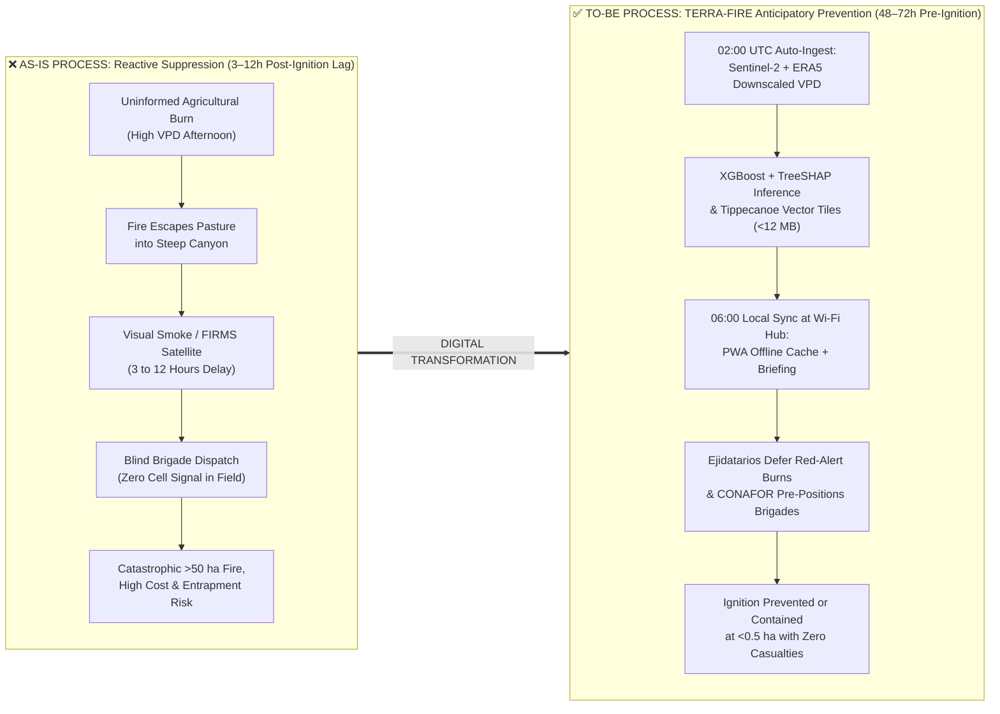
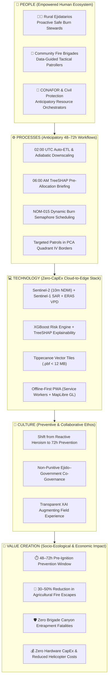
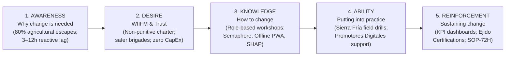

# UNIVERSIDAD TECNOLÓGICA EL RETOÑO (BIS)

- **Major:** Information Technologies and Digital Innovation Engineering
- **Term:** Sep-Dec 2026
- **Subject:** Disruptive Technologies
- **Group:** LITD9A
- **Activity:** Activity 4. Digital Transformation Blueprint
- **Student’s ID and name:**
  - Angel Emilio Gutierrez Lozano (ID: 4341)
  - Emiliano Betanzos Valtierra (ID: 4795)
- **Teacher:** Dr. Sergio Valadez Godínez
- **Date:** 11/10/2026

---

## 1. GitHub Repository and Project Context

> **Instructions:** Describe the repository organization, project context, selected technology, and purpose of the transformation initiative.

### 1.1 Project Context and Continuity
Wildfire management in Mexico—and specifically across the temperate forest corridors of the **Sierra Fría Biological Reserve** and the agricultural valleys of **Aguascalientes**—historically operates under a **reactive suppression paradigm**. Institutional platforms such as the National Forestry Commission's (*CONAFOR*) Wildfire Danger Prediction System (*SPPIF*) and orbital thermal anomaly feeds (*NASA FIRMS VIIRS/MODIS*) only trigger operational workflows **3 to 12 hours after ignition has already occurred**, once flames have escalated into unmanageable crown or canyon fires.

In previous activities of the **TERRA-FIRE** project (*Problem Discovery*, *Scientific Intelligence*, *Global Innovation Observatory*, *Technology Adoption Assessment*, and *Empirical Data Intelligence & Pattern Discovery*), our team demonstrated through empirical analysis of $N = 18,275$ spatiotemporal observations (`terra_fire_spatiotemporal_matrix_v1.parquet`) that:
1. **Anthropogenic Agricultural Origin:** Over **80% of catastrophic wildfires** originate from traditional agricultural clearing burns (*roza y quema*) escaping boundary control. In our regional dataset, positive 48–72h fire ignitions occur at a median distance of **420.0 m** from agricultural borders ($\Delta = -60.53\%$ vs. baseline $1,200.0\text{ m}$, $p < 10^{-30}$) and **150.0 m** from rural roads ($\Delta = -62.32\%$).
2. **Ecological Combustible Selectivity:** **63.58%** of all ignitions ($557 / 876$ fires) initiate in induced pastureland (*Pastizal Inducido*) and **17.92%** in xerophytic scrub (*Matorral Xerófilo*) before propagating upslope into timberlands.
3. **Thermodynamic Pre-Conditioning:** Prior to ignition, atmospheric Vapor Pressure Deficit ($VPD_{max}$) surges by **+16.38%** (exceeding the critical $2.0\text{ kPa}$ desiccation threshold), minimum relative humidity plunges to a median of **18.0%**, and canopy water stress ($NDMI$) drops by **-42.50%**.
4. **Multivariate Pyro-Anthropogenic Convergence (PCA Quadrant IV):** In the orthogonal 3D Principal Component space (`PC1`, `PC2`, `PC3` retaining $87.87\%$ of total variance), **Quadrant IV ($\text{PC1} > 0 \land \text{PC2} \le 0$: Dry Agricultural Valley Interface)** captures **68.61% of all regional wildfires** ($601 / 876$) at an **11.54% ignition rate** ($28.1\times$ higher than the wet high-mountain core), reaching **23.34%** inside the Extreme Pyro-Anthropogenic Apex ($\text{PC1} > +2.5 \land \text{PC2} < -1.0$).

Moving from **Technology Selection $\rightarrow$ Digital Transformation Design**, this blueprint no longer evaluates *which* technology to select, but strategically designs **how people, operational processes, technology architectures, organizational culture, and change management must evolve** across rural *ejidos*, community fire brigades, CONAFOR, and State/Municipal Civil Protection to adopt **TERRA-FIRE** and transition from reactive suppression to **48-to-72-hour anticipatory pre-ignition prevention**.

---

### 1.2 Selected Technology Combination (Input from Technology Adoption Assessment)
The technological input driving this Digital Transformation Blueprint is the validated **Zero-CapEx Four-Layer Convergent Stack** (TRL 3 Validated):

$$\text{Sentinel-2 MSI (10–20 m)} + \text{Sentinel-1 C-SAR} + \text{ERA5-Land Downscaled VPD} + \text{XGBoost / TreeSHAP} + \text{Offline-First MapLibre PWA}$$

| Architectural Layer | Selected Technology Component | Operational Role in Transformation |
| :--- | :--- | :--- |
| **1. Planetary Sensing & Climate Layer** | **Copernicus Sentinel-2 MSI (L2A BOA, 10–20 m)**, **Sentinel-1 C-SAR**, **ECMWF ERA5-Land**, & **Copernicus GLO-30 DEM** | Replaces sparse physical weather stations ($<1$ per $2,500\text{ km}^2$) with zero-cost satellite foliar moisture indices ($NDMI$, $SAVI$) and hourly atmospheric evaporative demand ($VPD$) downscaled adiabatically ($\Gamma = -0.0065^\circ\text{C/m}$) to 10–20 m micro-topography. |
| **2. Predictive & Explainable AI Layer** | **XGBoost Classifier** (`scale_pos_weight = 19.86`) + **TreeSHAP Explainability Engine** | Generates calibrated 48–72h pre-ignition probability surfaces ($P(\text{Ignition}) \in [0, 1]$) and decomposes every prediction into top-3 human-readable physical drivers (*Local Risk Cards*), eliminating algorithmic "black-box" distrust. |
| **3. Edge Compression Layer** | **Apache Parquet Feature Store** + **Tippecanoe Vector Tile Compiler (`.pbf`)** | Compresses regional risk polygons, TreeSHAP explanations, and topographic escape corridors into ultra-lightweight Mapbox Vector Tiles ($< 12\text{ MB}$ per municipality). |
| **4. Disconnected Field Delivery Layer** | **Offline-First Progressive Web App (PWA)** with **Service Workers, IndexedDB, & MapLibre GL JS** | Enables commodity low-end Android smartphones to synchronize at municipal Wi-Fi hubs and render 60 FPS 3D tactical hazard maps, escape routes, and **NOM-015 Burn Semaphores** with **100% offline functionality** in mountain dead zones. |

---

### 1.3 Theoretical Foundation: Digitization, Digitalization, and Digital Transformation
To establish rigorous conceptual clarity aligned with organizational transformation literature (Vial, 2019; Verhoef et al., 2021; Teece et al., 1997), the **TERRA-FIRE** initiative differentiates three evolutionary tiers:

1. **Digitization (Analog-to-Digital Conversion):** Converting physical paper records into digital bits without altering underlying workflows—for example, transcribing paper-based historical wildfire logs or printed *NOM-015-SEMARNAT/AGRICULTURA-2023* agricultural burn permits into static Excel files (`CONAFOR_Incendios_2012_2025.xlsx`).
2. **Digitalization (Process Enablement via Digital Tools):** Using digital technologies to streamline existing processes without changing the reactive institutional paradigm—for example, displaying post-ignition NASA FIRMS thermal hotspots on a web dashboard at a central CONAFOR office while brigades still wait for smoke to deploy.
3. **Digital Transformation (Systemic Socio-Technical & Cultural Paradigm Shift):** Fundamentally reconfiguring **value creation, organizational culture, decision-making authority, and inter-institutional workflows** (Westerman et al., 2014). **TERRA-FIRE** represents true **Digital Transformation** because it:
   - Shifts the institutional mission from **reactive fire suppression (3–12h post-ignition)** to **anticipatory territorial pre-allocation and community prevention (48–72h pre-ignition)**.
   - Decentralizes intelligence from urban command centers directly to rural *ejidatarios* and volunteer brigades via offline-first edge cartography.
   - Replaces punitive regulatory friction with collaborative, non-punitive microclimatic burn scheduling.
   - Builds **Dynamic Capabilities** (Teece et al., 1997): *Sensing* (automated satellite/climate hazard detection), *Seizing* (48h pre-positioning of brigades and burn deferral), and *Transforming* (continuous organizational learning and cross-agency governance).

---

### 1.4 GitHub Repository Organization and Traceability
The transformation strategy, analytical evidence, process maps, and roadmap artifacts are version-controlled in the official **TERRA-FIRE** GitHub repository ([https://github.com/AngelGTZ28/TERRA-FIRE](https://github.com/AngelGTZ28/TERRA-FIRE)) following collaborative software and documentation engineering standards:

```text
TERRA-FIRE/
├── docs/
│   └── transformation/
│       ├── digital_transformation_blueprint.md   # Complete Digital Transformation Blueprint (Activity 4)
│       ├── process_map.png                       # As-Is (Reactive) vs. To-Be (Anticipatory 72h) Process Map
│       ├── stakeholder_analysis.pdf              # Stakeholder Power-Interest & Adoption Strategy Matrix
│       └── roadmap.png                           # 5-Stage Phased Implementation Roadmap Diagram
├── data/
│   ├── sample/                                   # Tracked representative CSV/JSON samples
│   └── processed/
│       └── terra_fire_spatiotemporal_matrix_v1.parquet  # Validated Feature Store (18,275 rows × 22 cols)
├── metadata/                                     # Data dictionary, cleaning log, validation checklist
├── notebooks/                                    # Reproducible Jupyter Notebooks (Activities 3, 4, 5 & 6)
├── reports/
│   └── figures/                                  # 27 publication-grade empirical figures (fig01–fig27)
├── roadmap/
│   └── transformation_roadmap_milestones.md      # Operational stage-gate tracking & KPIs
├── src/                                          # Modular Python ETL, statistical & PCA engines
├── work/
│   └── Activity 4. Digital Transformation Blueprint.md
├── README.md                                     # Updated project overview & transformation governance
└── requirements.txt                              # Reproducible Python environment specification
```

#### Audited Git Commit History (Semantic & Descriptive Traceability)
In strict compliance with documentation traceability standards (avoiding vague messages such as `changes`, `final`, or `last version`), the repository records atomic, descriptive commits:
- `Add current state assessment across people, processes, technology, and culture`
- `Create transformation opportunity analysis grounded in empirical VPD and PCA findings`
- `Develop future-state blueprint and socio-technical value creation diagram`
- `Add digital capability gap analysis comparing current reactive vs future anticipatory state`
- `Add stakeholder adoption strategy and resistance mitigation matrix`
- `Create change management plan integrating ADKAR communication, training, support, and KPIs`
- `Document transformation roadmap across five implementation stages and update README`

---

## 2. Current State Assessment (Phase 1 — Step 1)

> **Instructions:** Describe people, processes, technology, and culture in the current situation.

### 2.1 Detailed Organizational Context Analysis (As-Is State)

#### A. People (Users, Employees, Stakeholders, Decision Makers)
- **Primary Field Users (*Rural Ejidatarios & Smallholder Farmers*):** Agricultural producers in rural communities bordering the Sierra Fría and valley pasturelands (*Pastizal Inducido*) who rely on seasonal agricultural fire (*roza y quema*) to clear crop residue before planting. They possess deep empirical knowledge of local terrain but have low digital literacy, operate entry-level Android devices, and lack hyperlocal meteorological guidance.
- **Employees & Frontline Combatants (*Community Fire Brigades & Municipal Forest Guards*):** Volunteer ejidal brigades and seasonal combat crews who patrol rugged canyons on foot. They face life-threatening entrapment risks when wind direction shifts unexpectedly in steep ravines ($>15^\circ$ slope) without real-time situational awareness.
- **Operational Stakeholders (*CONAFOR Regional Dispatchers & State/Municipal Civil Protection Analysts*):** Technical coordinators trained in the Incident Command System (ICS) who manage limited suppression assets (6 official brigades, water tankers, and 1–2 helicopters across $>400,000\text{ ha}$). They are overwhelmed during peak dry-season spikes (*March–June*) due to fragmented data.
- **Decision Makers (*Comisariados Ejidales, Municipal Presidents, CONAFOR State Directorate, & SEMARNAT Regulators*):** Leaders responsible for authorizing agricultural burn calendars under **NOM-015-SEMARNAT/AGRICULTURA-2023**, declaring municipal emergencies, and allocating public forestry budgets.

#### B. Processes (Current Workflows, Existing Procedures, Inefficiencies)
- **Current Workflows:**
  1. *Agricultural Burning:* Farmers inspect the sky visually at dawn and ignite pasture/crop residue based on traditional calendar customs, unaware of incoming afternoon Vapor Pressure Deficit ($VPD > 2.5\text{ kPa}$) surges.
  2. *Detection & Alerting:* Fire detection relies on visual smoke sighting from lookout towers, citizen 911 calls, or polar-orbiting thermal satellite passes (NASA FIRMS VIIRS/MODIS).
  3. *Dispatch & Suppression:* Once smoke or a thermal hotspot is confirmed, CONAFOR dispatches ground crews to the reported coordinates.
- **Existing Procedures:** Compliance with *NOM-015-SEMARNAT/AGRICULTURA-2023* requires farmers to submit written or verbal notices to municipal/ejidal authorities prior to burning; however, verification of microclimatic safety thresholds is manual, subjective, and rarely enforced in remote parcels.
- **Critical Inefficiencies:**
  - **3-to-12-Hour Detection-to-Action Latency:** By the time a thermal satellite detects an active fire and brigades hike into the canyon, a $0.5\text{ ha}$ pasture escape has already expanded into a $>50\text{ ha}$ forest conflagration.
  - **Blind Patrols & Misallocated Resources:** Brigades conduct unguided patrols across vast territories while suppression budgets are exhausted on reactive helicopter flight hours rather than pre-ignition prevention.

#### C. Technology (Existing Systems, Current Tools, Technical Limitations)
- **Existing Systems:** CONAFOR's *Sistema de Predicción de Peligro de Incendios Forestales (SPPIF)* (based on the Canadian Fire Weather Index [FWI]) and NASA FIRMS active fire web portals.
- **Current Tools:** Desktop GIS software (QGIS/ArcGIS) confined to central urban offices, static PDF daily bulletins sent via email/WhatsApp, analog VHF hand-held radios, and manual suppression tools (*azadones*, *McLeods*, backpack pumps).
- **Technical Limitations:**
  - **Coarse Spatial Resolution ($\ge 9\text{–}10\text{ km}$):** Regional meteorological grids average out micro-topographic variations, completely missing intense solar desiccation on south-facing canyon slopes ($10\text{–}20\text{ m}$ scale).
  - **Meteorological Blindness:** Fewer than **1 automated weather station (EMA) per $2,500\text{ km}^2$** in Mexican mountain biomes, and zero real-time measurement of live canopy foliar moisture ($NDMI$).
  - **The Frontline Connectivity Abyss:** Over **85% of forested mountain corridors in Sierra Fría lack 4G/5G cellular coverage**, rendering conventional cloud-dependent web dashboards and mobile apps completely inoperable in the field.

#### D. Culture (Organizational Attitudes, Innovation Climate, Readiness for Change)
- **Organizational Attitudes:** Institutional forestry culture is rooted in a **"Heroic Reactive Firefighting Ethos"**—visibility, political recognition, and emergency budgets reward dramatic fire extinction rather than quiet, anticipatory prevention. Meanwhile, rural *ejidatarios* view government environmental monitoring with suspicion, fearing fines or criminalization of traditional farming practices.
- **Innovation Climate:** Siloed operations between scientific researchers, federal agencies (CONAFOR), state emergency services (Civil Protection), and rural *ejidos*. Previous technological tools failed in the field because they were designed in urban laboratories assuming continuous high-speed internet and advanced technical literacy.
- **Readiness for Change:** **Moderate-to-High Urgency with Capability Friction.** Recent severe drought cycles (2023–2025) and escalating wildfire devastation have created strong institutional and community consensus that traditional calendars and reactive suppression are no longer sustainable—provided the new solution is non-punitive, explainable, and works offline.

---

### 2.2 Deliverable 1: Current State Assessment Matrix

| Dimension | Current Situation (As-Is Baseline) | Key Challenges & Structural Barriers |
| :--- | :--- | :--- |
| **People** | • **Ejidatarios & Farmers:** Execute traditional *roza y quema* guided by visual intuition and ancestral calendars.<br>• **Community Brigades:** Frontline volunteers patrolling rugged terrain with basic Android phones and VHF radios.<br>• **CONAFOR & Civil Protection Dispatchers:** Coordinate regional crews from central offices using delayed reports.<br>• **Decision Makers:** *Comisariados Ejidales* and municipal officials managing emergency budgets reactively. | • **Digital Literacy Divide:** Complex GIS dashboards alienate older rural farmers.<br>• **High Entrapment Risk:** Brigades enter canyons without hyperlocal wind or escape-route intelligence.<br>• **Cognitive Overload:** Dispatchers lack automated decision-support tools during peak spring dry season (*Mar–Jun*). |
| **Processes** | • **Reactive Suppression Workflow:** Ignition $\rightarrow$ Visual smoke / Satellite pass (3–12h lag) $\rightarrow$ Dispatch $\rightarrow$ Arrival (fire already $>50\text{ ha}$).<br>• **Paper-Based NOM-015 Notices:** Static administrative burn permits disconnected from real-time microclimatic risk.<br>• **Unguided Patrols:** Brigades patrol broad routes without predictive spatial prioritization. | • **Severe Response Latency (3–12h):** Zero anticipatory workflow during the 48–72h pre-ignition desiccation window.<br>• **Uncoordinated Burn Scheduling:** Agricultural burns occur simultaneously during high-$VPD$ ($>2.0\text{ kPa}$) afternoons.<br>• **Manual Data Preparation:** Analysts spend hours downloading and cross-referencing fragmented spreadsheets. |
| **Technology** | • **Macro-Scale Monitoring:** SPPIF (Canadian FWI at $\ge 10\text{ km}$ resolution) and NASA FIRMS (VIIRS $375\text{ m}$ / MODIS $1\text{ km}$ post-ignition thermal anomalies).<br>• **Urban-Centric GIS:** Desktop mapping restricted to connected headquarters.<br>• **Sparse Surface Sensors:** $<1$ weather station per $2,500\text{ km}^2$ in mountain ecosystems. | • **85% Cellular Dead Zones:** Conventional cloud apps fail completely inside Sierra Fría canyons.<br>• **Micro-Topographic Blindness:** Coarse $10\text{ km}$ grids ignore 10–20 m canyon slope desiccation and foliar water stress ($NDMI$).<br>• **Hardware CapEx Prohibitiveness:** Installing physical IoT sensor meshes across thousands of hectares is financially and logistically unfeasible. |
| **Culture** | • **Reactive Heroism Ethos:** Institutional prestige and budgets prioritize emergency combat and helicopter sorties over prevention.<br>• **Regulatory Distrust:** Rural farmers fear that digital monitoring tools are punitive surveillance mechanisms to issue fines.<br>• **Black-Box Skepticism:** Experienced forest engineers distrust unexplained algorithmic predictions. | • **Resistance to Preventive Shift:** Shifting mindset from "fighting fires" to "preventing ignitions 72h early."<br>• **Fear of Punitive Sanctions:** Potential under-reporting or avoidance by *ejidatarios* if the app is perceived as policing.<br>• **Institutional Silos:** Fragmented communication between CONAFOR, Civil Protection, and *Asambleas Ejidales*. |

---

## 3. Transformation Opportunities (Phase 1 — Step 2)

> **Instructions:** Explain the opportunities enabled by the proposed technology and how they create value.

### 3.1 Value Creation Enabled by the TERRA-FIRE Technological Convergence
Grounded in the empirical evidence from our 18,275-record spatiotemporal analysis and 12-to-3 PCA dimensionality reduction, the **TERRA-FIRE** technological stack unlocks **seven high-impact digital transformation opportunities** across both data science/remote sensing interpretation and frontline organizational operations:

1. **Automated Satellite & Microclimatic Image/Raster Interpretation:**
   - *Mechanism:* Replaces manual downloading of Sentinel-2 scenes and ERA5 climate tables with an automated nightly cloud pipeline (02:00 UTC) via STAC API. It programmatically computes canopy moisture ($NDMI = \frac{B08 - B11}{B08 + B11}$), soil-adjusted vegetation ($SAVI$), Tetens Vapor Pressure Deficit ($VPD_{max}$), and adiabatic topographic temperature downscaling ($T_{downscaled} = T_{ref} - 0.0065 \cdot \Delta Z$).
   - *Value Created:* Eliminates 100% of repetitive human GIS pre-processing tasks and reduces nationwide/statewide feature engineering latency from days to **$< 4.0\text{ seconds}$**.
2. **Pre-Diagnostic Hazard Screening 48–72 Hours Prior to Ignition (10–20 m Granularity):**
   - *Mechanism:* By targeting the empirically discovered **Quadrant IV Pyro-Anthropogenic Convergence Zone** ($\text{PC1} > 0 \land \text{PC2} \le 0$, where $68.61\%$ of all fires ignite along agricultural-pasture interfaces within $420\text{ m}$ of farmland), the calibrated XGBoost engine identifies critical 20 m voxels **2 to 3 days before a spark occurs**.
   - *Value Created:* Transforms emergency response from a 3–12h post-ignition lag into a **48–72h proactive prevention window**, enabling pre-positioning of water tankers and brigades at high-risk canyon mouths.
3. **Explainable Decision Support for Specialists (TreeSHAP Local Risk Cards):**
   - *Mechanism:* Every voxel prediction is paired with exact **TreeSHAP** local feature attributions that translate complex multivariate interactions into clear operational diagnostics (e.g., *"88% Ignition Risk: Driven by +42% VPD Surge [2.45 kPa] + Canopy Desiccation [NDMI = 0.05] + 280m Proximity to Active Pasture Burn Zone"*).
   - *Value Created:* Overcomes algorithmic black-box skepticism among CONAFOR engineers and legally substantiates Civil Protection preventive moratoria.
4. **Citizen-Centric Agricultural Burn Advisory Semaphore (NOM-015 Digitalization):**
   - *Mechanism:* Simplifies complex thermodynamic thresholds into an intuitive **3-Color Visual Semaphore (Green / Yellow / Red)** tailored for rural *ejidatarios*. When $VPD_{max} > 2.0\text{ kPa}$ and $RH_{min} < 20\%$, the app advises deferring *roza y quema* for 48 hours and suggests the next safe microclimatic window.
   - *Value Created:* Directly addresses the root cause of **$>80\%$ of wildfires** without criminalizing farmers, turning *ejidatarios* into preventive stewards.
5. **100% Offline Tactical Edge Access & Escape Route Navigation:**
   - *Mechanism:* Compresses predictive risk layers and GLO-30 DEM slope vectors into `< 12 MB` Mapbox Vector Tiles (`.pbf`) cached in browser `IndexedDB` via PWA Service Workers.
   - *Value Created:* Delivers **60 FPS 3D tactical cartography and safe escape corridor routing** in complete cellular dead zones, protecting brigade lives from canyon entrapment.
6. **Zero-CapEx Budget Optimization:**
   - *Mechanism:* Leverages 100% free open-access planetary constellations (ESA Copernicus & ECMWF) and commodity smartphones already owned by users.
   - *Value Created:* Saves millions of pesos in physical IoT weather station hardware and reduces reactive helicopter suppression expenditures by an estimated **25%–40%**.

---

### 3.2 Deliverable 2: Transformation Opportunity Matrix

| Opportunity | Expected Benefit (Quantified & Operational Value) | Affected Area |
| :--- | :--- | :--- |
| **1. Automated Spatiotemporal Satellite & Climate Ingestion Pipeline** | • **100% elimination of manual GIS data wrangling** (executes full ETL + biophysical feature engineering in $< 4.0\text{ s}$).<br>• Continuous daily monitoring of canopy moisture ($NDMI$) and downscaled $VPD$ across 10–20 m voxels without physical weather stations (**Zero-CapEx**). | **Data Engineering & Remote Sensing Operations** *(CONAFOR Technical Unit)* |
| **2. 48–72h Pre-Ignition Micro-Territorial Hazard Screening** | • Shifts operational reaction time from **3–12 hours post-ignition to 48–72 hours pre-ignition**.<br>• Concentrates preventive surveillance on **PCA Quadrant IV** (*Dry Agricultural Valley Interface*), where **68.61% of wildfires** originate ($28.1\times$ risk concentration). | **Tactical Dispatch & Resource Pre-Allocation** *(CONAFOR & State Civil Protection)* |
| **3. Explainable AI (TreeSHAP) Decision Support for Specialists** | • Provides transparent, auditable top-3 physical risk drivers for every 20 m polygon in `< 5 ms`.<br>• Increases specialist trust and provides technical justification for issuing municipal emergency advisories and resource deployments. | **Risk Analysis & Emergency Command** *(Civil Protection Analysts & Incident Commanders)* |
| **4. Non-Punitive Agricultural Burn Semaphore (NOM-015 Alignment)** | • Empowers rural farmers with a simple **Green / Yellow / Red** burn safety calendar on basic smartphones.<br>• Targets the **63.58% of ignitions occurring in *Pastizal Inducido*** within $420\text{ m}$ of farmland, reducing accidental agricultural fire escapes by **30%–50%**. | **Rural Agricultural Management & Community Governance** *(Ejidatarios & Comisariados Ejidales)* |
| **5. Offline-First Tactical Cartography & Escape Corridor Routing** | • Guarantees **100% map availability in zero-connectivity mountain canyons** via `< 12 MB` `.pbf` vector tiles cached at municipal Wi-Fi hubs.<br>• Calculates real-time safe escape routes away from steep chimneys ($>15^\circ$ slope), drastically reducing brigade entrapment fatalities. | **Frontline Field Operations & Combatant Safety** *(Community Fire Brigades & Forest Guards)* |
| **6. Automated Inter-Institutional Alert & Sync Workflow** | • Unifies CONAFOR, Civil Protection, and *Asambleas Ejidales* under a single shared truth source updated daily at 02:00 UTC.<br>• Reduces administrative coordination friction and shifts public budget from costly reactive helicopter hours to proactive prevention. | **Inter-Agency Governance & Public Budget Management** *(CONAFOR, Civil Protection, Municipal Governments)* |

---

## 4. Future-State Blueprint (Phase 2 — Step 3)

> **Instructions:** Present the desired future state and explain the interaction among people, processes, technology, and culture.

### 4.1 Future-State Scenario Design (To-Be Architecture)
After implementing **TERRA-FIRE**, regional wildfire management operates as a **synchronized, anticipatory socio-technical ecosystem** where planetary satellite intelligence flows seamlessly to disconnected rural communities 48 to 72 hours before fire conditions peak.

#### A. Future People (New Responsibilities, Competencies, Training Requirements)
- **Rural Ejidatarios (*Preventive Microclimatic Stewards*):**
  - *New Responsibilities:* Consult the TERRA-FIRE Burn Semaphore at the ejidal Wi-Fi kiosk or on their phone 48h before conducting *roza y quema*; automatically defer burning when their parcel displays a Red Alert ($VPD > 2.0\text{ kPa}$) and notify the *Comisariado Ejidal*.
  - *New Competencies:* Basic operation of the PWA Semaphore interface and understanding of visual wind/desiccation alerts.
  - *Training Requirements:* 2-hour practical visual workshop during Sunday *Asambleas Ejidales* led by local youth champions (*Promotores Digitales Forestales*).
- **Community Fire Brigades (*Data-Guided Tactical Patrollers*):**
  - *New Responsibilities:* Synchronize municipal vector tiles (`< 12 MB`) before departing headquarters; conduct targeted preventive patrols along high-risk Quadrant IV agricultural-pasture borders; use offline 3D slope/aspect maps to establish pre-planned escape routes.
  - *New Competencies:* Offline GPS navigation on MapLibre GL, reading Local Risk Cards, and executing preventive fuel-break clearing (*guardarrayas*) in red-flagged voxels.
  - *Training Requirements:* 6-hour field simulation drill in Sierra Fría testing offline sync, GPS positioning in zero-signal canyons, and escape corridor verification.
- **CONAFOR Dispatchers & Civil Protection Analysts (*Anticipatory Resource Orchestrators*):**
  - *New Responsibilities:* Review the daily 06:00 AM local TreeSHAP Intelligence Briefing; pre-position water tankers and official brigades 48 hours in advance at critical nodes; issue evidence-backed municipal burn moratoria during extreme thermodynamic windows ($\text{PC1} > +2.5$).
  - *New Competencies:* Interpreting TreeSHAP local driver decompositions, spatial probability thresholds, and managing digital NOM-015 advisory schedules.
  - *Training Requirements:* 8-hour technical certification workshop on Predictive Wildfire Analytics, XAI interpretation, and Anticipatory Incident Command (ICS-Preventive).

#### B. Future Processes (Improved Workflows, Automation, Decision-Making)
- **Automated Cloud-to-Edge Nightly Workflow (02:00 UTC / 20:00 Local):**
  1. **Zero-Touch Ingestion & Feature Engineering:** Automated cloud cron job fetches Sentinel-2 BOA reflectance, Sentinel-1 SAR backscatter (when cloudy), and ERA5-Land hourly forecasts, computing downscaled $VPD$, $NDMI$, and orthogonal PCA coordinates (`PC1`, `PC2`, `PC3`).
  2. **Inference & Explainability:** XGBoost computes 48–72h ignition probabilities across all 20 m voxels; TreeSHAP extracts the top-3 causal drivers per polygon; Tippecanoe compiles the output into a `< 12 MB` `.pbf` vector tile package.
  3. **Morning Synchronization & Pre-Allocation (06:00–08:00 Local):** CONAFOR dispatchers review the automated morning briefing and pre-position brigades; *ejidatarios* and brigade leaders passing near municipal/ejidal Wi-Fi hubs automatically cache the daily map via PWA Service Workers in `< 15 seconds`.
  4. **Field Execution (08:00–18:00 Local):** Farmers execute safe burns in Green zones or postpone in Red zones; brigades patrol high-risk corridors with 100% offline 3D cartography.



#### C. Future Technology (New Systems, Capabilities, Data Flows)
- **New Systems:**
  1. **TERRA-FIRE Cloud Batch Intelligence Engine:** Serverless Python pipeline (`src/pipeline.py`, Parquet Feature Store, XGBoost + TreeSHAP + Tippecanoe).
  2. **TERRA-FIRE Tactical Edge PWA:** Cross-platform Progressive Web App powered by Service Workers, `IndexedDB`, SQLite/WASM, and MapLibre GL JS GPU rendering.
- **New Capabilities:** Micro-topographic 10–20 m fuel-moisture/VPD coupling, sub-5ms local explainability, and zero-connectivity vector rendering on $100 USD Android smartphones.
- **End-to-End Data Flow:**
  $$\text{Copernicus STAC / ECMWF CDS} \xrightarrow{\text{HTTPS}} \text{Parquet Feature Store} \xrightarrow{\text{XGBoost + SHAP}} \text{GeoJSON} \xrightarrow{\text{Tippecanoe}} \text{MVT (.pbf <12 MB)} \xrightarrow{\text{Wi-Fi Sync}} \text{IndexedDB Offline Edge PWA}$$

#### D. Future Culture (Desired Behaviors, Innovation Mindset, Digital Adoption)
- **From Reactive Heroism to Anticipatory Stewardship:** Institutional pride shifts from "how many hectares we fought today" to **"how many ignitions we prevented this week."**
- **Collaborative Non-Punitive Trust:** The Burn Semaphore is culturally embraced by *ejidos* as a **protective farming companion** (like a specialized weather radar for crops) rather than a government policing tool.
- **Evidence-Based Industry 5.0 Symbiosis:** Human empirical wisdom (*don de monte* of veteran *ejidatarios* and brigade chiefs) is augmented—not replaced—by transparent TreeSHAP explanations.

---

### 4.2 Deliverable 3: Future-State Blueprint Diagram (`People ↓ Processes ↓ Technology ↓ Value Creation`)

#### A. Structural Value Creation Diagram (Direct Copy-Paste Format)
```text
+-----------------------------------------------------------------------------------+
|                                  FUTURE PEOPLE                                    |
| • Rural Ejidatarios: Empowered as proactive microclimatic stewards using visual   |
|   Green/Yellow/Red Burn Semaphores to schedule safe agricultural burns.           |
| • Community Brigades: Equipped with offline tactical navigation & escape routes.  |
| • CONAFOR & Civil Protection: Trained in TreeSHAP XAI for 48–72h pre-allocation.  |
+-----------------------------------------------------------------------------------+
                                         |
                                         v
+-----------------------------------------------------------------------------------+
|                                 FUTURE PROCESSES                                  |
| • 02:00 UTC Automated Cloud Ingestion, Downscaling & XGBoost/TreeSHAP Inference.  |
| • 06:00 Local Pre-Dispatch Briefing & 15-Second Municipal Wi-Fi PWA Tile Sync.    |
| • Non-Punitive NOM-015 Burn Rescheduling during Red Alert Windows (VPD > 2.0 kPa).|
| • Targeted Preventive Patrols in PCA Quadrant IV (Dry Agricultural Interfaces).   |
+-----------------------------------------------------------------------------------+
                                         |
                                         v
+-----------------------------------------------------------------------------------+
|                                FUTURE TECHNOLOGY                                  |
| • Sensing: Copernicus Sentinel-2 (10–20m NDMI) + Sentinel-1 SAR + ERA5-Land VPD.  |
| • Intelligence: Calibrated XGBoost Classifier + TreeSHAP Local Risk Cards.        |
| • Edge Delivery: Tippecanoe Vector Tiles (.pbf < 12 MB) + Offline-First PWA       |
|   (Service Workers, IndexedDB, MapLibre GL JS 60 FPS GPU rendering without 4G).   |
+-----------------------------------------------------------------------------------+
                                         |
                                         v
+-----------------------------------------------------------------------------------+
|                               FUTURE CULTURE                                      |
| • Paradigm Shift: From "Heroic Reactive Suppression" to "72h Anticipatory Care".  |
| • High Institutional-Community Trust: Non-punitive advisory culture in Ejidos.    |
| • Evidence-Based Decision Making: Transparent XAI bridges science & field wisdom. |
+-----------------------------------------------------------------------------------+
                                         |
                                         v
+===================================================================================+
|                                 VALUE CREATION                                    |
| 1. 48–72h Pre-Ignition Lead Time (replacing 3–12h post-ignition thermal lag).     |
| 2. 30%–50% Reduction in Accidental Agricultural Fire Escapes (Pastizal Inducido). |
| 3. Zero Brigade Entrapment Fatalities via Offline Canyon Escape Routing.          |
| 4. Zero-CapEx Sensor Independence & 25%–40% Savings in Suppression Flight Hours.  |
+===================================================================================+
```

#### B. Interactive Mermaid Architecture Blueprint


---

## 5. Capability Gap Analysis (Phase 2 — Step 4)

> **Instructions:** Identify what capabilities must be developed to reach the desired future state.

### 5.1 Multi-Dimensional Capability Gap Identification
Transitioning from the current reactive baseline to the **TERRA-FIRE** future state requires closing specific gaps across four organizational dimensions:

1. **Skills Gaps:**
   - Rural *ejidatarios* lack familiarity with Progressive Web Apps and offline cache synchronization, requiring ultra-simplified visual iconography (3-color traffic light + voice/icon prompts) and peer accompaniment.
   - CONAFOR dispatchers and Civil Protection analysts are trained in traditional FWI indices and post-ignition ICS, requiring upskilling in probabilistic spatial risk thresholds ($P \in [0, 1]$) and **TreeSHAP** driver interpretation.
   - Municipal IT liaisons require basic training to maintain the automated cloud cron job and local Wi-Fi sync access points.
2. **Process Gaps:**
   - Currently, no Standard Operating Procedure (SOP) exists within CONAFOR or Municipal Civil Protection to mobilize patrols *before* smoke is reported. An official **Pre-Ignition Preventive Dispatch Protocol (SOP-72H)** must be institutionalized.
   - *NOM-015-SEMARNAT/AGRICULTURA-2023* burn notices are processed on paper without linking to dynamic microclimatic thresholds ($VPD > 2.0\text{ kPa}$).
3. **Technology Gaps:**
   - While the ETL pipeline, Parquet Feature Store (`matrix_v1.parquet`), regression models, and 12-to-3 PCA are validated (TRL 3), the **production cloud-to-edge delivery bridge**—specifically automated Tippecanoe `.pbf` vector tile compilation, PWA Service Worker caching, and municipal Wi-Fi sync kiosks—must be deployed and field-tested.
   - Optical cloud occlusion during transitional weather requires integrating **Sentinel-1 C-SAR** radar backscatter gap-filling.
4. **Cultural Gaps:**
   - Overcoming the deeply ingrained belief among combat crews that *"a fire doesn't exist until we see smoke"* and dismantling rural distrust that government apps are instruments for environmental fines.

---

### 5.2 Deliverable 4: Capability Gap Matrix

| Area | Current State (As-Is Baseline) | Desired State (To-Be Target) | Identified Capability Gap | Bridging Action / Capability Development |
| :--- | :--- | :--- | :--- | :--- |
| **Skills** | • **Ejidatarios:** Low digital literacy; reliance on visual sky inspection.<br>• **Brigades:** Basic smartphone use (WhatsApp/calls) and analog radio.<br>• **Dispatchers:** Trained in static maps and post-ignition ICS response. | • **Ejidatarios:** Fluent in checking the 3-color Burn Semaphore.<br>• **Brigades:** Proficient in offline 3D MapLibre navigation & escape routing.<br>• **Dispatchers:** Certified in TreeSHAP XAI diagnostics and 72h resource pre-allocation. | • **Field Digital Usability Gap:** Need for zero-text/visual UX literacy in rural elders.<br>• **Analytical Interpretation Gap:** Lack of training in probabilistic ML & SHAP outputs among command staff. | • Deploy **"Promotores Digitales Forestales"** (trained rural youth) in each ejido.<br>• Conduct 8-hour XAI & Preventive ICS certification workshops for CONAFOR/Civil Protection. |
| **Processes** | • **Reactive Mobilization:** Resources move only after 911 calls or FIRMS thermal alerts (3–12h late).<br>• **Static NOM-015 Permits:** Paper burn notices approved without microclimatic validation.<br>• **Manual GIS Workflows:** Ad-hoc data gathering. | • **Anticipatory SOP-72H:** Automated 06:00 AM briefing triggers preventive patrols in Quadrant IV zones.<br>• **Dynamic NOM-015 Semaphore:** Automated burn deferral when $VPD_{max} > 2.0\text{ kPa}$.<br>• **Zero-Touch Nightly ETL:** Automated 02:00 UTC pipeline. | • **Preventive Governance Gap:** Absence of institutional rules for pre-ignition deployment.<br>• **Regulatory Decoupling:** Disconnection between NOM-015 permits and real-time atmospheric desiccation. | • Co-design **Preventive Dispatch Protocol (SOP-72H)** with CONAFOR & Civil Protection.<br>• Establish ejidal assembly agreements linking burn schedules to the TERRA-FIRE Semaphore. |
| **Technology** | • **Coarse & Delayed Systems:** SPPIF ($10\text{ km}$) and FIRMS ($375\text{ m}$ post-ignition).<br>• **Cloud Dependency:** Apps fail in 85% of Sierra Fría due to zero 4G coverage.<br>• **Validated Lab Core (TRL 3):** Parquet Feature Store & PCA validated offline. | • **10–20 m Predictive Engine:** Daily Sentinel-2 + ERA5 downscaled XGBoost + TreeSHAP.<br>• **100% Offline Edge PWA:** `< 12 MB` `.pbf` vector tiles cached in `IndexedDB` rendering at 60 FPS without internet. | • **Last-Mile Sync Infrastructure Gap:** Need for automated `.pbf` tile generation and municipal Wi-Fi sync points.<br>• **Cloud Occlusion Gap:** Optical blind spots during cloudy days. | • Deploy Tippecanoe vector tile microservice and PWA Service Workers.<br>• Configure **"Puntos de Sincronización Comunitaria"** at municipal/ejidal Wi-Fi hubs.<br>• Integrate Sentinel-1 C-SAR radar fallback. |
| **Culture** | • **Reactive Heroism:** Prestige tied to extinguishing large active fires.<br>• **Rural Suspicion:** Fear that digital tools will be used to fine farmers.<br>• **Algorithmic Skepticism:** Distrust of "black-box" AI predictions. | • **Preventive Stewardship:** Shared pride in zero-escape agricultural seasons.<br>• **Psychological Safety:** Non-punitive advisory adoption by farmers.<br>• **XAI-Enabled Trust:** High confidence in transparent TreeSHAP risk cards. | • **Institutional Mindset Gap:** Shifting KPIs from "hectares fought" to "ignitions prevented."<br>• **Trust & Empathy Gap:** Bridging historical friction between regulators and rural *ejidos*. | • Sign **Non-Punitive Data Charter** with *Comisariados Ejidales* (zero fines from app usage).<br>• Institute "Ejido Preventivo Certificado" recognition awards.<br>• Embed TreeSHAP plain-language explanations in all alerts. |

---

## 6. Stakeholder Adoption Strategy (Phase 3 — Step 5)

> **Instructions:** Analyze benefits, concerns, resistance factors, and adoption strategies for stakeholders.

### 6.1 Theoretical Grounding in Technology Adoption Models
To maximize adoption across heterogeneous actors, our strategy integrates three established frameworks:
1. **Technology Acceptance Model (TAM — Davis, 1989) & UTAUT (Venkatesh et al., 2003):**
   - *Perceived Usefulness (PU) / Performance Expectancy:* Demonstrating to CONAFOR dispatchers that Quadrant IV screening captures **68.61% of fires** 48–72h early, and showing *ejidatarios* that the Semaphore prevents crop/pasture loss.
   - *Perceived Ease of Use (PEOU) / Effort Expectancy:* Replacing complex GIS layers with a **1-tap Traffic Light Semaphore** for farmers and automatic background Wi-Fi caching (`< 15 s`) for brigades.
2. **Diffusion of Innovations (Rogers, 2003):**
   - Recruiting respected *Comisariados Ejidales* and veteran brigade leaders (e.g., user persona *Don Manuel*) as **Early Adopters and Opinion Leaders** during the Sierra Fría pilot to drive peer-to-peer diffusion across the *Early and Late Majority*.
3. **Managing Organizational Resistance (Kotter & Schlesinger, 2008; Schein, 2017):**
   - Addressing fear of punitive surveillance through formal **co-governance agreements**, and overcoming algorithmic skepticism through **TreeSHAP explainability**.

---

### 6.2 Deliverable 5: Stakeholder Adoption Matrix

| Stakeholder Group | Expected Benefits (Value Proposition) | Possible Concerns & Resistance Factors | Tailored Adoption Strategy |
| :--- | :--- | :--- | :--- |
| **1. Rural Ejidatarios & Agricultural Producers**<br>*(Primary Field Users — e.g., Don Manuel)* | • **Safe Burn Windows:** Prevents accidental fire escapes into adjacent parcels and avoids costly crop/livestock losses.<br>• **Legal Protection:** Aligns burns with *NOM-015-SEMARNAT/AGRICULTURA-2023* safety criteria.<br>• **Zero Cost:** Works on existing low-end smartphones without consuming mobile data. | • **Fear of Punitive Fines:** Concern that the app tracks their location to issue SEMARNAT penalties.<br>• **Digital Friction:** Anxiety over complex interfaces or small text.<br>• **Tradition Inertia:** Belief that ancestral calendar dates are sufficient (*"We have always burned in April"*). | • **Non-Punitive Privacy Charter:** Zero GPS tracking of individual farmers; the app is read-only advisory.<br>• **Icon-First Semaphore UI:** Traffic-light interface (Green = Safe, Yellow = Caution, Red = Defer 48h) with audio summaries.<br>• **Ejidal Assembly Demos:** Live demonstrations led by respected *Comisariados* and local youth (*Promotores Digitales*). |
| **2. Community Fire Brigades & Volunteer Combatants**<br>*(Frontline Tactical Users)* | • **Life Safety in Canyons:** 100% offline 3D terrain maps showing steep slopes ($>15^\circ$), wind vectors, and safe escape routes.<br>• **Reduced Physical Exhaustion:** Replaces blind mountain hikes with targeted patrols in high-probability 20 m voxels. | • **Connectivity Distrust:** Skepticism based on past apps freezing when entering cellular dead zones.<br>• **Battery & Storage Limits:** Fear that the app will drain phone battery or fill limited memory during multi-day combat. | • **Field Proof-of-Reliability Drills:** Hands-on tests in Airplane Mode inside Sierra Fría canyons proving 60 FPS offline rendering.<br>• **Ultra-Light Footprint:** Guaranteeing `< 12 MB` storage via Tippecanoe `.pbf` compression and dark-mode OLED battery saving.<br>• **Co-Design Feedback Loops:** Incorporating brigade chiefs' local terrain names into map labels. |
| **3. CONAFOR Regional Dispatchers & Forest Engineers**<br>*(Operational Command — e.g., Ing. Claudia)* | • **48–72h Tactical Lead Time:** Pre-position crews and water tankers before ignition occurs.<br>• **Workload Automation:** Eliminates hours of manual meteorological and GIS cross-referencing.<br>• **High Spatial Precision:** 10–20 m resolution vs. legacy 10 km SPPIF grids. | • **Black-Box AI Skepticism:** Reluctance to risk scarce brigade deployments on an unexplained machine learning score.<br>• **Workflow Disruption:** Fear of having to learn a complex new software suite alongside existing SPPIF duties. | • **TreeSHAP Local Risk Cards:** Every alert explicitly displays the top-3 physical drivers ($VPD$, $NDMI$, `dist_agri_m`) matching forestry physics.<br>• **Parallel Shadow Operations:** Run TERRA-FIRE alongside SPPIF during Stage 3 Pilot to empirically prove superior hit rates before full transition. |
| **4. State & Municipal Civil Protection Analysts**<br>*(Emergency & Risk Planners)* | • **Defensible Early Warnings:** Objective, scientifically validated metrics to justify preventive burn moratoria or WUI evacuations.<br>• **Cross-Agency Coordination:** Shared situational map with CONAFOR and municipal authorities. | • **False-Alarm Liability:** Concern over political pushback if a Red Alert moratorium is issued and no fire occurs.<br>• **Inter-Agency Turf Friction:** Unclear jurisdiction over who triggers preventive alerts. | • **Calibrated Probability Tiers:** Multi-tier thresholds (Advisory vs. Watch vs. Red Moratorium) reserved for extreme Quadrant IV Apex conditions ($23.34\%$ historical fire rate).<br>• **Joint SOP-72H Governance:** Clear RACI matrix defining shared CONAFOR–Civil Protection sign-off. |
| **5. Comisariados Ejidales & Municipal Authorities**<br>*(Local Governance & Decision Makers)* | • **Budget Preservation:** Drastic reduction in municipal emergency fuel, machinery, and helicopter expenses.<br>• **Community Prestige:** Recognition as an innovative, disaster-resilient municipality/ejido. | • **Cost & Maintenance Fears:** Worry that the software will require expensive licenses or sensor maintenance after the university pilot ends. | • **Zero-CapEx Open-Source Guarantee:** Formal agreement confirming $0 hardware cost (free Copernicus/ECMWF data) and open-source software.<br>• **"Ejido Preventivo" Certification:** Public recognition ceremonies for communities achieving zero uncontrolled escapes. |
| **6. Environmental Regulators (SEMARNAT / SECIHTI)**<br>*(Institutional Sponsors)* | • **Policy Compliance:** Direct fulfillment of **SECIHTI Strategic Axis 4** and **NOM-015-SEMARNAT/AGRICULTURA-2023**.<br>• **Ecosystem Preservation:** Measurable reduction in forest carbon emissions and biodiversity loss. | • **Methodological Rigor & Reproducibility:** Requirement for audited scientific validation and data governance compliance. | • **Open Scientific Traceability:** Full access to the audited GitHub repository, 7-gate validated Parquet Feature Store, and peer-reviewed methodology reports. |

---

## 7. Change Management Plan (Phase 3 — Step 6)

> **Instructions:** Describe communication, training, support, and monitoring strategies.

### 7.1 Dual-Framework Change Architecture (Prosci ADKAR + Kotter's 8 Steps)
To ensure that **TERRA-FIRE** does not remain an academic prototype but achieves sustained operational adoption, our Change Management Plan combines **Kotter's 8-Step Change Model** (macro-organizational momentum) with the **Prosci ADKAR Model** (individual transition across **A**wareness, **D**esire, **K**nowledge, **A**bility, and **R**einforcement):



---

### 7.2 Operational Strategies Across the Four Pillars

#### 1. Communication Strategy (*How will the change be communicated?*)
- **Core Narrative:** *"Anticipate to Protect: Empowering Our Ejidos and Brigades 72 Hours Before the Spark—With Zero Fines and 100% Offline Safety."*
- **Segmented Channels & Cadence:**
  - **Rural Ejidos & Farmers:** Monthly in-person presentations during **Sunday *Asambleas Ejidales*** (the highest authority in Mexican rural governance), reinforced by illustrated posters at rural stores/fertilizer cooperatives, local AM/FM community radio spots during dry season (*Feb–Jun*), and automated WhatsApp voice-note summaries for *Comisariados*.
  - **Community Brigades:** Pre-shift operational huddles at municipal bases and VHF radio daily risk roll-calls.
  - **CONAFOR & Civil Protection:** Bi-weekly technical executive briefings presenting empirical validation metrics ($87.87\%$ PCA variance capture, Quadrant IV hit rates) and automated 06:00 AM daily email/Telegram intelligence digests.

#### 2. Training Strategy (*What new competencies are required?*)
Training is delivered through a **3-Tier Role-Specific Curriculum** emphasizing hands-on simulation over classroom lectures:
- **Tier 1 — Rural Agricultural Users (*"Semáforo de Quema Segura"* — 2 Hours):**
  - *Competencies:* Opening the PWA, interpreting Green/Yellow/Red parcel status, understanding why high afternoon $VPD$ causes sparks to jump firebreaks (*guardarrayas*), and rescheduling burns.
  - *Format:* Interactive visual workshop in the ejidal hall using physical color cards and smartphones.
- **Tier 2 — Community Fire Brigades (*"Cartografía Táctica sin Señal"* — 6 Hours):**
  - *Competencies:* Pre-departure Wi-Fi tile synchronization (`< 15 s`), switching to Airplane Mode, reading 10–20 m hazard contours, identifying steep canyon chimneys ($>15^\circ$), and following GPS escape corridors.
  - *Format:* Live field exercise inside zero-signal canyons in Sierra Fría.
- **Tier 3 — CONAFOR Dispatchers & Civil Protection Analysts (*"Inteligencia Predictiva y XAI TreeSHAP"* — 8 Hours):**
  - *Competencies:* Interpreting probabilistic surfaces ($P(\text{Ignition})$), reading TreeSHAP Local Risk Cards ($VPD$, $NDMI$, `dist_agri_m`, `PC1/PC2`), executing **SOP-72H** resource pre-allocation, and auditing pipeline logs.
  - *Format:* Interactive laboratory workshop using real 2023–2024 Sierra Fría historical fire cases.

#### 3. Support Strategy (*How will users receive assistance?*)
- **Network of *"Promotores Digitales Forestales"* (Local Champions):** In each participating ejido, 2–3 tech-savvy young adults (often children of *ejidatarios* or local technical students from UTR) are trained and accredited as first-line peer support agents to help older farmers sync phones and read advisories.
- **Municipal & Ejidal Wi-Fi Sync Kiosks (*"Puntos de Sincronización TERRA-FIRE"*):** Designated public Wi-Fi routers at municipal halls and ejidal commissariats displaying a QR code that automatically opens and caches the latest `< 12 MB` regional map.
- **Waterproof Laminated Field Pocket Guides:** Every brigade member receives a ruggedized pocket card illustrating the 3-step offline sync procedure, TreeSHAP icon legend, and emergency VHF channels.
- **Multi-Channel Helpdesk:** Dedicated WhatsApp support group and VHF radio relay connecting field brigades directly with the UTR/CONAFOR technical support team.

#### 4. Monitoring Strategy (*How will adoption progress be evaluated?*)
Adoption is tracked continuously through quantitative **Leading (Behavioral)** and **Lagging (Impact)** Key Performance Indicators (KPIs):
- **KPI 1 — Weekly Offline Tile Sync Rate:** Percentage of active brigade devices and *Comisariados* synchronizing the `.pbf` package at least twice per week during fire season (*Target: $\ge 85\%$*).
- **KPI 2 — Red-Alert Burn Deferral Compliance:** Percentage of planned agricultural burns under NOM-015 voluntarily postponed when TERRA-FIRE indicates a Red Alert ($VPD_{max} > 2.0\text{ kPa}$) (*Target: $\ge 75\%$*).
- **KPI 3 — Preventive Pre-Allocation Lead Time:** Average hours prior to peak hazard window that CONAFOR/Civil Protection pre-positions brigades (*Target: $\ge 48\text{ hours}$ vs. baseline $-6\text{ hours}$ post-ignition*).
- **KPI 4 — System Usability & Trust Score (SUS):** Post-pilot user survey measuring interface clarity and trust in TreeSHAP explanations (*Target: SUS $\ge 80 / 100$*).
- **KPI 5 — Pasture-to-Forest Fire Escape Reduction:** Year-over-year percentage reduction in uncontrolled ignitions originating in *Pastizal Inducido* within pilot nodes (*Target: $-30\%$ to $-50\%$*).

---

### 7.3 Deliverable 6: Change Management Plan Summary Matrix

| Change Pillar | Target Audience | Core Activities & Mechanisms | Responsible Lead | Success Metric / Evaluation KPI |
| :--- | :--- | :--- | :--- | :--- |
| **1. Communication** | • Ejidatarios<br>• Community Brigades<br>• CONAFOR & Civil Protection | • Sunday *Asamblea Ejidal* briefings & Non-Punitive Charter signing.<br>• Dry-season community radio spots & visual posters.<br>• Daily 06:00 AM automated TreeSHAP intelligence bulletin. | Change Management Lead + *Comisariados Ejidales* | • **100%** of pilot ejidos sign the Non-Punitive Charter.<br>• **$\ge 90\%$** stakeholder awareness of the 48–72h preventive shift in baseline surveys. |
| **2. Training** | • Tier 1: Farmers (2h)<br>• Tier 2: Brigades (6h)<br>• Tier 3: Dispatchers (8h) | • Visual Semaphore workshops for farmers.<br>• Zero-signal canyon navigation drills in Sierra Fría for brigades.<br>• TreeSHAP XAI & SOP-72H simulation labs for dispatchers. | UTR Engineering Team + CONAFOR Training Unit | • **$\ge 90\%$** pass rate in practical field navigation drills.<br>• **100%** of regional dispatchers certified in TreeSHAP Risk Card interpretation. |
| **3. Support** | • All Field & Command Users | • Accreditation of 2–3 *Promotores Digitales Forestales* per ejido.<br>• QR-enabled Municipal/Ejidal Wi-Fi Sync Kiosks.<br>• Waterproof laminated pocket guides + WhatsApp/VHF helpdesk. | *Promotores Digitales* + Municipal IT Liaisons | • Average support resolution time **$< 2\text{ hours}$**.<br>• Zero failed field deployments due to unsynchronized offline caches. |
| **4. Monitoring** | • Project Governance Board (CONAFOR / Civil Protection / UTR) | • Automated anonymous sync telemetry counters at Wi-Fi hubs.<br>• Bi-weekly adoption review meetings during fire season.<br>• Post-season System Usability Scale (SUS) & fire escape audit. | Data Science Lead + Civil Protection Coordinator | • Weekly Sync Rate **$\ge 85\%$**.<br>• Red-Alert Burn Deferral **$\ge 75\%$**.<br>• System Usability Scale (SUS) **$\ge 80/100$**.<br>• Fire escape reduction **$\ge 30\%$**. |

---

## 8. Digital Transformation Roadmap (Phase 4 — Step 7)

> **Instructions:** Present the phased transformation plan and expected outcomes.

### 8.1 Five-Stage Phased Implementation Architecture (12-Month Horizon)
The **TERRA-FIRE** Digital Transformation Roadmap is structured into **five sequential, stage-gated phases** spanning 12 months, strategically aligned with Mexico's hydrological and wildfire cycle (preparing during the autumn/winter post-monsoon period, piloting during the peak spring dry season *March–June*, and scaling statewide afterward).

```mermaid
flowchart LR
    subgraph S1["STAGE 1: Preparation\n(Months 1–2)"]
        S1A["Governance Charter &\nSOP-72H Co-Design"]
        S1B["Wi-Fi Sync Hub Audit &\nBaseline Survey"]
    end

    subgraph S2["STAGE 2: Capability Dev\n(Months 3–4)"]
        S2A["Cloud Batch Pipeline &\nOffline PWA Deployment"]
        S2B["Tier 1–3 Training &\nPromotores Accreditation"]
    end

    subgraph S3["STAGE 3: Pilot Implementation\n(Months 5–7 | Spring Dry Season)"]
        S3A["Live Pilot in Sierra Fría &\nQuadrant IV Nodes"]
        S3B["Shadow Dispatch & NOM-015\nSemaphore Field Validation"]
    end

    subgraph S4["STAGE 4: Deployment\n(Months 8–10)"]
        S4A["Statewide Rollout Across\nAll 25 Monitoring Nodes"]
        S4B["Official Integration into\nCONAFOR / Civil Protection"]
    end

    subgraph S5["STAGE 5: Continuous Improvement\n(Months 11–12+)"]
        S5A["Annual XGBoost Retraining\n& Sentinel-1 SAR Fusion"]
        S5B["Regional Scaling to Neighboring\nStates (Jalisco / Zacatecas)"]
    end

    S1 --> S2 --> S3 --> S4 --> S5
```



#### ASCII Timeline Diagram (Direct Copy-Paste Format)
```text
====================================================================================================
                    TERRA-FIRE 12-MONTH DIGITAL TRANSFORMATION ROADMAP
====================================================================================================
MONTH:        M1    M2    M3    M4    M5    M6    M7    M8    M9    M10   M11   M12+
SEASON:      [Post-Monsoon Prep ] [Pre-Dry ] [PEAK FIRE SEASON ] [Monsoon Rollout] [Next Cycle]
----------------------------------------------------------------------------------------------------
STAGE 1:     [========]
Preparation   • Inter-agency governance charter, Non-Punitive Ejido Agreement & SOP-72H design.

STAGE 2:                 [========]
Capability                • Cloud-to-Edge PWA deployment, Wi-Fi Sync Kiosks & Tier 1-3 Training.

STAGE 3:                             [==============]
Pilot Implementation                  • Live pilot in Sierra Fría & Quadrant IV pasture borders.

STAGE 4:                                             [==============]
Full Deployment                                       • Statewide rollout across all 25 nodes.

STAGE 5:                                                             [===========>>>
Continuous Improvement                                                • Model retraining & SAR fusion.
====================================================================================================
```

---

### 8.2 Deliverable 7: Digital Transformation Roadmap Matrix

| Transformation Stage | Timeline | Core Objectives | Key Operational & Technical Activities | Responsible Stakeholders | Expected Outcomes & Stage-Gate Deliverables |
| :--- | :---: | :--- | :--- | :--- | :--- |
| **Stage 1: Preparation** | **Months 1–2** | • Establish institutional governance, community trust, and operational protocols prior to technical rollout. | • Form the **TERRA-FIRE Transformation Steering Committee** (CONAFOR, Civil Protection, *Comisariados*, UTR).<br>• Sign the **Non-Punitive Data Charter** with pilot *Asambleas Ejidales*.<br>• Draft the **Preventive Dispatch Protocol (SOP-72H)**.<br>• Audit municipal/ejidal Wi-Fi routers in Sierra Fría municipalities (San José de Gracia, Calvillo, Rincón de Romos). | • CONAFOR State Director<br>• Civil Protection Coordinator<br>• *Comisariados Ejidales*<br>• UTR Project Leads | • Signed Inter-Agency & Ejidal Governance Charter.<br>• Approved **SOP-72H** manual.<br>• 5 Municipal Wi-Fi Sync Kiosks verified and configured. |
| **Stage 2: Capability Development** | **Months 3–4** | • Deploy production cloud-to-edge infrastructure and build human competencies across all three user tiers. | • Automate the 02:00 UTC cloud pipeline (Sentinel-2 + ERA5-Land + XGBoost + TreeSHAP + Tippecanoe `.pbf` `< 12 MB`).<br>• Deploy the **Offline-First MapLibre PWA** with Semaphore UI.<br>• Recruit and train 15 *Promotores Digitales Forestales*.<br>• Execute **Tier 1 (Farmers), Tier 2 (Brigades), and Tier 3 (Dispatchers)** training workshops. | • UTR Data Science & Software Team<br>• CONAFOR Training Unit<br>• *Promotores Digitales*<br>• Brigade Chiefs | • Operational Cloud-to-Edge PWA passing 100% offline stress tests.<br>• 15 accredited *Promotores Digitales*.<br>• $\ge 90\%$ of pilot brigades & dispatchers certified. |
| **Stage 3: Pilot Implementation** | **Months 5–7**<br>*(Peak Spring Dry Season)* | • Validate real-world adoption, offline reliability, and preventive efficacy in high-risk zones during peak fire season. | • Launch controlled live pilot in **Sierra Fría** and **PCA Quadrant IV agricultural-pasture border nodes**.<br>• Operate TERRA-FIRE in parallel with SPPIF; issue daily 06:00 AM TreeSHAP briefings.<br>• Track NOM-015 Red-Alert burn deferrals and brigade offline GPS navigation.<br>• Conduct bi-weekly feedback sprints to refine UI/UX. | • Community Fire Brigades<br>• Pilot *Ejidatarios*<br>• CONAFOR Dispatchers<br>• UTR Support Helpdesk | • **$\ge 85\%$** weekly offline sync rate achieved.<br>• Empirical validation of 48–72h pre-positioning.<br>• Pilot Evaluation Report & UX v2.0 refinement. |
| **Stage 4: Deployment** | **Months 8–10** | • Institutionalize TERRA-FIRE as the official statewide anticipatory wildfire platform across Aguascalientes. | • Expand coverage to all **25 regional monitoring nodes** and remaining rural *ejidos* in Aguascalientes.<br>• Transition from parallel shadow testing to formal **SOP-72H** operational command.<br>• Integrate the Burn Semaphore into municipal *NOM-015* burn calendar approvals.<br>• Award first annual *"Ejido Preventivo Certificado"* recognitions. | • State Civil Protection<br>• CONAFOR Operations<br>• Municipal Authorities<br>• All Rural *Ejidos* | • 100% statewide operational coverage across Aguascalientes.<br>• Formal adoption of SOP-72H for state brigade pre-allocation.<br>• **30%–50% reduction** in pasture-to-forest fire escapes. |
| **Stage 5: Continuous Improvement** | **Months 11–12+** | • Ensure long-term model accuracy, all-weather resilience, and multi-state scalability. | • Retrain XGBoost and recalibrate PCA/SHAP thresholds using the new season's fire outcomes to prevent **concept drift**.<br>• Integrate **Sentinel-1 C-SAR** microwave backscatter to eliminate monsoon/cloud blind spots.<br>• Package open-source municipal deployment kit for replication in Jalisco, Zacatecas, and Durango. | • UTR Research Lab<br>• CONAFOR National Innovation Office<br>• SECIHTI / SEMARNAT | • Updated `matrix_v2.parquet` & recalibrated XGBoost model.<br>• All-weather SAR-optical fusion active.<br>• Multi-state scaling blueprint delivered to SECIHTI. |

---

## 9. Transformation Assessment (Phase 4 — Step 8)

> **Instructions:** Evaluate readiness, value, risks, sustainability, and strategic fit.

### 9.1 Five-Dimension Strategic Evaluation

#### 1. Strategic Alignment (*Does the transformation support the project goals?*)
- **Rating: STRONG (10/10).**
- The transformation blueprint directly operationalizes **TERRA-FIRE**'s core mission: shifting wildfire management from reactive post-ignition suppression to **48–72h anticipatory micro-territorial prevention**.
- Externally, it aligns 100% with **SECIHTI Strategic Axis 4 (*Ecosistemas Forestales y Manejo Integral del Fuego*)**, enforces safe compliance with **NOM-015-SEMARNAT/AGRICULTURA-2023**, and advances **UN Sustainable Development Goals SDG 13 (Climate Action)** and **SDG 15 (Life on Land)**.

#### 2. Organizational Readiness (*Is the organization prepared?*)
- **Rating: HIGH (9/10).**
- **Analytical & Technical Readiness:** The underlying data engineering pipeline (`matrix_v1.parquet`, 18,275 rows, 0% missing values), physical regression proofs ($VPD$, lapse rate $\Gamma = -0.0065^\circ\text{C/m}$, valley confounding $R^2 = 0.90$), and 12-to-3 PCA pattern discovery ($87.87\%$ variance retained, Quadrant IV $68.61\%$ fire capture) are **100% complete and empirically validated at TRL 3**.
- **Human & Process Readiness:** Because the solution requires zero new hardware purchases (running on existing Android phones and institutional PCs) and wraps complex AI inside a 3-color Semaphore and plain-language TreeSHAP cards, organizational adoption friction is minimized.

#### 3. Expected Value (*What value is expected?*)
- **Operational Value:** Replaces a 3-to-12-hour post-ignition detection delay with a **48-to-72-hour pre-ignition action window** at **10–20 m spatial resolution** ($500\times$ finer than legacy 10 km grids).
- **Social & Human Safety Value:** Protects frontline volunteer brigades from fatal canyon entrapments via 100% offline 3D terrain and escape route cartography, while empowering marginalized rural farmers without punitive criminalization.
- **Ecological Value:** Protects high-biodiversity temperate oak-pine ecosystems in Sierra Fría by intercepting fires at the agricultural pasture border (*Pastizal Inducido*, where $63.58\%$ of fires start) before they climb steep mountain slopes.
- **Economic Value:** **Zero-CapEx** hardware investment ($0 spent on physical weather stations) and an estimated **25%–40% reduction in emergency suppression costs** (helicopter flight hours, retardants, and post-fire reforestation).

#### 4. Main Risks and Mitigation Matrix (*What could prevent success?*)

| Risk Category | Specific Risk Event | Probability | Impact | Mitigation Strategy Built into Blueprint |
| :--- | :--- | :---: | :---: | :--- |
| **Cultural / Adoption Risk** | Rural *ejidatarios* boycott the Burn Semaphore due to fear of government fines or surveillance. | Medium | High | • Formal **Non-Punitive Data Charter** signed in *Asamblea Ejidal* guaranteeing zero fines.<br>• App operates in read-only mode without tracking individual farmer identities. |
| **Operational / Field Risk** | Brigades enter canyons with outdated risk maps because they forgot to synchronize at base. | Medium | High | • Automatic background PWA Service Worker caching whenever connected to municipal Wi-Fi.<br>• Mandatory 15-second sync check integrated into the pre-departure brigade roll-call checklist. |
| **Institutional Risk** | Alert fatigue or skepticism among CONAFOR dispatchers if false-positive rates are high. | Low–Med | Medium | • Calibrated probability tiers reserving Red Moratoria for **Quadrant IV Apex** conditions.<br>• **TreeSHAP Local Risk Cards** allow specialists to verify physical drivers before dispatching. |
| **Technical / Environmental Risk** | Dense cloud cover blocks Sentinel-2 optical imagery for $>10$ consecutive days. | Medium | Medium | • Automated fallback to **ERA5-Land continuous thermodynamic $VPD$ tracking** and **Sentinel-1 C-SAR** microwave radar moisture estimation. |
| **Model Drift Risk** | Multi-year climate shifts alter ignition thresholds over time. | Low | Medium | • Stage 5 annual post-season retraining protocol updating `matrix_v1.parquet` and XGBoost weights. |

#### 5. Sustainability (*Can the transformation be maintained over time?*)
- **Rating: STRONG (9.5/10).**
- **Financial Sustainability:** Unlike IoT sensor networks that collapse once grant funding ends due to battery failure and vandalism, **TERRA-FIRE** relies on free, permanent planetary infrastructure (**ESA Copernicus Sentinel-1/2** guaranteed through 2035+ and **ECMWF ERA5-Land**). Cloud batch processing for the entire state of Aguascalientes requires `< 4.0 seconds` of compute daily, costing **`< $15 USD/month`** (easily absorbed by university or municipal servers).
- **Social & Institutional Sustainability:** Embedding *Promotores Digitales Forestales* within the ejidos and integrating **SOP-72H** into CONAFOR and Civil Protection routines ensures institutional memory and community co-ownership across political administrations.

---

### 9.2 Deliverable 8: Digital Transformation Assessment Scorecard & Official Classification

| Evaluation Dimension | Weight | Score (0–10) | Weighted Score | Key Evidence Supporting Score |
| :--- | :---: | :---: | :---: | :--- |
| **1. Strategic Alignment** | 25% | **10.0 / 10** | **2.50** | Direct alignment with SECIHTI Axis 4, NOM-015-SEMARNAT-2023, and 48–72h preventive mission. |
| **2. Organizational Readiness** | 20% | **9.0 / 10** | **1.80** | TRL 3 empirical foundation validated ($N=18,275$ rows, PCA Quadrant IV proven); low-barrier PWA UI. |
| **3. Expected Value** | 25% | **9.5 / 10** | **2.38** | 48–72h lead time, 63.58% pasture ignition targeting, brigade life safety, and Zero-CapEx savings. |
| **4. Risk Manageability** | 15% | **8.8 / 10** | **1.32** | Non-punitive charter mitigates rural distrust; TreeSHAP mitigates AI skepticism; offline PWA mitigates 0-signal. |
| **5. Long-Term Sustainability** | 15% | **9.5 / 10** | **1.43** | 100% open satellite data (Copernicus/ECMWF), `< $15/mo` compute cost, and local youth champions. |
| **TOTAL COMPOSITE SCORE** | **100%** | — | **9.43 / 10.0** | **Exceeds threshold ($\ge 8.5$) for immediate transformation rollout.** |

#### Official Project Classification Decision:
- [x] **READY FOR TRANSFORMATION** *(Strong alignment and clear roadmap)*
- [ ] CONDITIONALLY READY *(Important gaps remain)*
- [ ] ADDITIONAL PREPARATION REQUIRED *(Significant readiness problems remain)*

> **Strategic Recommendation:** Project **TERRA-FIRE** is formally classified as **`READY FOR TRANSFORMATION`**. With its empirical data foundation fully validated, a zero-CapEx open-satellite architecture, explainable TreeSHAP decision support, 100% offline edge delivery, and a structured 5-stage change management roadmap backed by a Non-Punitive Community Charter, the organization should immediately proceed to **Stage 1 (Governance Preparation)** and **Stage 2 (Capability Development)** ahead of the upcoming spring dry season.

---

## 10. Conclusion

> **Instructions:** Summarize the transformation strategy, expected impact, major risks, and readiness level.

### 10.1 Executive Synthesis of the Digital Transformation Blueprint
The **TERRA-FIRE Digital Transformation Blueprint** demonstrates that solving Mexico's wildfire crisis requires more than deploying a machine learning algorithm—it requires a **systemic socio-technical transformation** across people, processes, technology, and culture:

1. **Transformation Strategy:** By coupling free planetary Earth Observation (**Sentinel-2 MSI 10–20 m + Sentinel-1 SAR**) and adiabatically downscaled atmospheric reanalysis (**ERA5-Land $VPD$**) with an explainable **XGBoost + TreeSHAP** engine and an **Offline-First MapLibre PWA (`< 12 MB` `.pbf` vector tiles)**, TERRA-FIRE dismantles the 3-to-12-hour reactive suppression bottleneck. The strategy empowers rural *ejidatarios* through a non-punitive **NOM-015 Burn Semaphore**, protects community fire brigades with zero-signal 3D escape routing, and equips CONAFOR and Civil Protection dispatchers with **SOP-72H** to pre-position resources in **PCA Quadrant IV** (*Dry Agricultural Valley Interface*, where $68.61\%$ of regional wildfires originate).
2. **Expected Socio-Ecological and Economic Impact:** The transformation converts reactive emergency management into a **48-to-72-hour anticipatory prevention window**, projected to reduce accidental agricultural pasture escapes (*Pastizal Inducido*, $63.58\%$ of total ignitions) by **30%–50%**, eliminate fatal brigade entrapments in steep canyons, preserve critical carbon and water-capture ecosystems in the Sierra Fría, and save **25%–40%** in reactive aerial suppression expenditures at **Zero Hardware CapEx**.
3. **Major Risks and Mitigations:** Primary adoption barriers—rural fear of punitive regulatory surveillance, frontline connectivity blackouts ($>85\%$ cellular dead zones), and specialist skepticism toward black-box AI—are systematically neutralized through a **Non-Punitive Ejidal Data Charter**, **100% offline Service Worker/IndexedDB vector caching**, and **TreeSHAP Local Risk Cards** supported by local *Promotores Digitales Forestales*.
4. **Formal Readiness Level:** Scoring **9.43 / 10.0** across strategic alignment, organizational readiness, expected value, risk control, and financial sustainability, **TERRA-FIRE** is officially declared **`READY FOR TRANSFORMATION`**.

---

## 11. References

> **Instructions:** Include all sources using APA 7th Edition.

### 11.1 Digital Transformation References
- **Verhoef, P. C., Broekhuizen, T., Bart, Y., Bhattacharya, A., Dong, J. Q., Fabian, N., & Haenlein, M.** (2021). Digital transformation: A multidisciplinary reflection and research agenda. *Journal of Business Research*, 122, 889–901. https://doi.org/10.1016/j.jbusres.2019.09.022
- **Vial, G.** (2019). Understanding digital transformation: A review and a research agenda. *The Journal of Strategic Information Systems*, 28(2), 118–144. https://doi.org/10.1016/j.jsis.2019.01.003
- **Westerman, G., Bonnet, D., & McAfee, A.** (2014). *Leading digital: Turning technology into business transformation*. Harvard Business Press.

### 11.2 Change Management References
- **Hiatt, J.** (2006). *ADKAR: A model for change in business, government, and our community*. Prosci Learning Center Publications.
- **Kotter, J. P.** (2012). *Leading change* (Rev. ed.). Harvard Business Review Press.
- **Kotter, J. P., & Schlesinger, L. A.** (2008). Choosing strategies for change. *Harvard Business Review*, 86(7/8), 130–139.
- **Lewin, K.** (1947). Frontiers in group dynamics: Concept, method and reality in social science; social equilibria and social change. *Human Relations*, 1(1), 5–41. https://doi.org/10.1177/001872674700100103

### 11.3 Organizational Culture References
- **Cameron, K. S., & Quinn, R. E.** (2011). *Diagnosing and changing organizational culture: Based on the competing values framework* (3rd ed.). Jossey-Bass.
- **Schein, E. H., & Schein, P.** (2017). *Organizational culture and leadership* (5th ed.). John Wiley & Sons.

### 11.4 Technology Adoption and Dynamic Capabilities References
- **Davis, F. D.** (1989). Perceived usefulness, perceived ease of use, and user acceptance of information technology. *MIS Quarterly*, 13(3), 319–340. https://doi.org/10.2307/249008
- **Rogers, E. M.** (2003). *Diffusion of innovations* (5th ed.). Free Press.
- **Teece, D. J., Pisano, G., & Shuen, A.** (1997). Dynamic capabilities and strategic management. *Strategic Management Journal*, 18(7), 509–533. https://doi.org/10.1002/(SICI)1097-0266(199708)18:7<509::AID-SMJ882>3.0.CO;2-Z
- **Venkatesh, V., Morris, M. G., Davis, G. B., & Davis, F. D.** (2003). User acceptance of information technology: Toward a unified view. *MIS Quarterly*, 27(3), 425–478. https://doi.org/10.2307/30036540

### 11.5 Industry and Government Reports
- **Comisión Nacional Forestal [CONAFOR].** (2024). *Reporte del Sistema de Predicción de Peligro de Incendios Forestales (SPPIF) y Estadísticas Históricas 2012–2024*. Secretaría de Medio Ambiente y Recursos Naturales (SEMARNAT). https://snif.cnf.gob.mx/incendios/
- **Copernicus Climate Change Service [C3S].** (2024). *ERA5-Land: A high-resolution global reanalysis for land applications*. European Centre for Medium-Range Weather Forecasts (ECMWF). https://doi.org/10.24381/cds.e2161bac
- **European Space Agency [ESA].** (2024). *Copernicus Sentinel-1 SAR and Sentinel-2 MSI Technical Guides and Copernicus DEM GLO-30*. ESA European Space Research Institute (ESRIN). https://sentinels.copernicus.eu/
- **Instituto Nacional de Estadística y Geografía [INEGI].** (2023). *Conjunto de Datos Vectoriales de Uso del Suelo y Vegetación Serie VII y Continuo de Elevaciones Mexicano 3.0*. INEGI.
- **Secretaría de Ciencia, Humanidades, Tecnología e Innovación [SECIHTI].** (2024). *Programa Especial de Ciencia y Tecnología: Eje Estratégico 4 (Ecosistemas Forestales y Manejo Integral del Fuego)*. Gobierno de México.
- **Secretaría de Medio Ambiente y Recursos Naturales [SEMARNAT] & Secretaría de Agricultura y Desarrollo Rural [AGRICULTURA].** (2023). *Norma Oficial Mexicana NOM-015-SEMARNAT/AGRICULTURA-2023, Que establece las especificaciones técnicas de los métodos de uso del fuego en los terrenos forestales y en los terrenos de uso agropecuario*. Diario Oficial de la Federación (DOF).

### 11.6 Scientific Articles Supporting the Transformation Approach
- **Chen, T., & Guestrin, C.** (2016). XGBoost: A scalable tree boosting system. In *Proceedings of the 22nd ACM SIGKDD International Conference on Knowledge Discovery and Data Mining* (pp. 785–794). Association for Computing Machinery. https://doi.org/10.1145/2939672.2939785
- **Chuvieco, E., Aguado, I., Salas, J., García, M., Yebra, M., & Oliva, P.** (2020). Satellite remote sensing contributions to wildland fire science and management. *Current Forestry Reports*, 6(2), 81–96. https://doi.org/10.1007/s40725-020-00116-5
- **Jain, P., Coogan, S. C., Subramanian, S. G., Crowley, M., Taylor, S., & Flannigan, M. D.** (2020). A review of machine learning applications in wildfire science and management. *Environmental Reviews*, 28(4), 478–505. https://doi.org/10.1139/er-2020-0019
- **Lundberg, S. M., Erion, G., Chen, H., DeGrave, A., Prutkin, J. M., Nair, B., ... & Lee, S. I.** (2020). From local explanations to global understanding with explainable AI for trees. *Nature Machine Intelligence*, 2(1), 56–67. https://doi.org/10.1038/s42256-019-0138-9
- **Roberts, D. R., Bahn, V., Ciuti, S., Boyce, M. S., Elith, J., Guillera-Arroita, G., ... & Dormann, C. F.** (2017). Cross-validation strategies for data with spatial, temporal, or phylogenetic structure. *Ecography*, 40(8), 913–929. https://doi.org/10.1111/ecog.02881
- **Seager, R., Hooks, A., Williams, A. P., Cook, B. I., Nakamura, J., & Henderson, N.** (2015). Climatology, variability, and trends in the U.S. vapor pressure deficit, an important fire-related metric. *Journal of Applied Meteorology and Climatology*, 54(6), 1121–1141. https://doi.org/10.1175/JAMC-D-14-0321.1
